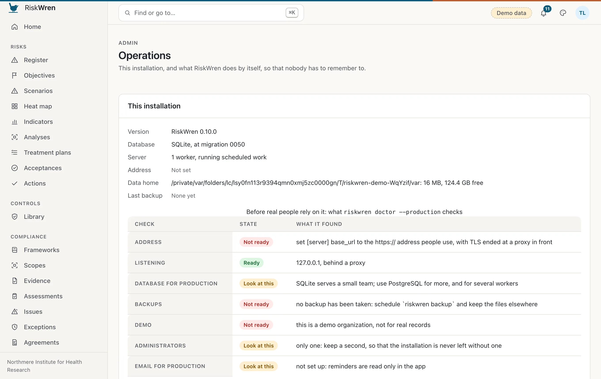

# Adopting RiskWren

For an organization deciding whether to use RiskWren, and then putting it into use: what to look at, what to decide, how to pilot it, how to bring in what you already have, and how to go live and roll it out. It follows [Getting started](getting-started.md), which installs RiskWren and loads the units and people. [The program handbook](handbook.md) takes over once it is running.

## Look at it

Build the demo organization on a laptop and sign in as each of its sample people ([Explore the demo organization](getting-started.md#explore-the-demo-organization)). It is a fictional research institute with two years of history, and every screen has something on it. Look at it as the people who would use it:

- **The security leader** and **the risk manager**: the dashboards, the register, the program, and the reports to leadership.
- **A steward** and **a staff member**: what a person who answers for a few things sees, and how little they are asked.
- **The auditor**: whether the record can be shown to be what it says it was, on any date.

Then read [How RiskWren works](concepts.md) for the ideas behind it, and [Where RiskWren stops](README.md#where-riskwren-stops) for what it does not do. The [changelog](../CHANGELOG.md) lists what each release does.

## Decide

Settle these before the pilot, and write the answers down. Each is a setting that can be changed later, but changing some of them moves records: publishing a change to appetite, the matrix, or the cadences reads every open risk again, its rating, its standing, and its next review, and shows you which first ([See what a change would do](running-the-program.md#see-what-a-change-would-do-before-you-make-it)).

**People and the program**

| Decision | What to weigh | A good start | Where |
|---|---|---|---|
| **Who gets which role** | Most people need no role. A manager runs the program but cannot accept risk; a leader accepts up to a limit; nobody tests or confirms their own work, so some steps need two people | The table in [Choosing roles](roles.md#choosing-roles-for-your-organization) | **Admin → People**, the import, or the identity provider |
| **Who runs the program** | Managers shape the program and keep the register; administrators keep the installation | Two managers from the security or risk office | [The risk and compliance team](roles.md#the-risk-and-compliance-team-managers) |
| **Who holds admin** | An administrator reads every record, restricted ones included (all but incident cases restricted to the people named on them), and can change the program. Keep two, so the installation is never left without one, and no more | Two people who look after the installation, neither of them someone who should not read restricted records | [Administrators](roles.md#administrators) |
| **The program to start from** | The four starters differ in families of risk and in their vocabularies | The one nearest your organization | `riskwren init --program` ([Set up the installation](getting-started.md#set-up-the-installation)) |
| **The units** | Every record belongs to one, and roles are limited to them | The units that answer for things, two or three levels deep. Not every team | **Admin → Units** ([Units](getting-started.md#units)) |
| **What the first year covers** | What can be finished well beats what can be listed | The systems and processes that hold restricted information, and the frameworks you are already held to | Your plan |
| **Appetite** | One rating for each family of risk: the most the organization will live with without a plan or an acceptance | Agreed with leadership | **Admin → Program → Categories and appetite** ([Appetite](running-the-program.md#appetite)) |
| **Who accepts what** | A leader's limit is set on their role. The program's table says how long an acceptance of each rating may last and whether it needs a limit | Unit leaders at moderate, division leaders at high, the head of the organization at critical | **Admin → People**; [Who may accept what](running-the-program.md#who-may-accept-what) |
| **Who sees the register** | What a person with no role sees of risks and controls: all, their unit's, or only what they are named on | **Unit**, as shipped | **Admin → Program → Who sees what** ([Who sees what](running-the-program.md#who-sees-what)) |
| **What the data classes mean here** | Public, internal, confidential, and restricted, each with examples. They decide which processes and systems need a privacy impact assessment (restricted, as shipped), that a supplier that holds or can see restricted information is tier 1, which evidence is seen only by those named on it or with a role over its unit (the most sensitive class), and what the optional assistant may be sent | Reword them to match the organization's own classification policy | **Admin → Program → Vocabularies** ([Vocabularies](running-the-program.md#vocabularies)) |
| **Your own words** | Renaming a kind of record or unit changes every screen | Only where the standard word would confuse people | **Admin → Appearance → Your own words** ([Appearance](running-the-program.md#appearance)) |
| **Reports without a name** | Whether anyone may report an incident or concern without signing in | Decided with the privacy and compliance officers | [Reporting without a name](incidents.md#reporting-without-a-name) |

**The installation**

| Decision | What to weigh | Where |
|---|---|---|
| **How people sign in** | Local passwords are one factor, and each is set by an administrator and passed on by hand: there is no emailed invitation and no reset of one's own password. Single sign-on brings the organization's own accounts and second factor, makes each account at its first sign-in, and can give roles. The security review advises single sign-on for production ([`spec/security-review.md`](../spec/security-review.md)) | [Single sign-on](configuration.md#single-sign-on) |
| **How long a sign-in lasts** | As shipped, 12 hours without activity and 7 days in any case. `session_idle_hours = 0.5` and `session_max_days = 0.5` meet the OWASP verification standard's level 2. A shorter session also means a role taken away at the identity provider is gone here sooner | [`[server]`](configuration.md#server) |
| **SQLite or PostgreSQL** | SQLite serves a small team with one server process; PostgreSQL serves more people and several processes. A backup restores into either, so the choice can be changed | [Use PostgreSQL](configuration.md#use-postgresql), [Move between SQLite and PostgreSQL](configuration.md#move-between-sqlite-and-postgresql) |
| **Email** | Without it, notices and reminders are read only in the app. With it, each person chooses every notice, a daily summary, or none. Choose the address it is sent from | [Email](configuration.md#email) |
| **Backups** | How often they are taken (every day), where they are kept (somewhere else), and when a restore is tested | [Back up and restore](configuration.md#back-up-and-restore) |
| **The look** | Your names, logos, colors, and words, set in the app or fixed in the file | [Appearance](running-the-program.md#appearance), [`[branding]`](configuration.md#branding) |
| **Other systems** | Which systems read from it or report to it, each with its own token, and which are told of events | [Tokens](other-systems.md#tokens), [Webhooks](other-systems.md#being-told-what-happens-webhooks) |

Keep the first version of the program small. A scale with five levels that everyone understands beats a precise one that nobody applies the same way.

## Pilot it

A pilot of about three months answers the questions that matter: will the people who must keep it current do so, and does what it shows hold up?

1. **Install it as you will run it in production** ([Deployment](deployment.md)): on PostgreSQL, behind your proxy, with backups, with sign-in as decided, and with the starter program you chose. Then the pilot's records are the start of the real record, and nothing needs moving afterwards.
2. **Choose a slice** of the organization: one division, or the systems in one compliance scope. Large enough to have real risks and real owners; small enough to finish.
3. **In the first month, build the slice's record** as [The first month](handbook.md#the-first-month-the-record) describes, with its real stewards and owners: its inventory, controls, scope, and risks, brought in as [below](#bring-in-what-you-have).
4. **In the second and third months, test it:** one assessment of the slice's key controls, with results confirmed by a second person and the issues they open put right ([The first quarter](handbook.md#the-first-quarter-the-evidence)), and one campaign, such as a control attestation, so that owners are asked and reminded.
5. **Judge it** by what the pilot's people did, not by what they said: did owners answer their reminders, did a test result move readiness, did the leadership report survive a question?

Keep the pilot's installation: it becomes production.

## Bring in what you have

Most organizations start with spreadsheets. Bring them in in this order, because each step names what the one before brought in: a risk names its unit and owners, and a control is linked to risks.

1. **Units and people.** From two spreadsheets: [Import units and people](getting-started.md#import-units-and-people). People arrive invited, so they can be named as owners before they ever sign in.
2. **The inventory.** Processes, systems, third parties, and information assets, one spreadsheet for each kind, imported from the list of that kind with **Import** ([Import and export](the-register.md#import-and-export)). A unit is given by its code, owners by their email addresses, separated by semicolons. Start with what matters most: the critical processes and the systems they rely on. Services and sites are added by hand.
3. **An existing risk register.** Risks import with their name, unit, category, owners, cause, event, and consequence. Ratings never import: a rating is a judgment made here by a named person. Each risk arrives **not assessed**, and due for its first assessment within three months, as the program's cadence for a risk not yet rated says. Plan an assessment round: a **Risk self-assessment** campaign asks each owner to look at theirs ([Campaigns](running-the-program.md#campaigns)), and each rating is then recorded on the risk's page, inherent first ([Assess it](the-register.md#assess-it)). Link each risk to the processes, systems, and third parties it concerns as you go.
4. **Controls.** Start from the library of common controls where you can: a control started from it arrives mapped to the built-in frameworks ([Map controls to requirements](compliance.md#map-controls-to-requirements)). Your own controls import with their name, unit, owners, statement, objective, kind, nature, and frequency. An imported control arrives unrated and mapped to nothing. Either way, link each control to the risks it reduces ([Link a control to a risk](the-register.md#link-a-control-to-a-risk)); a control that one unit runs for everyone, such as backups, is linked to other units' risks by a manager.
5. **Frameworks.** The four built-in ones are loaded already. Others ship and are loaded on request: `uv run riskwren frameworks load nist-800-53-r4` loads one, and the rest are `hipaa-breach`, `nist-privacy`, and `iso-27001`. `uv run riskwren frameworks text iso-27001 FILE` adds the words of ISO/IEC 27001 from a licensed copy. An agreement's terms or an internal standard is entered as [a framework of your own](compliance.md#a-framework-of-your-own), its requirements pasted or imported from a spreadsheet.

Each import is checked whole first: **Check the file** lists every problem by row and changes nothing, and nothing is added unless every row can be.

### What does not import

| What | How to bring it in |
|---|---|
| Links between records: a process relies on a system, a system holds information | On each record's page ([Links](the-register.md#links)), or through the API |
| What a risk concerns, and the controls that reduce it | On the risk's page ([Link a control to a risk](the-register.md#link-a-control-to-a-risk)), or through the API |
| Which requirements a control answers | On the control's **Requirements** tab ([Map controls to requirements](compliance.md#map-controls-to-requirements)), or through the API |
| Evidence | Attached in the app ([Attach it](evidence-and-testing.md#attach-it)), or through the API |
| Open issues | Raised in the app ([Raise an issue](issues-and-exceptions.md#raise-an-issue)), or through the API |
| Exceptions | Asked for again, and decided by a leader or a manager ([Exceptions](issues-and-exceptions.md#exceptions)) |
| Ratings, assessments, test results, and acceptances | Made here, by a named person, with a reason. No import and no token makes a judgment |
| Policies and other documents | Written, approved, and published here, or linked to where the full text is kept ([Policies](policies.md)) |

The API takes the rest from a script, with a token an administrator makes under **Admin → Other systems** that acts as a manager or a unit's steward and may change things ([Tokens](other-systems.md#tokens), [API](api.md)). Everything a token adds is in the history under its name. Withdraw it once the loading is done.

## Go live

1. Run `uv run riskwren doctor --production` until it has nothing to fix ([Check before going live](deployment.md#check-before-going-live)). **Admin → Operations** shows the same checks.
2. Bring in what you have, as [above](#bring-in-what-you-have), one division or scope at a time.
3. Roll it out to people, as [below](#roll-it-out).

**Reminders run from the first start.** There is no switch to turn them or their escalation on: while scheduled work runs, owners are reminded two weeks before a date and again when it passes, and what stays late goes to the unit's steward after a week and its leader after three ([Reminders](running-the-program.md#reminders)). Anything entered with a date already passed, such as an action that was due last month, is late from the first run; something long overdue is told once, to whoever it has reached. To hold reminders back while records are loaded and owners named, pause the **Reminders** job under **Admin → Operations**, and resume it once owners know what is theirs. Lengthening the reminder periods under **Admin → Program → Cadences** is the other way.

## Roll it out

**Tell people in this order.** Each group needs to know before the next is asked anything.

1. **Leaders**, who accept their units' risks and decide exceptions: what will come to them, and their limit.
2. **Stewards**, who keep their units' records: their Home, the import, **Drafts**, and late work that will come up to them after a week.
3. **Owners** of systems, risks, and controls: what they are named on, before the first reminder reaches them.
4. **Everyone**: where to report something that went wrong, the policy library, and that a campaign may ask them a few questions.

**What people will be asked to do.** As shipped:

| What | Who | How often |
|---|---|---|
| Finish an action by its date | Whoever it is assigned to | As each plan, issue, or incident sets |
| Review a risk they own | Its owners | Critical every 3 months, high every 6, moderate every 12, low every 24; a risk not yet rated within 3 |
| Keep a control's evidence current | Its owners | Evidence counts until its own date; a rating or a test result holds 12 months |
| Put right an issue | Its owners | Within 30 days for a critical issue, 90 high, 180 moderate, 365 low |
| Answer a campaign: attest to a control, assess a risk, confirm a unit's records | Owners and stewards | When the team runs one, often each quarter |
| Acknowledge a policy | The people it applies to | Each new version, when asked |
| Report something that went wrong | Everyone | Whenever it happens. It takes a minute |

**Sign-in for everyone.** Without single sign-on, an administrator sets each person's password and tells them, one by one, and resets it when it is forgotten ([People and roles](getting-started.md#people-and-roles)). That is fine for a pilot. Roll out more widely with single sign-on.

**A suggested order of units.**

1. The security office and central information technology: they run the controls other units inherit, such as backups and identity.
2. The units in the first scope: for a health organization, often the clinic and its systems under the HIPAA Security Rule.
3. Research units that hold restricted or controlled information, such as an enclave held to NIST SP 800-171, and the cores they rely on.
4. The rest, in order of the criticality of what they hold.

Widen one division or scope at a time, with its stewards shown what is theirs. Campaigns do the asking ([Campaigns](running-the-program.md#campaigns)), and [Your part in it](roles.md) is the page to send each kind of person.

## Keep it current

- **Upgrades** come as releases, each with a changelog that says what looks different afterwards. Back up, then upgrade ([Upgrade](deployment.md#upgrade)). Within 0.x, a release may change the API; the changes are listed under **Breaking**, and the [contract](api.md#the-contract) catches them before they ship.
- **Security problems** are reported as [SECURITY.md](../SECURITY.md) says. The application was reviewed against the OWASP Application Security Verification Standard at level 2; the review and what was done about each finding are in the repository's `spec/security-review.md`.
- **Your program** is yours: export it as one file (`uv run riskwren program export`) to keep it under version control or carry it to another installation.

Once it is running, [The program handbook](handbook.md) says what to do in the first month, the first quarter, and each year.
