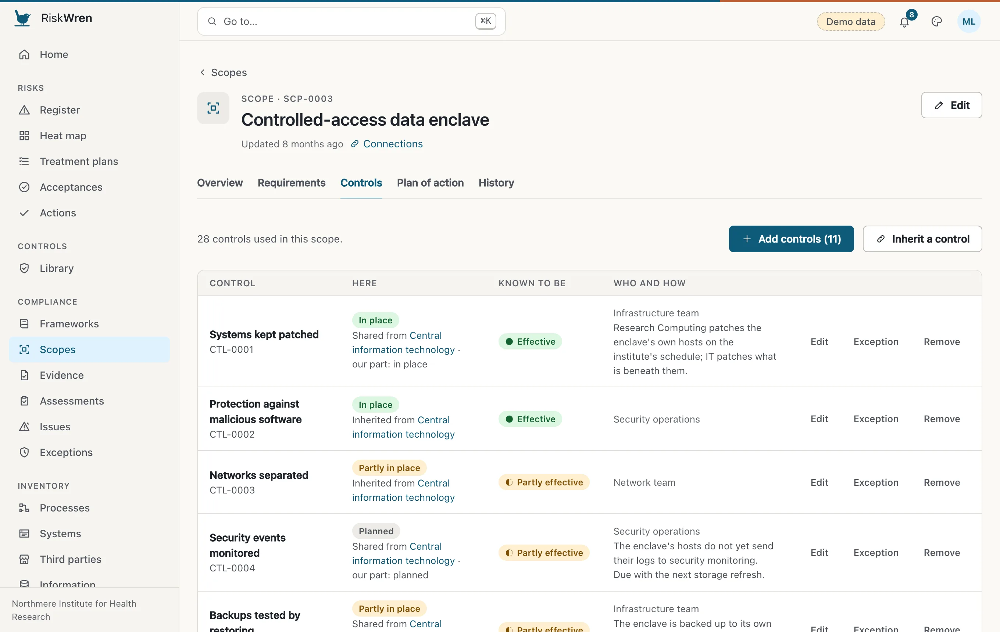
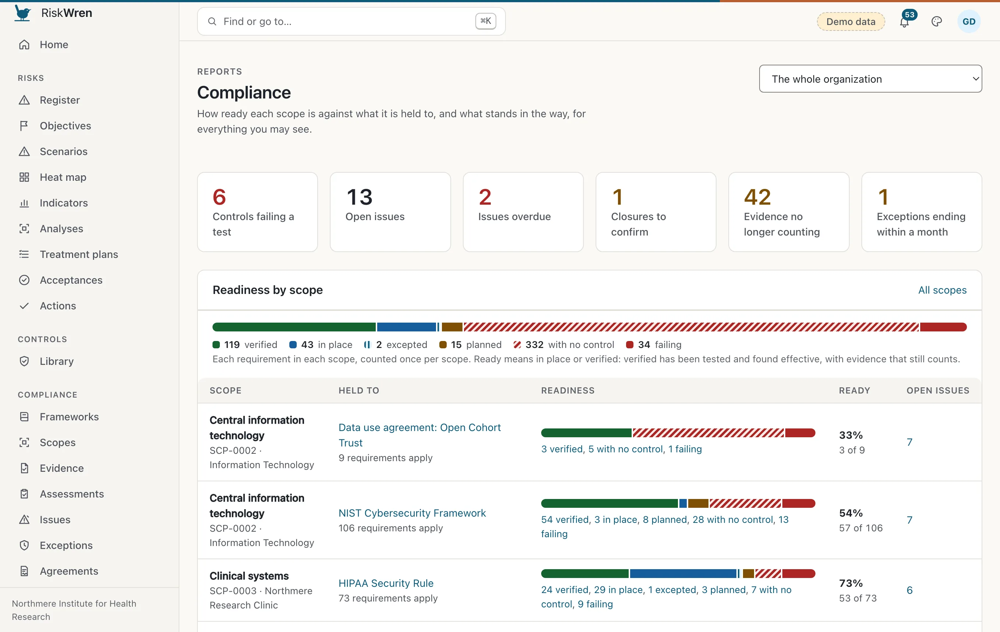

# Compliance

This guide is for the people who answer for what the organization is held to: a security or compliance lead, the stewards of the units that must comply, and whoever reads the result. It covers frameworks, mapping controls to requirements, scopes, inherited controls, readiness, and the compliance dashboard.

The idea is **test once, satisfy many**. A control is described once. It is mapped to every requirement it helps to meet, in as many frameworks as apply. It is tested once. What that test finds shows against every one of those requirements, in every scope that relies on the control.

## Frameworks

A framework is any source of requirements: a federal rule, a security standard, the terms of a data use agreement, an internal standard. **Compliance → Frameworks** lists the ones on record.

A new installation has four, each built from its publisher's own machine-readable file and carried as published:

| Framework | What it is |
|---|---|
| NIST Cybersecurity Framework 2.0 | Six functions, their categories, and 106 outcomes |
| NIST SP 800-53 Rev. 5 | The full control catalog, with the Low, Moderate, High, and Privacy baselines |
| NIST SP 800-171 Rev. 3 | The requirements for protecting controlled unclassified information |
| HIPAA Security Rule | 45 CFR Part 164 Subpart C, with its standards and implementation specifications |

Each shows its publisher, version, license, and where it came from. Anyone signed in can browse a framework's tree, search it, narrow it to a baseline, and read any requirement in full.

A heading is not a requirement. Families, functions, and sections that only introduce others are kept in the tree and cannot be mapped or tested. What can be is called **citable**.

### A framework of your own

An agreement's terms, a sponsor's security requirements, or an internal standard is entered as a framework and then behaves like any other. **Frameworks → Add a framework** (a manager for the whole organization, or an administrator). Give it a title and say what kind it is, then add its requirements:

- one at a time, with a code, a title, and the text;
- by **Paste**, a line each: a code, a space, then what it requires;
- by **Import**, from a spreadsheet saved as CSV with a code, a title, the text, and the code of the requirement each sits under.

Paste and Import check everything first and add nothing unless every line can be added. A published framework is never edited; one of your own always can be, and every change to it is in its history.

## Map controls to requirements

A mapping says that a control helps to satisfy a requirement, **in full** or **in part**, with a note if it needs one.

- From a control, open its **Requirements** tab: it lists what the control answers, in every framework, and adds more.
- From a requirement, open it in its framework: it lists the controls that answer it, and adds one.

A control started from the library of common controls arrives already mapped: 27 of the 56 carry suggested mappings to the built-in frameworks. A suggestion is marked as suggested and as answering in part, because a plain-words control rarely answers the whole of a requirement that has a dozen parts. Change one and it is yours.

Each framework's page says how many of its requirements have a control and lists those with none. That figure is **coverage**. It says a control exists. It says nothing about whether the control works, which is what a scope and a test are for.

## Scopes

A scope is a boundary that must meet one or more frameworks: the clinical systems, a data enclave, central computing, the whole organization. **Compliance → Scopes → Add a scope** (a steward of the unit, or a manager).

A scope says four things.

**What is inside it.** On **Overview → Inside the boundary**, list the units, processes, systems, information assets, and third parties it covers.

**What it is held to.** **Held to → Add a framework.** Start from every requirement, or from a baseline where the framework has them.

**Which requirements apply.** On the **Requirements** tab, every requirement applies until someone says otherwise. **Leave out** takes one out, and needs a reason; **Bring back** returns it. Only the departures from the starting point are kept, each with who decided and when. The tab is the scope's **statement of applicability**, and it prints.

**How each control is done here.** On the **Controls** tab, **Add controls** offers the controls that answer the scope's requirements. Each one used in the scope has an implementation: where it stands (planned, partly in place, in place, or not applicable here), who answers for it, and how it is done in this scope.

### Inherited controls

A central team runs backup, identity, and the network once, for everyone. A scope that provides controls says so: edit it and tick **Offers its controls to other scopes**.

Another scope then uses **Controls → Inherit a control**, and chooses how:

| How | What it means |
|---|---|
| **Inherited** | The provider does all of it. The control stands in this scope exactly where it stands in theirs, and slips the day theirs does |
| **Shared** | The provider does part and this scope does the rest. It says what its part is and where that stands, and the control is as far along as the weaker half |

People in the inheriting scope see whose control they rely on, where it stands, and how well it is known to work, without being able to open the provider's record. A provider cannot stop offering a control, or stop using it, while another scope inherits it.

## Readiness

For a scope and a framework, each requirement that applies is in exactly one state. It is worked out and never typed in.

| State | Rule |
|---|---|
| **Verified** | Every control that answers it here is in place, has been tested and found effective, and has evidence that still counts |
| **In place** | Every control that answers it here is said to be in place, and at least one lacks a test that still holds or current evidence |
| **Excepted** | It would be planned, a gap, or failing, and an approved exception that covers it is in force today |
| **Planned** | A control that answers it is used here and is not yet in place |
| **Gap** | No control mapped to it is used in this scope |
| **Failing** | A test that still holds found a control that answers it partly effective or ineffective |

A requirement is as ready as the weakest control that answers it. Each control in the list carries a sentence saying how it came to be where it is: "Tested effective on 2026-10-16, with evidence that still counts", or "In place, with no test result that still holds".

Three things follow, and they are the point of the design:

- **Saying a control is in place takes a requirement to in place, never to verified.** That takes a test by someone who does not own the control, confirmed by a second person. See [Evidence and testing](evidence-and-testing.md).
- **Readiness decays by itself.** When evidence passes its date, or a test becomes older than a rating may be, a verified requirement drops back to in place without anyone touching it.
- **A failure shows everywhere at once.** When a provider's control fails a test, every scope that inherits it shows the requirements it answers as failing the same day.

The **Requirements** tab can be narrowed to any one state. A requirement that is a gap, planned, or failing has two actions beside it: **Raise an issue** and **Ask for an exception**. See [Issues and exceptions](issues-and-exceptions.md).

## The compliance dashboard

**Reports → Compliance** is the page for whoever answers for all of it, for the whole organization or for one unit and everything beneath it.

| Figure | Counts |
|---|---|
| Controls failing a test | Active controls whose current rating is a test that found them partly effective or ineffective |
| Open issues | Issues that are not closed or withdrawn |
| Issues overdue | Those past their date |
| Closures to confirm | Issues whose owner says they are put right, waiting for someone else to confirm |
| Evidence no longer counting | Evidence past the date it holds until |
| Exceptions ending within a month | Approved exceptions whose last day is within 30 days |

Below them:

- **Readiness by scope**: each scope against each framework it is held to, in the six states, with the share that is ready (in place or verified) and its open issues. Each count opens the scope's requirements in that state. A requirement that three scopes must meet is three things to make ready, and is counted once in each.
- **Open issues, by severity and age**, and the longest overdue.
- **What the controls' ratings rest on**: a test that found them effective, a test that found them wanting, or no test that still holds.
- **What found the open issues**: tests, gaps, security testing, audits, incidents, reviews, or somebody noticing.
- **Evidence** that still counts and that does not, and **exceptions** waiting to be decided, in force, and ended.
- **Assessments in progress**, each with how far it has got.

Every figure is the count of a list, and opens that list with the same filters. A figure never counts a record its reader could not open.

## Connections

Every record has a **Connections** link beside its name. It opens a picture of what the record is joined to: what it relies on and what relies on it, the risks that bear on it, the controls that reduce them, the scopes it sits in, and the evidence, issues, exceptions, and assessments about it.

The button on a neighbor shows what lies beyond it without leaving the page, and choosing a neighbor puts it in the middle. A list beside the picture says the same in full, so nothing is told by the picture alone. Everything in it can be reached and opened with the keyboard.

For a security lead this answers the questions that come up in an incident or a review: what does this system support, which scopes is it in, what controls stand in front of it, and what is already known to be wrong with them.
