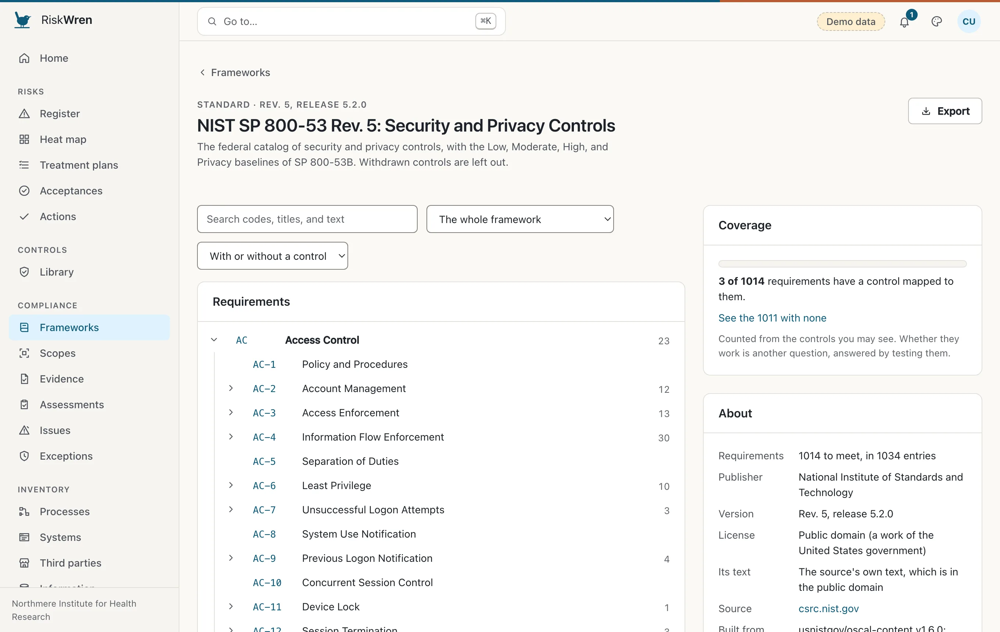
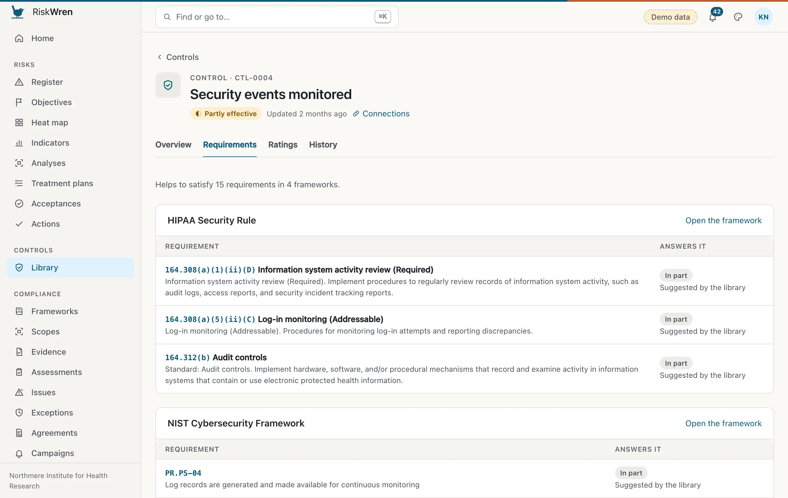
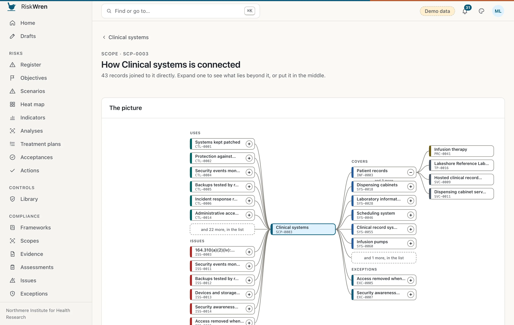

# Compliance

This guide is for the people who answer for what the organization is held to: a security or compliance lead, the stewards of the units that must comply, and whoever reads the result. It covers frameworks and how to load them, mapping controls to requirements, scopes and their statement of applicability, inherited and shared controls, agreements, privacy impact, good standing, readiness and why it says what it says, the security plan, and the compliance dashboard. [From nothing to a statement of applicability](#from-nothing-to-a-statement-of-applicability) puts the steps in order, using the demo's clinical systems.

The idea is **test once, satisfy many**. A control is described once. It is mapped to every requirement it helps to meet, in as many frameworks as apply. It is tested once. What that test finds shows against every one of those requirements, in every scope that relies on the control. [How RiskWren works](concepts.md#the-pieces-and-how-they-fit) explains how frameworks, scopes, controls, and evidence fit together.

## Frameworks

A framework is any source of requirements: a federal rule, a security standard, the terms of a data use agreement, an internal standard. **Compliance → Frameworks** lists the ones on record.

A new installation has four, each built from its publisher's own machine-readable file and carried as published:

| Framework | What it is |
|---|---|
| NIST Cybersecurity Framework 2.0 | Six functions, their categories, and 106 outcomes |
| NIST SP 800-53 Rev. 5 | The full control catalog, with the Low, Moderate, High, and Privacy baselines |
| NIST SP 800-171 Rev. 3 | The requirements for protecting controlled unclassified information |
| HIPAA Security Rule | 45 CFR Part 164 Subpart C, with its standards and implementation specifications |

Three more ship, and are loaded when someone asks, under **Load a framework**:

- **NIST SP 800-53 Rev. 4**, for programs and agreements that still name it.
- The **HIPAA Breach Notification Rule**, 45 CFR Part 164 Subpart D: notifying individuals, the media, and the Secretary, and a business associate's duty to the covered entity.
- The **NIST Privacy Framework 1.0**, with five functions, their categories, and 100 subcategories, for a privacy office that holds itself to it.

[Breach assessment](incidents.md#breach-assessment) and [privacy impact assessments](running-the-program.md#privacy-impact-assessments) are the working side of the last two.

**ISO/IEC 27001:2022** also ships, as its codes alone: clauses 4 to 10 and the 93 controls of Annex A, without their titles or text, which are copyrighted. Load it from **Load a framework**, or with `uv run riskwren frameworks load iso-27001`, to map controls and scope to its codes. An organization that holds a license to the standard can load its titles and text from its own copy, as a CSV file with the columns `code`, `title`, and `text`:

```bash
uv run riskwren frameworks text iso-27001 our-licensed-copy.csv
```

The words stay in that installation and its backups, and each requirement says that its text is the organization's licensed copy.

Each shows its publisher, version, license, and where it came from. Anyone signed in can browse a framework's tree, search it, narrow it to a baseline, and read any requirement in full, with the publisher's guidance under **Guidance from the source** where the pack carries it.



A heading is not a requirement. Families, functions, and sections that only introduce others are kept in the tree and cannot be mapped, tested, or left out. What can be is called **citable**.

**Retire** (a manager for the whole organization, or an administrator) takes any framework out of use: it is kept, with everything attached to it, and offered to nothing new. **Restore** puts it back.

### Load a framework

**Compliance → Frameworks → Load a framework** (a manager for the whole organization, or an administrator) offers two things:

- **That ship with RiskWren**: each framework above that is not loaded yet, with **Load** beside it.
- **From a pack file**: a publisher's new version before RiskWren ships it, or a framework the organization keeps as a pack.

A **framework pack** is one JSON file. Its `pack` header names the framework (`key`, `title`, `version`, `publisher`, `license`, `source_url`), says what kind it is, says how much of the source's wording it carries (its text policy), and, for a new version, names the key of the version it `follows`. Then comes the tree of `requirements`, each with a stable `code`, a `title` or `text`, optional `guidance`, and `children`; an entry marked as a `group` is a heading. A pack may add `baselines` (named lists of codes), `moved` (where codes of the version it follows went), and `mappings` to another framework. The shipped packs, under `src/riskwren/resources/packs/frameworks/` in the source, are worked examples.

A pack is checked whole before anything is written. Every problem is reported together, and a pack with any problem is refused whole. A pack whose key is already loaded is refused: a new version has a key of its own.

The same work from the command line:

| Command | What it does |
|---|---|
| `uv run riskwren frameworks list` | Lists every framework on record |
| `uv run riskwren frameworks show nist-csf` | Shows a framework's publisher, version, license, and source |
| `uv run riskwren frameworks load FILE --dry-run` | Checks a pack file and loads nothing |
| `uv run riskwren frameworks load FILE` | Loads a pack file, or a shipped one by its key, such as `hipaa-breach` |
| `uv run riskwren frameworks load --builtin` | Loads the built-in frameworks not yet here, and the publishers' mappings for those that are |

Another system loads one with `POST /api/v1/framework-packs`, giving either the `key` of one that ships or the whole `pack`. The [command reference](cli.md#riskwren-frameworks) has every option.

### A framework of your own

An agreement's terms, a sponsor's security requirements, or an internal standard is entered as a framework and then behaves like any other. **Frameworks → Add a framework** (a manager for the whole organization, or an administrator). Give it a name, say what kind it is (an agreement, an internal standard, a standard, or a regulation), and who it comes from. Then add its requirements:

- **Add a requirement**, one at a time: a **Code** (short and stable, such as `DUA-7`, because controls and evidence stay attached by it), a **Title**, **What is required**, and, if it helps, **Guidance**: how it is read here, or what the other party has said about it. Tick **This is a heading** for an entry that only groups those beneath it.
- **Add one beneath it**, from a requirement that is open, puts the new one under it in the tree.
- **Paste**, a line each: a code, a space, then what it requires. A line that starts with a space continues the one above.
- **Import**, from a spreadsheet saved as CSV with a code, a title, the text, and the code of the requirement each sits under.

Paste and Import check everything first and add nothing unless every line can be added. A published framework is never edited; one of your own always can be (**Edit** and **Remove** on each requirement), and every change to it is in its history.

### A new version of a framework

Frameworks change: a publisher revises a standard, a sponsor renews its terms. A new version is **loaded beside the old one**, never over it, and says which version it follows. Nothing that uses the old version changes when the new one arrives: its scopes, decisions, crosswalks, and exceptions stay exactly as they were until someone moves them.

- **Compliance → Frameworks → Load a framework** loads one that ships with RiskWren but is not loaded at first, such as SP 800-53 Rev. 4, or a pack from a file, as [above](#load-a-framework).
- **Start a new version**, on a framework of your own, copies it beside itself to be edited: an agreement's terms as renewed, an internal standard as revised.

A framework's page lists its versions, and the earlier one says when a later version is loaded. **What changed** compares two versions requirement by requirement, by code:

- **changed**: the same code with a different title or text, with the words that differ marked;
- **added**: codes only in the new version;
- **withdrawn**: codes only in the old, each with where the publisher says it went: moved to, or incorporated into, another. SP 800-53 Rev. 5 says so for nearly every Rev. 4 control it withdrew.

Beside the list is what uses the old version: the scopes held to it, the controls mapped to what changed or was withdrawn, the exceptions to its requirements, the documents that answer them, and how many crosswalks a move would carry.


### Moving a scope to the new version

**Move to** (those who keep the scope) holds the scope to the new version in place of the old, starting from the baseline of the same name. What has the same code goes with it:

- its decisions about which requirements apply, with their reasons;
- the exceptions to those requirements within the scope;
- for the whole organization, the crosswalks and the documents mapped to the old version, to the same code, or to where the publisher says a withdrawn one went. A crosswalk carried to a different code answers in part, and says where it came from.

A decision about a requirement the new version withdrew is left behind, and the scope's history says so, as it says each decision carried. The old version stays loaded, and anything still on it is as it was. A scope held to a version because an [agreement](#agreements) imposes it moves when the agreement names the new version as its terms.

## Map controls to requirements

A mapping says that a control helps to satisfy a requirement, **in full** or **in part**, with a note if it needs one.

- From a control, open its **Requirements** tab: it lists what the control answers, in every framework, and **Map to a requirement** adds more.
- From a requirement, open it in its framework: it lists the controls that answer it, and **Map a control** adds one. It also lists the published documents that answer it ([Policies](policies.md#what-it-governs)).



A control started from the starter library of common controls (**Controls → Library → Add a control**, then **Start from the library**) arrives already mapped to the frameworks that are loaded. Most of the library carries suggested mappings to the built-in frameworks; the rest are about things no security framework asks for, such as cold storage, research integrity, and finance. Between them they answer most of the Cybersecurity Framework, SP 800-171, and the HIPAA Security Rule, so an organization that adopts them starts with most of each framework answered and can see exactly what is left. A suggestion is marked **Suggested by the library** and as answering in part, because a plain-words control rarely answers the whole of a requirement that has a dozen parts. Change one and it is yours.

When the library has suggestions a control does not carry yet (a framework was loaded after the control was added, or a suggested mapping was removed), its **Requirements** tab says *The library suggests N more requirements for a control like this one*, and **Add them** maps them, in part. Check that each one fits.

### Crosswalks a publisher's mapping suggests

Some publishers say how their framework relates to another. SP 800-171 Rev. 3 names the SP 800-53 controls each of its requirements comes from, and RiskWren carries that with the pack. From it, a control mapped to one side is **suggested** for the requirement on the other: a control mapped to SP 800-171's 03.01.01 is suggested for AC-2 and the enhancements it was derived from, and the other way around.

A framework with suggestions waiting says so on its page. **Review them** lists them control by control, each with what suggests it. **Map it** maps the control, in part, and it is yours like any crosswalk. **Not this one** sets the suggestion aside, and it is not suggested again. Nothing is mapped until a person confirms it.

Each framework's page says how many of its requirements have a control and lists those with none. That figure is **coverage**. It says a control exists. It says nothing about whether the control works, which is what a scope and a test are for.

## Scopes

A scope is a boundary that must meet one or more frameworks: the clinical systems, a data enclave, central computing, the whole organization. **Compliance → Scopes → Add a scope** (a steward of the unit, or a manager).

A scope says four things.

**What is inside it.** On **Overview → Inside the boundary**, **Edit** lists the units, processes, systems, information assets, and third parties it covers. What is inside does not by itself change readiness, which follows the controls the scope uses. It decides which [agreements](#what-it-covers-and-what-that-binds) bind the scope, and it is the boundary the security plan describes.

**What it is held to.** **Held to → Add a framework.** Choose the framework, then **Start from** every requirement or, where the framework has them, a baseline: the publisher's own selection, such as SP 800-53's moderate baseline.

**Which requirements apply.** The **Requirements** tab lists the requirements of the starting point, and only the departures from it are kept, each with who decided and when:

- **Leave out** takes one out, and needs a reason. **Bring back** returns one that was left out.
- A scope started from **every requirement** lists every citable requirement, so each one applies until someone leaves it out.
- A scope started from **a baseline** lists only the baseline's requirements. One outside the baseline is not listed, and the page has no way to bring it in. To hold the scope to it, those who keep the scope send `PUT /api/v1/scopes/{ref}/requirements` with the framework, the code, and `applicable` set to `true`; it is then listed, marked *Added to the baseline*, and can be left out again from the page.

A published framework carries some entries that only say how it is to be read, or that bind another kind of organization: leave those out, with the reason. The tab is the scope's **statement of applicability**, and it prints.

**How each control is done here.** On the **Controls** tab, **Add controls** offers the controls, among those you may see, that are mapped to the scope's requirements and not used in it yet. Each one used in the scope has an implementation: where it stands (**Planned**, **Partly in place**, **In place**, or **Not applicable here**), who answers for it, and how it is done in this scope. **Edit** on a row changes them.

**Add controls** sets each control it offers to **In place** unless you change it. Set each one to where it honestly stands before you choose **Add the ones ticked**: a control that is only planned or partly done, left at **In place**, makes the requirements it answers look further along than they are.

### Inherited controls

A central team runs backup, identity, and the network once, for everyone. A scope that provides controls says so: edit it and tick **Offers its controls to other scopes**.

Another scope then uses **Controls → Inherit a control**, and chooses how:

| How | What it means |
|---|---|
| **Inherited** | The provider does all of it. The control stands in this scope exactly where it stands in theirs, and slips the day theirs does |
| **Shared** | The provider does part and this scope does the rest. It says what its part is and where that stands, and the control is as far along as the weaker half |

People in the inheriting scope see whose control they rely on, where it stands, and how well it is known to work, without being able to open the provider's record. A provider cannot stop offering a control, or stop using it, while another scope inherits it.

Three things follow from relying on another scope:

- **The provider tests it.** An inherited or shared control is left out of the inheriting scope's own assessment. It is tested in the provider's, once, and the result reaches every scope that relies on it. A shared control has no test of this scope's part alone: the provider's test of the control is the only one, so the provider's assessors should look at this scope's part too. See [Assessments](evidence-and-testing.md#assessments).
- **The provider's exception covers you.** An exception to a control, approved in the provider's scope, covers that control in every scope that inherits or shares it.
- **The provider's failure is yours.** A failed test of the control shows as failing here the same day.


### Good standing

Another process may ask RiskWren, with a token, whether a scope, or an exception within it, is in good standing before it goes ahead: a data-access request before it grants access to a research enclave, a deployment pipeline before it releases into a scope. It gets yes or no, with the reasons, and nothing of the scope's contents. Those who keep a scope should know what makes the answer no:

| Asked about | It is not in good standing when |
|---|---|
| **A scope** | The scope is retired; a requirement of any framework it is held to is **failing**; or a critical or high issue about the scope is past its date |
| **An exception** | It is not in force: still requested, approved but not yet begun, refused, ended, or withdrawn |

A failing requirement that an exception in force covers is excepted, not failing, so it does not count against the scope. An issue opened by a failed test names every scope that relies on the control, so one that is high and past its date counts against each of them. [Is it in good standing?](other-systems.md#is-it-in-good-standing) is the user's side of the question, and the [API guide](api.md#asking-whether-something-is-in-good-standing) the developer's.

## From nothing to a statement of applicability

The demo's **Clinical systems** scope was set up this way, and is the example here: the systems that hold patient records in the research clinic, held to the HIPAA Security Rule, relying on central information technology for most of its technical controls. Sign in to the demo as the risk manager to follow it.

1. **Have the framework.** Open **Compliance → Frameworks**. The HIPAA Security Rule is loaded with every installation. For one that is not, use [**Load a framework**](#load-a-framework), or enter [a framework of your own](#a-framework-of-your-own).
2. **Have controls that answer it.** Under **Controls → Library**, **Add a control** and **Start from the library** for each common control you run, such as the clinic's downtime procedures; it arrives mapped, in part, and you make its words specific. Describe any the library does not have, and map each on its **Requirements** tab with **Map to a requirement**. The framework's page then shows its coverage, and **With no control** lists what nothing answers yet.
3. **Add the scope.** **Compliance → Scopes → Add a scope**: its name, the unit that answers for it (the clinic), what it is for, and its boundary in words.
4. **Hold it to the framework.** **Overview → Held to → Add a framework**: the HIPAA Security Rule. It has no baselines, so every requirement applies to begin with. For SP 800-53 you would start from the baseline that fits, such as Moderate.
5. **Say what is inside it.** **Inside the boundary → Edit**: the clinical record system, the laboratory information system, the dispensing cabinets, the infusion pumps, scheduling, the patient information they hold, and the clinic as a unit.
6. **Add the controls it does itself.** **Controls → Add controls**: tick the ones the clinic runs, such as physical access to clinical areas and its business associate agreements, and set where each honestly stands; the dialog starts every one at **In place**. Then **Edit** each to say who answers for it here and how it is done, which is what the security plan prints.
7. **Inherit what another scope provides.** **Controls → Inherit a control**, once for each: second factor, backups, patching, logging, and the rest from central information technology, inherited whole; access reviews and security training shared, each with what the clinic does as its part and where that stands.
8. **Leave out what does not apply, with the reason.** On the **Requirements** tab, **Leave out** each requirement that binds another kind of organization or only says how the rule is to be read. The demo's clinic leaves out those for health care clearinghouses, group health plans, business associates, and arrangements between government bodies, and the rule's general instructions, each with a sentence saying why.
9. **Read it.** Narrow the tab by **State**. A **Gap** needs a control mapped and used here; **Planned** needs one finished; **In place** needs a test; **Failing** needs an issue put right and a new test. Then **Print** it, **Export** it as a spreadsheet, or download the **Security plan** or the **OSCAL** file, as [below](#the-security-plan-and-oscal).

The statement is then current by itself: a new control, a test, an exception, or evidence passing its date shows on it the same day. To make the in-place requirements verified, test the scope's controls in an [assessment](evidence-and-testing.md#a-yearly-assessment-start-to-finish).

## Agreements

**Compliance → Agreements** holds what the organization has promised others: an award's terms, a data use agreement, a business associate agreement, a contract, a confidentiality agreement, a memorandum of understanding. **Add an agreement** (a steward or leader of the unit that answers for it, or a manager) records:

- **who it is with**, and their reference for it;
- **when it runs**: the day it starts and the day it ends, or none for one that runs until it is ended;
- **its notice period**: how many days before it ends notice must be given, to end it or to keep it going, and whether it carries on by itself unless notice is given;
- **its terms**: the framework of the requirements it imposes. That is usually its own terms, entered as [a framework of your own](#a-framework-of-your-own), but it can be a published one the agreement names, as a sponsor that requires SP 800-171 does;
- where the signed copy is kept.


### What it covers, and what that binds

**Who it is with** names the third parties it binds, from the inventory, beside the words of **With**. **What it covers** names the systems, the bodies of information, the services, and the scopes the agreement binds; together they say whether the information a third party holds is covered, as [Coverage](third-parties.md#coverage) describes. Then every scope that is one of them, or holds one of them inside its boundary, is **held to the agreement's terms**, without anyone adding the framework by hand. On the scope's page the framework says why: *because AGR-0003 covers what it holds*. Its requirements are answered like any others, and the agreement's page lists the scopes it binds.

The scopes follow the agreement as it changes. Cover more, or put a covered system into a scope, and the terms arrive. Cover less, or close the agreement, and they go, with the decisions made about their requirements; the history of the scope keeps both. A scope's keepers cannot remove terms an agreement imposes, but they can hold the scope to the framework themselves (**Add a framework**), and then it stays when the agreement goes. A scope already held to the framework by its own decision is left as it is.

### Dates and warnings

An agreement is in one of these states:

| State | When |
|---|---|
| **Not yet started** | Its start date is still ahead. What it imposes binds its scopes already, from the day it is recorded |
| **In force** | Running, with nothing due soon |
| **Notice due** | Within 30 days of the last day to give notice |
| **Ending** | Within 60 days of its end |
| **Ended, still open** | Its end date has passed and nobody has closed it |
| **Closed** | Someone closed it, with the reason |

Its owners are told, under the bell and by email where it is set up, and it is on their Home:

| When | What |
|---|---|
| 30 days before the last day to give notice | Give notice, or let it carry on |
| 60 days before it ends | Renew it, or let it end |
| After it has ended, while it is still open | The same people, then the unit's steward after 7 days and its leader after 21 |

An agreement that has ended stays open, and what it imposes still binds its scopes, until someone records its new end date (**Edit**) or closes it (**Close it**) with the reason. That way nothing it imposed drops out of a scope unnoticed. **Open it again** (its owners, or its unit's steward, leader, or manager) reopens a closed one, and its terms bind the scopes that hold what it covers again. Agreements are in search, in the **Connections** picture (what each covers, and the agreements that cover a record), and in exports; Tidy lists an open one that covers nothing.

## Privacy impact

A process or a system that handles a class of data the program names (to begin with, **restricted**) needs a privacy impact assessment, done again on a cadence (to begin with, every 36 months).

- **Compliance → Privacy impact** lists every process and system in use that needs one, with where each stands: **Never assessed**, **Asked, not yet answered**, **Answered, to review**, **Reviewed**, or **Due again**, with when it was last answered and when it is due. **Start a campaign** opens **Campaigns**, where a privacy impact campaign asks the owner of each that has none current.
- A process's or a system's **Privacy** tab shows its last assessment: who answered and when, the concerns found in the answers, and the review. **Read the answers** opens them. One of those who assess for its unit chooses **Review it** and says what was made of it.

[Privacy impact assessments](running-the-program.md#privacy-impact-assessments) explains the questions, the concerns RiskWren looks for in the answers, and the campaign that asks for them.

## Readiness

For a scope and a framework, each requirement that applies is in exactly one state. It is worked out and never typed in.

| State | Rule |
|---|---|
| **Verified** | Every control that answers it here is in place, has been tested and found effective, and has evidence that still counts |
| **In place** | Every control that answers it here is said to be in place, and at least one lacks a test that still holds or evidence that still counts, or its owner has since said it does not fully operate |
| **Excepted** | It would be planned, a gap, or failing, and an approved exception that covers it is in force today |
| **Planned** | A control that answers it is used here and is planned or only partly in place |
| **Gap** | No control mapped to it is used in this scope, or the only ones used are marked not applicable here |
| **Failing** | A test that still holds found a control that answers it partly effective or ineffective |

A requirement is as ready as the weakest control that answers it. A failed test outranks everything else: a control found wanting is failing whether it is in place or not. Each control in the list carries a sentence saying how it came to be where it is: "Tested effective on 2026-10-16, with evidence that still counts", or "In place, with no test result that still holds".


Four things follow, and they are the point of the design:

- **Saying a control is in place takes a requirement to in place, never to verified.** That takes a test by someone who does not own the control, confirmed by a second person. See [Evidence and testing](evidence-and-testing.md).
- **An owner's attestation does not count as a test.** It never makes a requirement verified, and it can take one out of verified. See [An attestation is not a test](evidence-and-testing.md#an-attestation-is-not-a-test).
- **Readiness decays by itself.** When evidence passes its date, or a test becomes older than a rating may be (twelve months as shipped), a verified requirement drops back to in place without anyone touching it. A failing one stops failing the same way, and becomes whatever lies beneath.
- **A failure shows everywhere at once.** When a provider's control fails a test, every scope that inherits it shows the requirements it answers as failing the same day.

Some things do not move readiness at all: closing an issue, a check that another system reports (passed, partly, or failed, even once it is confirmed), and evidence attached only to the scope rather than to its controls.

Evidence that another system reports is different once it is confirmed. It is filed on the control, and counts like any other evidence there. So where a test that still holds found the control effective, confirmed evidence can take the requirements the control answers from in place to verified. See [What other systems report](evidence-and-testing.md#what-other-systems-report).

[A failed test, through to closure](issues-and-exceptions.md#a-failed-test-through-to-closure) follows one failure from the test to the day the requirement is verified again.

The **Requirements** tab can be narrowed to any one state. A requirement that is a gap, planned, or failing has two actions beside it: **Raise an issue** and **Ask for an exception**. See [Issues and exceptions](issues-and-exceptions.md).

## The security plan and OSCAL

A scope's **Requirements** tab has two more downloads beside **Print** and the export.

**Security plan** is the scope's system security plan. It opens from the download as a page that prints by itself, in the customary order:

1. System identification: name, reference, unit, and owners.
2. The description and authorization boundary, and what the system includes.
3. The frameworks it is held to.
4. For each framework, every requirement in the catalog's order, with where it stands. Under each, every control that answers it, with the implementation statement here (or the provider's, for an inherited control), its responsibility, and where it stands.
5. The requirements left out, each with its reason.
6. Last, the plan of action.

**OSCAL** is the same scope's system security plan against the framework shown, in the Open Security Controls Assessment Language (OSCAL 1.1.2) that United States federal programs read. The scope's **Plan of action** tab has the plan of action and milestones in OSCAL too.

In the OSCAL files every identifier is a name-based UUID made from RiskWren's references, so a scope exported twice keeps its identifiers and a reader can tell what changed. A requirement's control id is its code lowercased, with an enhancement's number after a dot (`AC-2(1)` becomes `ac-2.1`), as the published catalogs name them, and its code as written is kept as its label. Each requirement's implementation status follows its state here: verified and in place are *implemented*, failing is *partial*, planned and gap are *planned*, excepted is *alternative*, and left out is *not applicable*. What has no place in the model (a severity, a due date, the state here) is carried as a property in RiskWren's own namespace, `urn:riskwren:oscal`. A scope with no open issue has a plan of action with no items.

Both downloads hold what you may see. See also [Dossiers](running-the-program.md#dossiers), which carry both.

## The compliance dashboard

**Reports → Compliance** is the page for whoever answers for all of it, for the whole organization or for one unit and everything beneath it.

| Figure | Counts |
|---|---|
| Controls failing a test | Active controls whose current rating is a test that found them partly effective or ineffective |
| Open issues | Issues that are not closed or withdrawn |
| Issues overdue | Those past their date |
| Closures to confirm | Issues whose owner says they are put right, waiting for someone else to confirm |
| Evidence no longer counting | Evidence past the date it holds until |
| Exceptions ending within a month | Approved exceptions whose last day is within 30 days |


Below them:

- **Readiness by scope**: each scope against each framework it is held to, in the six states, with the share that is ready (in place or verified) and its open issues. Each count opens the scope's requirements in that state. A requirement that three scopes must meet is three things to make ready, and is counted once in each.
- **Open issues, by severity and age**, and the longest overdue.
- **What the controls' ratings rest on**: a test that found them effective, a test that found them wanting, or no test that still holds.
- **What found the open issues**: tests, gaps, security testing, audits, incidents, exercises, reviews, or somebody noticing.
- **Evidence** that still counts and that does not, and **exceptions** waiting to be decided, in force, and ended.
- **Assessments in progress**, each with how far it has got.

Every figure is the count of a list, and opens that list with the same filters. A figure never counts a record its reader could not open.

## Connections

Every record has a **Connections** link beside its name. It opens a picture of what the record is joined to: what it relies on and what relies on it, the risks that bear on it, the controls that reduce them, the documents that direct those controls, the scopes it sits in, and the evidence, issues, exceptions, and assessments about it.

The button on a neighbor shows what lies beyond it without leaving the page, and choosing a neighbor puts it in the middle. A list beside the picture says the same in full, so nothing is told by the picture alone. Everything in it can be reached and opened with the keyboard.



For a security lead this answers the questions that come up in an incident or a review: what does this system support, which scopes is it in, what controls stand in front of it, and what is already known to be wrong with them.
