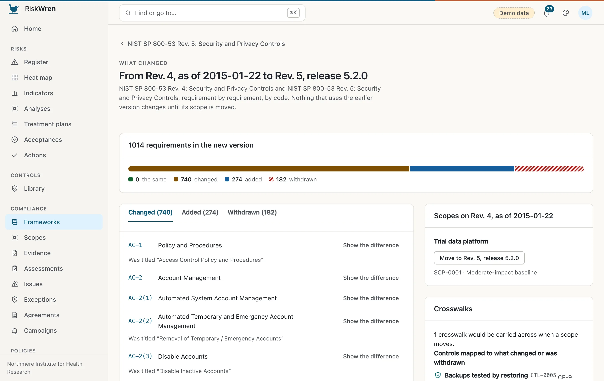
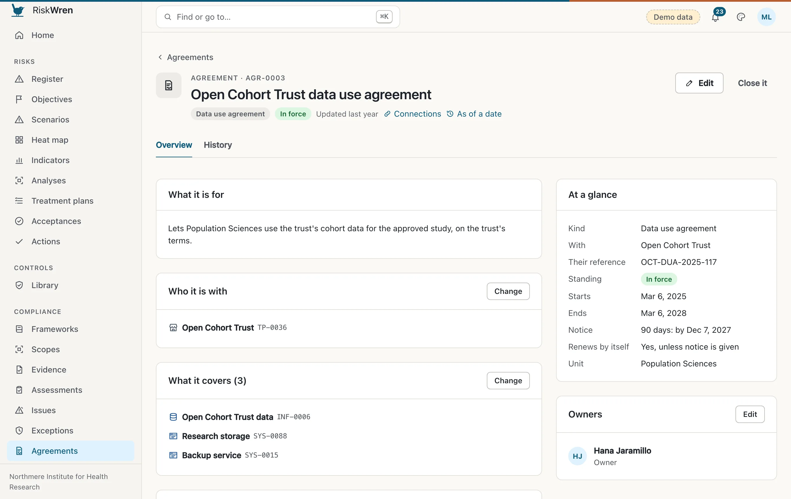
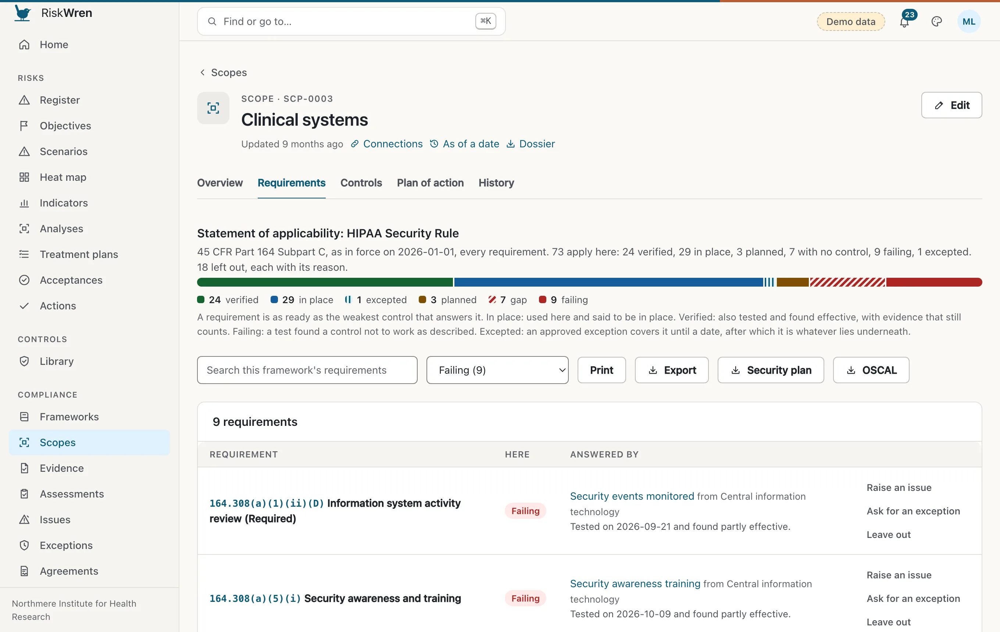

# Compliance

This guide is for the people who answer for what the organization is held to: a security or compliance lead, the stewards of the units that must comply, and whoever reads the result. It covers frameworks, mapping controls to requirements, scopes, inherited controls, readiness, and the compliance dashboard.

The idea is **test once, satisfy many**. A control is described once. It is mapped to every requirement it helps to meet, in as many frameworks as apply. It is tested once. What that test finds shows against every one of those requirements, in every scope that relies on the control.

## Frameworks

A framework is any source of requirements: a federal rule, a security standard, the terms of a data use agreement, an internal standard. **Compliance → Frameworks** lists the ones on record.

A new installation has four, each built from its publisher's own machine-readable file and carried as published:

| Framework | What it is |
|---|---|
| NIST Cybersecurity Framework 2.0 | Six functions, their categories, and 106 outcomes |
| NIST SP 800-53 Rev. 5 | The full control catalog, with the Low, Moderate, High, and Privacy baselines |
| NIST SP 800-171 Rev. 3 | The requirements for protecting controlled unclassified information |
| HIPAA Security Rule | 45 CFR Part 164 Subpart C, with its standards and implementation specifications |

Three more ship and are loaded when someone asks, under **Load a framework**: NIST SP 800-53 Rev. 4, for programs and agreements that still name it; the **HIPAA Breach Notification Rule** (45 CFR Part 164 Subpart D: notifying individuals, the media, and the Secretary, and a business associate's duty to the covered entity); and the **NIST Privacy Framework 1.0** (five functions, their categories, and 100 subcategories), for a privacy office that holds itself to it. [Breach assessment](incidents.md#breach-assessment) and [privacy impact assessments](running-the-program.md#privacy-impact-assessments) are their working side.

Each shows its publisher, version, license, and where it came from. Anyone signed in can browse a framework's tree, search it, narrow it to a baseline, and read any requirement in full.

A heading is not a requirement. Families, functions, and sections that only introduce others are kept in the tree and cannot be mapped or tested. What can be is called **citable**.

### A framework of your own

An agreement's terms, a sponsor's security requirements, or an internal standard is entered as a framework and then behaves like any other. **Frameworks → Add a framework** (a manager for the whole organization, or an administrator). Give it a title and say what kind it is, then add its requirements:

- one at a time, with a code, a title, and the text;
- by **Paste**, a line each: a code, a space, then what it requires;
- by **Import**, from a spreadsheet saved as CSV with a code, a title, the text, and the code of the requirement each sits under.

Paste and Import check everything first and add nothing unless every line can be added. A published framework is never edited; one of your own always can be, and every change to it is in its history.

### A new version of a framework

Frameworks change: a publisher revises a standard, a sponsor renews its terms. A new version is **loaded beside the old one**, never over it, and says which version it follows. Nothing that uses the old version changes when the new one arrives: its scopes, decisions, crosswalks, and exceptions stay exactly as they were until someone moves them.

- **Compliance → Frameworks → Load a framework** (a manager or an administrator) loads one that ships with RiskWren but is not loaded at first, such as SP 800-53 Rev. 4 for programs and agreements that still name it, or a pack from a file: a publisher's new version before RiskWren ships it, or a framework the organization keeps as a pack.
- **Start a new version**, on a framework of your own, copies it beside itself to be edited: an agreement's terms as renewed, an internal standard as revised.

A framework's page lists its versions, and the earlier one says when a later version is loaded. **What changed** compares two versions requirement by requirement, by code:

- **changed**: the same code with a different title or text, with the words that differ marked;
- **added**: codes only in the new version;
- **withdrawn**: codes only in the old, each with where the publisher says it went: moved to, or incorporated into, another. Rev. 5 says so for 179 of the 182 Rev. 4 controls it withdrew.

Beside the list is what uses the old version: the scopes held to it, the controls mapped to what changed or was withdrawn, the exceptions to its requirements, the documents that answer them, and how many crosswalks a move would carry.

### Moving a scope to the new version

**Move to** (those who keep the scope) holds the scope to the new version in place of the old, starting from the baseline of the same name. What has the same code goes with it:

- its decisions about which requirements apply, with their reasons;
- the exceptions to those requirements within the scope;
- for the whole organization, the crosswalks and the documents mapped to the old version, to the same code, or to where the publisher says a withdrawn one went. A crosswalk carried to a different code answers in part, and says where it came from.

A decision about a requirement the new version withdrew is left behind, and the scope's history says so, as it says each decision carried. The old version stays loaded, and anything still on it is as it was. A scope held to a version because an [agreement](#agreements) imposes it moves when the agreement names the new version as its terms.

## Map controls to requirements

A mapping says that a control helps to satisfy a requirement, **in full** or **in part**, with a note if it needs one.

- From a control, open its **Requirements** tab: it lists what the control answers, in every framework, and adds more.
- From a requirement, open it in its framework: it lists the controls that answer it, and adds one. It also lists the published documents that answer it ([Policies](policies.md#what-it-governs)).

A control started from the library of common controls arrives already mapped: 46 of the 75 carry suggested mappings to the built-in frameworks. The other 29 are about things no security framework asks for, such as cold storage, research integrity, and finance. Between them the 46 answer 80 of the Cybersecurity Framework's 106 outcomes, 72 of the 97 requirements of SP 800-171, and 66 of the 91 entries of the HIPAA Security Rule, so an organization that adopts them starts with most of each framework answered and can see exactly what is left. A suggestion is marked as suggested and as answering in part, because a plain-words control rarely answers the whole of a requirement that has a dozen parts. Change one and it is yours.

### Crosswalks a publisher's mapping suggests

Some publishers say how their framework relates to another. SP 800-171 Rev. 3 names the SP 800-53 controls each of its requirements comes from, and RiskWren carries that with the pack. From it, a control mapped to one side is **suggested** for the requirement on the other: a control mapped to SP 800-171's 03.01.01 is suggested for AC-2 and the enhancements it was derived from, and the other way around.

A framework with suggestions waiting says so on its page. **Review them** lists them control by control, each with what suggests it. **Map it** maps the control, in part, and it is yours like any crosswalk. **Not this one** sets the suggestion aside, and it is not suggested again. Nothing is mapped until a person confirms it.

Each framework's page says how many of its requirements have a control and lists those with none. That figure is **coverage**. It says a control exists. It says nothing about whether the control works, which is what a scope and a test are for.

## Scopes

A scope is a boundary that must meet one or more frameworks: the clinical systems, a data enclave, central computing, the whole organization. **Compliance → Scopes → Add a scope** (a steward of the unit, or a manager).

A scope says four things.

**What is inside it.** On **Overview → Inside the boundary**, list the units, processes, systems, information assets, and third parties it covers.

**What it is held to.** **Held to → Add a framework.** Start from every requirement, or from a baseline where the framework has them.

**Which requirements apply.** On the **Requirements** tab, every requirement applies until someone says otherwise. **Leave out** takes one out, and needs a reason; **Bring back** returns it. Only the departures from the starting point are kept, each with who decided and when. A published framework carries some entries that only say how it is to be read, or that bind another kind of organization: leave those out, with the reason. The demo's clinic leaves out 18 of the HIPAA Security Rule's 91 entries that way. The tab is the scope's **statement of applicability**, and it prints.

**How each control is done here.** On the **Controls** tab, **Add controls** offers the controls that answer the scope's requirements. Each one used in the scope has an implementation: where it stands (planned, partly in place, in place, or not applicable here), who answers for it, and how it is done in this scope.

### Inherited controls

A central team runs backup, identity, and the network once, for everyone. A scope that provides controls says so: edit it and tick **Offers its controls to other scopes**.

Another scope then uses **Controls → Inherit a control**, and chooses how:

| How | What it means |
|---|---|
| **Inherited** | The provider does all of it. The control stands in this scope exactly where it stands in theirs, and slips the day theirs does |
| **Shared** | The provider does part and this scope does the rest. It says what its part is and where that stands, and the control is as far along as the weaker half |

People in the inheriting scope see whose control they rely on, where it stands, and how well it is known to work, without being able to open the provider's record. A provider cannot stop offering a control, or stop using it, while another scope inherits it.

## Agreements

**Compliance → Agreements** holds what the organization has promised others: an award's terms, a data use agreement, a business associate agreement, a contract, a confidentiality agreement, a memorandum of understanding. **Add an agreement** (a steward or leader of the unit that answers for it, or a manager) records:

- **who it is with**, and their reference for it;
- **when it runs**: the day it starts and the day it ends, or none for one that runs until it is ended;
- **its notice period**: how many days before it ends notice must be given, to end it or to keep it going, and whether it carries on by itself unless notice is given;
- **its terms**: the framework of the requirements it imposes. That is usually its own terms, entered as [a framework of your own](#a-framework-of-your-own), but it can be a published one the agreement names, as a sponsor that requires SP 800-171 does;
- where the signed copy is kept.

### What it covers, and what that binds

**Who it is with** names the third parties it binds, from the inventory, beside the words of **With**. **What it covers** names the systems, the bodies of information, the services, and the scopes the agreement binds; together they say whether the information a third party holds is covered, as [Coverage](third-parties.md#coverage) describes. Then every scope that is one of them, or holds one of them inside its boundary, is **held to the agreement's terms**, without anyone adding the framework by hand. On the scope's page the framework says why: *because AGR-0003 covers what it holds*. Its requirements are answered like any others, and the agreement's page lists the scopes it binds.

The scopes follow the agreement as it changes. Cover more, or put a covered system into a scope, and the terms arrive. Cover less, or close the agreement, and they go, with the decisions made about their requirements; the history of the scope keeps both. A scope's keepers cannot remove terms an agreement imposes, but they can hold the scope to the framework themselves (**Add a framework**), and then it stays when the agreement goes. A scope already held to the framework by its own decision is left as it is.

### Dates and warnings

An agreement is **in force**, **ending** (within 60 days of its end), **notice due** (within 30 days of the last day to give notice), **ended** but still open, or **closed**. Its owners are told, under the bell and by email where it is set up, and it is on their Home:

| When | What |
|---|---|
| 30 days before the last day to give notice | Give notice, or let it carry on |
| 60 days before it ends | Renew it, or let it end |
| After it has ended, while it is still open | The same people, then the unit's steward after 7 days and its leader after 21 |

An agreement that has ended stays open, and what it imposes still binds its scopes, until someone records its new end date (**Edit**) or **closes** it with the reason. That way nothing it imposed drops out of a scope unnoticed. Agreements are in search, in the **Connections** picture (what each covers, and the agreements that cover a record), and in exports; Tidy lists an open one that covers nothing.

## Readiness

For a scope and a framework, each requirement that applies is in exactly one state. It is worked out and never typed in.

| State | Rule |
|---|---|
| **Verified** | Every control that answers it here is in place, has been tested and found effective, and has evidence that still counts |
| **In place** | Every control that answers it here is said to be in place, and at least one lacks a test that still holds or current evidence |
| **Excepted** | It would be planned, a gap, or failing, and an approved exception that covers it is in force today |
| **Planned** | A control that answers it is used here and is not yet in place |
| **Gap** | No control mapped to it is used in this scope |
| **Failing** | A test that still holds found a control that answers it partly effective or ineffective |

A requirement is as ready as the weakest control that answers it. Each control in the list carries a sentence saying how it came to be where it is: "Tested effective on 2026-10-16, with evidence that still counts", or "In place, with no test result that still holds".

Three things follow, and they are the point of the design:

- **Saying a control is in place takes a requirement to in place, never to verified.** That takes a test by someone who does not own the control, confirmed by a second person. See [Evidence and testing](evidence-and-testing.md).
- **An owner's attestation does not count as a test.** It never makes a requirement verified, and it can take one out of verified. See [An attestation is not a test](evidence-and-testing.md#an-attestation-is-not-a-test).
- **Readiness decays by itself.** When evidence passes its date, or a test becomes older than a rating may be, a verified requirement drops back to in place without anyone touching it.
- **A failure shows everywhere at once.** When a provider's control fails a test, every scope that inherits it shows the requirements it answers as failing the same day.

The **Requirements** tab can be narrowed to any one state. A requirement that is a gap, planned, or failing has two actions beside it: **Raise an issue** and **Ask for an exception**. See [Issues and exceptions](issues-and-exceptions.md).

## The security plan and OSCAL

A scope's **Requirements** tab has two more downloads beside **Print** and the export:

- **Security plan** is the scope's system security plan, in the customary order: system identification (name, reference, unit, owners), the description and authorization boundary, what the system includes, the frameworks it is held to, then for each framework every requirement in the catalog's order with where it stands and, for each control that answers it, the implementation statement here (or the provider's, for an inherited control), its responsibility, and where it stands; requirements left out with their reason; and last, the plan of action. It is a page that prints by itself, opened from the download.
- **OSCAL** is the same scope's system security plan against the framework shown, in the Open Security Controls Assessment Language (OSCAL 1.1.2) that United States federal programs read. The scope's **Plan of action** tab has the plan of action and milestones in OSCAL too.

In the OSCAL files every identifier is a name-based UUID made from RiskWren's references, so a scope exported twice keeps its identifiers and a reader can tell what changed. A requirement's control id is its code lowercased, with an enhancement's number after a dot (`AC-2(1)` becomes `ac-2.1`), as the published catalogs name them, and its code as written is kept as its label. Each requirement's implementation status follows its state here: verified and in place are *implemented*, failing is *partial*, planned and gap are *planned*, excepted is *alternative*, and left out is *not applicable*. What has no place in the model (a severity, a due date, the state here) is carried as a property in RiskWren's own namespace, `urn:riskwren:oscal`. A scope with no open issue has a plan of action with no items.

Both downloads hold what you may see. See also [Dossiers](running-the-program.md#dossiers), which carry both.

## The compliance dashboard

**Reports → Compliance** is the page for whoever answers for all of it, for the whole organization or for one unit and everything beneath it.

| Figure | Counts |
|---|---|
| Controls failing a test | Active controls whose current rating is a test that found them partly effective or ineffective |
| Open issues | Issues that are not closed or withdrawn |
| Issues overdue | Those past their date |
| Closures to confirm | Issues whose owner says they are put right, waiting for someone else to confirm |
| Evidence no longer counting | Evidence past the date it holds until |
| Exceptions ending within a month | Approved exceptions whose last day is within 30 days |

Below them:

- **Readiness by scope**: each scope against each framework it is held to, in the six states, with the share that is ready (in place or verified) and its open issues. Each count opens the scope's requirements in that state. A requirement that three scopes must meet is three things to make ready, and is counted once in each.
- **Open issues, by severity and age**, and the longest overdue.
- **What the controls' ratings rest on**: a test that found them effective, a test that found them wanting, or no test that still holds.
- **What found the open issues**: tests, gaps, security testing, audits, incidents, reviews, or somebody noticing.
- **Evidence** that still counts and that does not, and **exceptions** waiting to be decided, in force, and ended.
- **Assessments in progress**, each with how far it has got.

Every figure is the count of a list, and opens that list with the same filters. A figure never counts a record its reader could not open.

## Connections

Every record has a **Connections** link beside its name. It opens a picture of what the record is joined to: what it relies on and what relies on it, the risks that bear on it, the controls that reduce them, the documents that direct those controls, the scopes it sits in, and the evidence, issues, exceptions, and assessments about it.

The button on a neighbor shows what lies beyond it without leaving the page, and choosing a neighbor puts it in the middle. A list beside the picture says the same in full, so nothing is told by the picture alone. Everything in it can be reached and opened with the keyboard.

For a security lead this answers the questions that come up in an incident or a review: what does this system support, which scopes is it in, what controls stand in front of it, and what is already known to be wrong with them.
