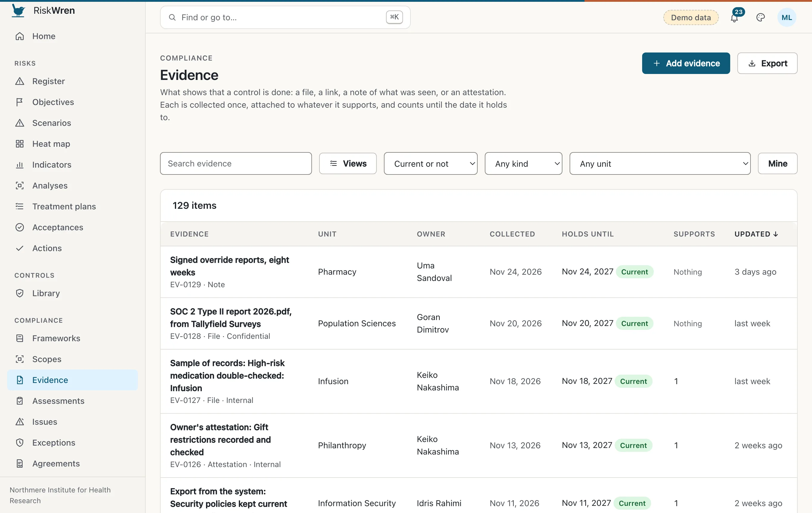
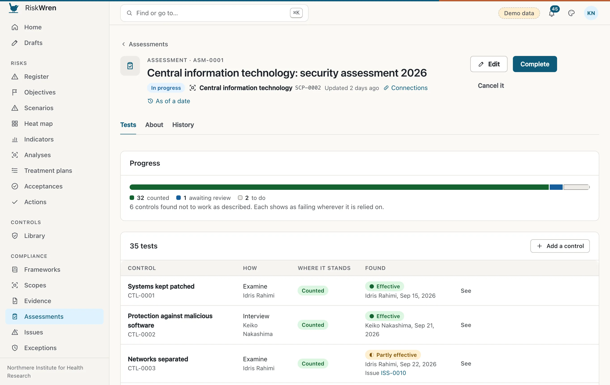
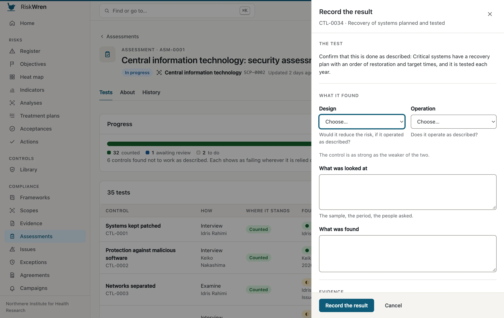
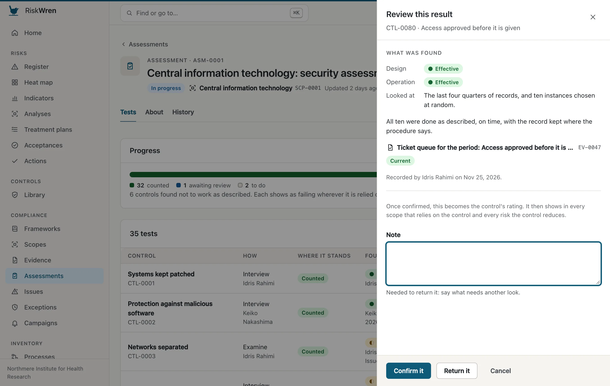
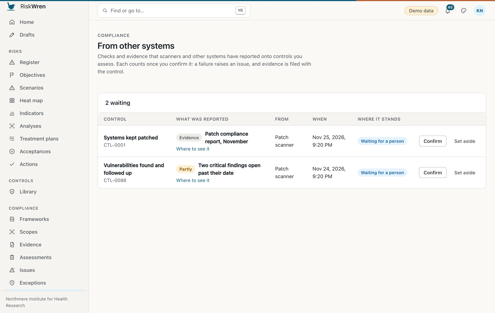

# Evidence and testing

This guide is for the people who collect proof that a control is done, and for those who test whether it works: control owners, assessors, and whoever leads an assessment. It covers evidence, its dates, files, and what it counts toward; assessments, planning and recording tests, independence and review, what a result changes, testing again, and what other systems report. [A yearly assessment, start to finish](#a-yearly-assessment-start-to-finish) puts it in order, using the demo's assessment of central information technology.

## Evidence

An evidence item is something that shows a control is done. It is collected once and attached to everything it supports.

| Kind | What it is |
|---|---|
| **A file** | A report, an export, a screenshot, a signed form |
| **A link** | Where the proof lives in another system |
| **A note of what was seen** | What somebody looked at, and what they saw |
| **An attestation** | A named person's statement that something is so |

**Compliance → Evidence → Add evidence**, or **Add evidence** on a control or a scope, which attaches it there as it is made. Anyone may add evidence for a unit they work in or have a role over, because the people who do the work hold the proof.

Every item has an owner, the date it was collected, the period it covers, a data class, and the date it **holds until**. What kind of item it is cannot change once it is added: a note that should have been a file is a new item.

### Evidence stops counting

Evidence is true of a moment. An item holds for twelve months from the day it was collected unless you give another date (the period follows the program's cadence for a control's rating), and it is in one of three states:

| State | Meaning |
|---|---|
| **Current** | It counts |
| **Expires soon** | It counts, and its date is within 30 days. Its owner sees it on Home |
| **No longer counts** | Its date has passed. It stays on the record, and counts toward nothing |

Stale evidence is never deleted and never quietly renewed. Collect it again and add a new item; the old one remains as what was true then.

An item can also be **retired**, which stops it counting at once, whatever its date: **Edit**, then **Status**: **Retired**. A retired item stays on the record, marked as retired, and can be put back in use the same way.

### Attach it

An item counts once it is attached to the control it shows. On the item, **Supports → Edit** lists the controls and scopes it is attached to. One item can support many: the same restore log may be evidence for a backup control and for the scope that relies on it.

Only evidence on a control counts toward [readiness](compliance.md#readiness): items attached to the control itself, and items cited by a confirmed test result of the control. Evidence attached only to a scope is kept and shown on the scope, but it never makes a requirement verified. Attach proof to the control it shows.

Putting evidence on a control or a scope is for those who keep or assess that control or scope. Collecting is open; attaching is not.

### Files

A file is checked by what it contains, not by its name, up to 25 MB:

| Taken | Refused |
|---|---|
| PDF; PNG, JPEG, GIF, and WebP images; Word, Excel, and PowerPoint documents in their current formats (`.docx`, `.xlsx`, `.pptx`); plain text in UTF-8, including CSV, JSON, and logs | Programs; the older Office formats (`.doc`, `.xls`, `.ppt`); OpenDocument files; anything else, and text in another encoding |

Save an older document as `.docx` or as a PDF before sending it.

- Files are stored under the SHA-256 of their content, in the data home, in a directory the server does not serve from. The same file sent twice is kept once.
- A file only ever leaves as a download. A page or a drawing kept as evidence of a configuration is stored and returned as the plain text it is, so it cannot run in the browser.
- Every download is recorded in the item's history.

### Who sees evidence

Evidence is more closely held than the register. An item is seen by whoever collected it, those named on it, and those with a role over its unit. Others see it only through something it is attached to that they may see, and not at all if it is restricted or of the most sensitive data class. A person who cannot see a control cannot download its evidence.

## Assessments

An assessment is a planned look at whether a scope's controls work. **Compliance → Assessments → Start an assessment** (an assessor or a manager for the scope's unit), or **Start an assessment** on a scope.

Give it a **Name**, the **Scope**, a period (**Period from** and **Period to**), a **Lead**, and an **Approach**: how it will be carried out, and anything it will not cover. It plans a test for each control the scope does itself:

- every one of them; or
- with **Against** set to a framework the scope is held to, only those that answer a requirement of it that applies in the scope.

A control the scope inherits, or shares with a provider, is not tested here. It is tested where it is provided, once, and the result reaches every scope that relies on it. For a shared control, that one test speaks for both halves: the provider's part and this scope's own part. A provider testing a shared control should look at what each relying scope says it does as its part, or that part goes untested. A control marked **Not applicable here** is not tested either.

### Plan the tests

Each test has a **Method** (examine records and settings, interview the people who do it, or test it and see), **What to do** (the procedure), and a person it is **Assigned to**. **Plan** on a test changes them. A test that is assigned appears on that person's Home, due on the last day of the assessment's period.

A test is assigned to someone who can record its result: an assessor or a manager for the scope's unit who does not own the control.

On the **Tests** tab, **Add a control** adds a test for a control the scope does itself that is not in the assessment yet, such as one it started using after the assessment began. **Remove** takes out a test that has no result; once a test has a result, it stays.

A control marked **key** is due to be tested again six months after it was last rated, not twelve, and every rated control's page shows **Next test due**. See [Key controls and the next test](running-the-program.md#key-controls-and-the-next-test).

### Record a result

**Record result** on a test:

- **Design**: would it reduce the risk, if it operated as described?
- **Operation**: does it operate as described?
- **What was looked at**: the sample, the period, the people asked.
- **What was found.** This is required.
- **Evidence**: cite the items that show it.

Each of design and operation is effective, partly effective, or ineffective. The control is as strong as the weaker of the two.

### Independence, and a second pair of eyes

Two rules always hold, and the server enforces both.

1. **Nobody records or reviews a result for a control they own.** The test is shown to them as theirs, with someone else to do it.
2. **A result counts only when a second person has confirmed it.** Whoever recorded it cannot confirm it.

Recording a result changes nothing. It waits as **Awaiting review**, and the assessment's lead sees it on Home. **Review** (an assessor or a manager for the unit, who neither recorded it nor owns the control) then either confirms it or returns it with a note saying what needs another look. A returned result is recorded again (**Record again**); the earlier one stays in the assessment's history.

A result the lead records themselves cannot be reviewed by them, so it waits on the Home of the others with tests in the assessment, any of whom may review it if they do not own the control. A lead who works alone needs a second assessor in the assessment.

### What a confirmed result changes

Confirming a result does three things at once.

1. **It becomes the control's rating**, on the basis of a test, in the tester's name.
2. **It moves every requirement the control answers, in every scope that uses it.** Effective, with evidence that still counts, makes them verified where the control is in place. Partly effective or ineffective makes them failing, in the scope that does the control and in every scope that inherits it.
3. **It moves the residual rating that the controls suggest for every risk the control reduces.** If the suggestion is now worse than the rating on record, the risk is flagged as in doubt and its owner is asked to assess again.

A rating belongs to the control, not to a scope. A result moves every scope that uses the control, including scopes that run it on their own rather than inheriting it. Two units that each want a result of their own for the same kind of control need two controls, one each.

A result of partly effective or ineffective also opens an issue for the control's owners, filled in from the result. See [Issues and exceptions](issues-and-exceptions.md#from-a-failed-test).

While a test result holds, the control cannot be re-rated by judgment. Otherwise the quickest way to clear a failing test would be to have an opinion. A later test replaces it, and so does the passing of time: a result holds for as long as any rating does, twelve months by default.

### Testing again

Once a test's result counts, it cannot be recorded again on the page: the assessment has its answer. To test a control again, after a failure has been put right or before its rating lapses, start a new assessment of the scope that does the control, and **Remove** the tests you do not need; through the API, `POST /api/v1/assessments` with `controls` naming only that control plans just the one test. The new result counts once it is confirmed, and replaces the old rating.

Through the API a result can also be recorded again on a test that already counts, while its assessment is open. The new result takes the old one's place at once, before anyone has confirmed it, and the evidence the old result cited stops counting toward the control unless it is also attached to the control: a verified requirement can drop to in place until the new result is confirmed. The old rating stays until then.

### What other systems report

A scanner or a monitoring tool may report onto a control, with a token: that a check **passed**, **partly** passed, or **failed**, or a piece of evidence such as a monthly patch report. What it says is shown on the control's page at once, under **Reported by other systems**, in its source's name, and counts for nothing until a person who assesses the control's unit, and does not own the control, confirms it.

| Reported | Confirming it |
|---|---|
| **Failed** or **Partly** | Raises an issue on the control, and on the scope if the report named one, found by **Security testing**. Its severity is high for a failure and moderate for partly, unless the confirmer changes it in the dialog. It goes to the control's owners, who are told; with no owner, the confirmer keeps it. Like any issue, someone else confirms its closure |
| **Passed** | Keeps it on record as confirmed. Nothing else changes |
| **Evidence** | Files it with the control, counting for a year (365 days) from when it was observed. Only the confirmer can give another date, through the API (`valid_until`); the reporting system cannot |

**Set aside** keeps a report on record with the reason, and changes nothing else.

No report becomes the control's rating: only a test in an assessment does that. So a confirmed check (passed, partly, or failed) does not move readiness; the issue a failure raises is worked like any other. Confirmed evidence is different. It is filed on the control and counts like any current evidence there, so where a test that still holds found the control effective, it can make the requirements the control answers verified.

Three things to know when you assess:

- **Home says when reports are waiting.** Those who may confirm them see one line, with how many, leading to **From other systems**; nothing is said under the bell.
- **That page lists only what waits.** A report once decided stays on the control's **Reported by other systems** card (the last 50), which has **Confirm** and **Set aside** too.
- **A repeated failure joins the open issue.** As with failed tests, while an issue is open because the control was found wanting, by a test or an earlier report, confirming another failure joins it rather than raising a second.

[Results reported by other systems](other-systems.md#results-reported-by-other-systems) is the administrator's and user's side, and [the API guide](api.md#reporting-onto-a-control) says what a system sends.

### Finish

**Complete** closes an assessment once every test in it has a result that counts. A test that will not be done is taken out first; one that has a result, even a returned one, cannot be taken out, so record it again and have it confirmed. **Cancel it** abandons an assessment; results already confirmed still count.

The assessment's **History** tab tells every test planned, every result recorded, and every confirmation and return, with who did each.

## A yearly assessment, start to finish

The demo has one under way: Keiko Nakashima, the security assurance lead, leads the assessment of **Central information technology** against the Cybersecurity Framework, and Idris Rahimi, a compliance analyst, is the second assessor. Each records what the other confirms. Sign in to the demo as the assessor to see it: tests to do, a result to review, and a control found partly effective.

**Before it starts**

1. **Agree the timing with the scopes that rely on it.** The clinic's own assessment tests only what the clinic does itself: its downtime procedures, physical access, agreements, and screening. Backups, patching, access reviews, training, and the rest are tested in central information technology's assessment, which is this one. A requirement in the clinic is verified only while every control that answers it there has a test result that still holds, so run the provider's assessment first, or in the same weeks, and both scopes stay current for the same year.
2. **Ask the owners to renew their evidence.** Each control needs evidence that still counts, attached to it or cited by the result. Evidence due to lapse during the period should be collected again before the tests begin.

**Plan it**

3. **Compliance → Assessments → Start an assessment.** Choose the scope, set **Against** to the framework if you want only the controls that answer it, give the period, name the lead, and write the **Approach**. The demo's says that each control is examined against its records for the last four quarters, the team that runs it is interviewed, and results are recorded by one assessor and confirmed by the other.
4. **Plan each test.** On the **Tests** tab, **Plan** sets the method, what to do, and who does it. Assign each to an assessor who does not own the control. A control not yet in place has little to test: leave it to do, or **Remove** it.

**Do the work**

5. **Record each result.** **Record result**: design, operation, what was looked at, what was found, and the evidence cited.
6. **Review each result.** The second assessor opens each **Awaiting review** test and confirms it or returns it. The lead sees what waits on Home, except results the lead recorded.
7. **Follow what fails.** A confirmed result of partly effective or ineffective opens an issue for the control's owners and shows as failing in every scope that relies on the control. In the demo, removing access when people leave was found partly effective: the accounts of three people on fixed-term contracts stayed active for up to three weeks after they left. [A failed test, through to closure](issues-and-exceptions.md#a-failed-test-through-to-closure) follows it.

**Finish, and plan the next**

8. **Complete** it once every test counts.
9. **Plan the next one.** Each result holds for twelve months, and a key control's next test is due after six. **Next test due** on each control's page, and the reminders its owners receive, say when; start the next assessment before the first results lapse, or the requirements they make verified drop back to in place.

In a very small team the rules on independence may mean giving the assessor role to someone in another unit, so that nobody tests what they own. See [the rules it keeps](concepts.md#the-rules-it-keeps) and [Assessors](roles.md#assessors).

## An attestation is not a test

A control's owner can be asked, in a [campaign](running-the-program.md#campaigns), whether it still operates as described. Their answer is recorded on the control and shown there, apart from its rating: who said it, when, and what they said.

That is the owner's word. It is worth having, and it is a different kind of assurance from a test by someone who does not own the control. RiskWren keeps the two apart by rule:

- **An attestation never makes anything verified.** A control its owner says is working is in place, and the reason given says it rests on an attestation and no test.
- **An attestation can take a control out of verified.** If a test found a control effective and its owner has since said it operates only partly, or not at all, the requirements it answers drop to in place, and the reason says why. It is not shown as failing, because nobody has tested it; it is no longer something to call verified.
- An attestation holds for as long as a rating does, twelve months by default.

So a figure that says verified always rests on a test and on evidence. Nobody's say-so is in it.

## Verified, in practice

A requirement is verified when each control that answers it in the scope is in place, has a confirmed test result of effective that still holds, and has current evidence, either attached to the control or cited by that result.

So the working rhythm for a control owner and an assessor is:

1. The owner keeps the control's evidence current, renewing it before its date.
2. The assessor tests the control once a year (twice, for a key control) and cites that evidence.
3. A second assessor confirms the result.

Miss the first and the requirement drops to in place when the evidence goes stale. Miss the second and it drops when the test is a year old. Neither needs anyone to notice: the scope's Requirements tab and the compliance dashboard say so the same day.
