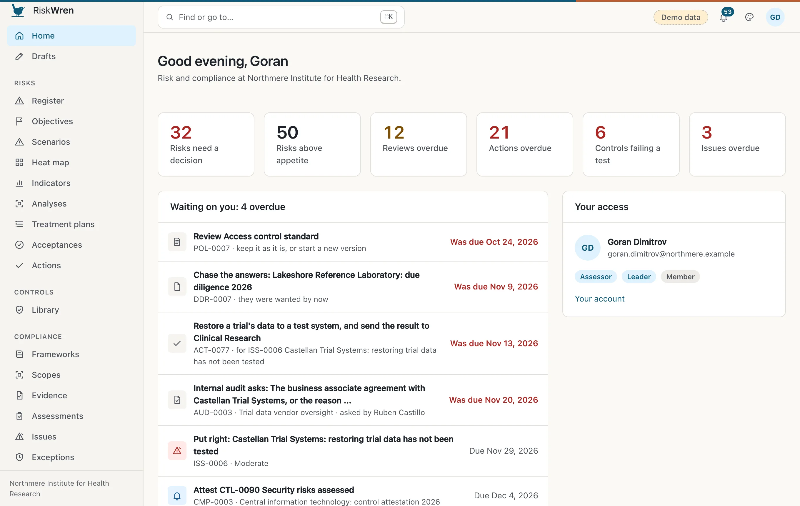

# Getting started

This guide takes you from nothing to a running RiskWren with your organization's units and people loaded and signing in. It is for whoever installs it and sets it up. Installing takes about fifteen minutes; loading the organization takes as long as preparing two spreadsheets, one of units and one of people.

If you have not read [How RiskWren works](concepts.md), read it first: it explains the words this guide uses. If you only want to look around, skip to [Explore the demo organization](#explore-the-demo-organization).

## What you need

- [uv](https://docs.astral.sh/uv/), which provides the right Python (3.12 or later).
- [Git](https://git-scm.com/), to get a copy of the repository:

```bash
git clone https://github.com/robert-mcdermott/riskwren.git
cd riskwren
```

Every command in these guides is written `uv run riskwren …`, run from the repository directory. A deployment installed as a package or in a container runs the same commands as `riskwren …`, without `uv run` ([Deployment](deployment.md)). The full list is in the [command reference](cli.md).

## Install

```bash
uv sync
```

## Set up the installation

```bash
uv run riskwren init
```

`init` does six things:

1. Writes `riskwren.toml`, the deployment settings, in the current directory.
2. Creates the data home, `./var`, which holds everything that is not in the database.
3. Creates the database, or brings an existing one up to date. With no other setting, it is a SQLite file inside the data home.
4. Loads the default program: nine families of risk with an appetite for each, a scoring method with defined scales, review cadences, the table of who may accept what, the rules that tier third parties, the rules that say which agreements shared information needs, and which processes and systems need a privacy impact assessment.
5. Loads the starter content: a library of common risks, a library of common controls, the built-in questionnaires (control attestation, risk self-assessment, unit completeness, system security profile, third-party tiering, three depths of due diligence, and privacy impact), and four public frameworks (the NIST Cybersecurity Framework 2.0, NIST SP 800-53 Rev. 5, NIST SP 800-171 Rev. 3, and the HIPAA Security Rule) with the common controls already mapped to them.
6. Asks for your email address, your name, and a password, and creates the first administrator.

The password needs at least 12 characters. Length matters more than symbols: a few unrelated words make a good one.

The default program is written for a research institute with a clinic. To start from one written for another kind of organization, name it:

```bash
uv run riskwren init --program university
```

| Program | For | What differs |
|---|---|---|
| `research-institute` | A research institute, with or without a clinic (the default) | |
| `academic-medical-center` | Hospitals and clinics, with research and the education of clinicians | Patient care and safety, with quality of care and emergency preparedness; education and training; billing and coding, and referrals; hospitals and service lines; patient care and the revenue cycle |
| `university` | Teaching, research, and the life of a campus | Teaching and learning; students; enrollment and tuition; student records and campus safety reporting; colleges and schools; teaching, student services, and admissions. The clinical family is retired |
| `nonprofit` | Programs and services funded by grants and gifts | Programs and services; mission and impact; donor restrictions and tax-exempt status; donor and client records; programs and chapters; fundraising. The research and clinical families are retired |

Each is the default program with those differences, and with the impact scale's words about the mission written for that kind of organization. Families of risk that do not apply are retired, not removed, so they can be taken up again. The libraries of common risks and controls are the same for all.

`--program` counts only when `init` loads the program into a new database. On a database that already has a program it is ignored. To load a starter program over the one in force, run `uv run riskwren program import university --dry-run` to see what would change, then again without `--dry-run`.

Most of the program can be changed afterwards under **Admin → Program**: the families and their appetite, what each level of the scales means, the matrix, the cadences, the vocabularies, and who sees the register. The number of levels, the set of ratings, who may accept what, the third-party tiers, and the rules for sharing information are changed with a program pack ([Change the program with a pack](running-the-program.md#change-the-program-with-a-pack)).

`init` is safe to run again. It leaves an existing configuration file alone, brings the database up to date, adds only what is missing from the program and the starter content, and creates an administrator only if there is none.

To set up without being asked anything, name the administrator and pipe the password in:

```bash
printf '%s' "$ADMIN_PASSWORD" | uv run riskwren init \
  --admin-email you@example.org --admin-name "Your Name" --password-stdin
```

## Check it

```bash
uv run riskwren doctor
```

`doctor` prints one line for each check, marked ✓ (fine), ! (look at it), or ✗ (must be fixed), and exits with 1 if anything must be fixed. It checks:

| Check | What it looks at |
|---|---|
| Python | The version in use |
| Configuration | That `riskwren.toml` can be read, with advice on settings that work but are unwise, such as an `http://` address |
| Data home | That it is set up, and that it has more than 1 GB free |
| Database | That it answers |
| Schema | That it is at the migration this version expects |
| History guard | That the database still refuses changes to the history |
| History | That every event in the history verifies |
| Sign-in | Local accounts; or, with single sign-on, that the provider can be read, its client secret is in the environment, and `base_url` is set |
| Email | Not set up; or that the mail server can be reached and signed in to. Nothing is sent |
| Scheduled work | That no job's last run failed, and that something runs the jobs: the server's own scheduler, or `riskwren jobs run` within the last two days |

`uv run riskwren doctor --production` also checks what matters before real people rely on it: an `https://` address in `base_url`, a server that listens only on its own machine behind a proxy, PostgreSQL (SQLite is a warning for one server process and a failure for several), a backup taken within two days, a second active administrator, email, and that the installation is not a demo. [Check before going live](deployment.md#check-before-going-live) says what to do about each.

## Run it

```bash
uv run riskwren serve
```

The server prints its address, by default `http://127.0.0.1:8000`. Use `--port` to pick another port.

`serve` refuses to start until it can run safely, and says what to do:

| It says | Do this |
|---|---|
| There is no configuration file, or the file is not valid | `uv run riskwren init` writes one; otherwise correct the key the message names ([Configuration](configuration.md)) |
| There is no initialized data home | `uv run riskwren init` |
| The data home is not writable | Let the account that runs RiskWren write to it |
| The database is empty | `uv run riskwren init` |
| The database schema is behind | `uv run riskwren db upgrade` |
| The database was last used by a newer version | Run that version, or restore a backup taken with this one ([Restore from a backup](help.md#restore-from-a-backup)) |
| There is no administrator yet | `uv run riskwren users add you@example.org --name "Your Name" --role admin` |
| A demo organization was asked to listen beyond this machine | Read [The demo and the network](configuration.md#the-demo-and-the-network), then start it with `--demo-on-network` if you mean it |
| The port is already in use | Stop what is using it, or pass `--port` |

As installed, RiskWren listens only on the machine it runs on. To put it in front of other people, read [Configuration](configuration.md) and [Deployment](deployment.md) first.

## Sign in for the first time

Open the address in a browser and sign in with the email address and password you gave `init`.

RiskWren signs in with local accounts: an email address and a password that it keeps. Nothing else has to be installed or connected. Signing in with your organization's identity provider, such as Microsoft Entra ID, is optional and can be added at any time: see [Single sign-on](configuration.md#single-sign-on). Once it is on, the password form can be kept for everyone or for administrators only.

- Five failed attempts at one account from one address within fifteen minutes stop that account being tried from that address until the fifteen minutes have passed. Twenty-five failures at one account from anywhere, or from one address at any accounts, stop that account or that address the same way. A right password clears the count for its account.
- A sign-in ends after 12 hours without activity, and after 7 days in any case. Both are [settings](configuration.md#server), and both can be shorter.
- If you cannot sign in at all, set a new password from the command line: `uv run riskwren users reset-password you@example.org`. [Signing in](help.md#signing-in) covers the other cases.

### Your account

Open the account menu, your initials at the top right, and choose **Your account**. Everyone has this page:

| Part | What it does |
|---|---|
| **Your details** | Your **Name** and **Title** (your role at the organization, such as Lab Manager), as others see them on records. Your email address is shown, and cannot be changed |
| **Password** | **Current password** and **New password**, then **Change password**. Changing it signs out your other sessions. Someone who signs in through single sign-on has no password here |
| **Email** | Shown only where email is set up. **Send me** each notice as it happens (the start for everyone), one summary a day, or no email. Everything is listed under the bell either way |
| **Your roles** | The roles you hold. They are given by an administrator, and decide what you can see and do |

## Set up the organization

The administrator account sets the installation up: units, people, roles, and appearance. An administrator also reads every record, restricted ones included, except an incident case restricted to the people named on it, and may change the program. It does not assess, rate, test, or accept: that belongs to the roles below, and an administrator who also does that work is given a second role. Give the administrator role to as few people as can keep the installation running ([Before you give roles, know this](roles.md#before-you-give-roles-know-this)).

Set up the units first, then the people, then their roles: a person works in units, and most roles name one.

### Units

**Admin → Units** holds the organization as a hierarchy of any depth: divisions, departments, labs, cores, clinics, offices. Every record belongs to a unit, roles can be limited to a unit and everything beneath it, and figures roll up the tree. Give each unit a short, permanent code; imports and the command line refer to units by it.

Start with the units that answer for things, as the organization chart has them, two or three levels deep. A unit can be added beneath another at any time.

### People and roles

**Admin → People → Add a person** takes a **Name**, an **Email address**, a **Title**, and a **Password**. Leave the password empty to add them as **invited**: they can be named as owners on records straight away, and can sign in once they are given a password or come in through single sign-on. Then open the person (**Edit**) to say which units they work in (the first is their main unit) and which roles they hold.

A person with no role is a **member**. Most people are members who own a few records.

| Role | What it is for |
|---|---|
| **Manager** | The risk and compliance team. Runs the program, edits any record, reads everything, and issues leadership reports. Cannot accept risk. Can be limited to a unit, and then works only within it |
| **Assessor** | Assesses risks, rates and tests controls they do not own, confirms others' results and closures, and triages incidents. Can be limited to a unit |
| **Leader** | Leads a unit. Sees it and everything beneath it, decides its exceptions, and accepts its risks up to a limit set on the role |
| **Steward** | Keeps a unit's records complete and current: its processes, systems, third parties, risks, and controls |
| **Auditor** | Reads everything, including the full history, and runs internal audit's own work: the universe, plans, and engagements |
| **Admin** | Accounts, units, sign-in, appearance, other systems, and operations. Reads every record, restricted ones included, and may change the program |
| **Member** | Everyone who can sign in; it is never given. Sees what they own and are named on, and their unit's register if the program allows it |

An incident case restricted to the people named on it is the one exception to reading everything: a manager, an auditor, or an administrator who is not named on it does not see it ([Restricted cases](incidents.md#restricted-cases)).

A leader's limit is the highest residual rating they may accept: moderate, high, or critical. As shipped, any leader of a risk's unit or a unit above it may accept a moderate risk, and a high or critical one needs a limit that reaches it ([Who may accept what](running-the-program.md#who-may-accept-what)). Which role to give whom, in an organization like yours, is in [Choosing roles for your organization](roles.md#choosing-roles-for-your-organization).

**Passwords.** Without single sign-on, an administrator sets each person's password (**Set a password** on their page under **Admin → People**, or `uv run riskwren users reset-password`) and tells them what it is; they change it under **Your account**. RiskWren sends no invitation and has no way to reset one's own forgotten password: the sign-in page tells people to ask an administrator. That is workable for a pilot. For more than a few dozen people, [single sign-on](configuration.md#single-sign-on) is the practical way: people use the account and second factor they already have, an account is made the first time each person signs in, and roles can come from the identity provider ([Roles from the provider](configuration.md#roles-from-the-provider)). Single sign-on never makes units, and it makes a person's account only when they first sign in; to name people as owners before then, import them, or add them as invited.

**From the command line.** `riskwren users` does the same for setting up, and for getting back in when nobody can sign in. A role is written `admin`, `manager`, `assessor`, `auditor`, `steward=unit:CODE`, or `leader=unit:CODE,limit:RATING`; a manager or an assessor may also take `unit:CODE`.

| Command | What it does |
|---|---|
| `uv run riskwren users add EMAIL --name "…" --role ROLE --unit CODE` | Add an account, asking for its password. `--role` and `--unit` may be repeated |
| `uv run riskwren users add EMAIL --name "…" --invite` | Add an account without a password, as invited |
| `uv run riskwren users list` | Every account, with its status and roles |
| `uv run riskwren users roles EMAIL` | Show an account's roles; with `--set ROLE` (repeated), replace the roles given in RiskWren. Roles from the identity provider are left alone |
| `uv run riskwren users disable EMAIL` | Stop an account signing in and end its sessions. What the person alone answered for passes to the steward of each record's unit |
| `uv run riskwren users enable EMAIL` | Let a disabled account sign in again |
| `uv run riskwren users reset-password EMAIL` | Give an account a new password and end its sessions |

For example, to add the director of a core as an invited leader who may accept up to moderate:

```bash
uv run riskwren users add ines@northmere.example --name "Ines Castellanos" \
  --role "leader=unit:BIO,limit:moderate" --unit BIO --invite
```

The last active administrator can never be disabled or lose that role. Every change made from the command line is in the history as made there. The options are in the [command reference](cli.md#riskwren-users).

### Import units and people

**Admin → Units** and **Admin → People** each take a spreadsheet saved as CSV, which is the quick way to load an organization. **Import**, choose the file, and **Check the file**: every problem is listed by row and nothing is changed. **Import** once every row is good. Nothing is loaded unless every row can be.

**Units** are matched by code, so importing the same file again updates names, kinds, and parents.

| Column | Needed | What it holds |
|---|---|---|
| `code` | Yes | The unit's short, permanent code, once in the file |
| `name` | Yes | Its name |
| `kind` | Yes | Its kind, by key: `organization`, `division`, `department`, `center`, `core`, `lab`, `clinic`, or `office` as shipped (the list is under **Admin → Program → Vocabularies**) |
| `parent_code` | All but one | The code of the unit above it, in the file or already in RiskWren, before or after it in the file. Exactly one unit, the organization itself, has none |

```csv
code,name,kind,parent_code
NMI,Northmere Institute for Health Research,organization,
CORES,Core Facilities,division,NMI
BIO,Biospecimen Repository,core,CORES
ADMIN,Administration,division,NMI
SEC,Information Security,department,ADMIN
```

**People** are matched by email address. New people are added as **invited**: they can be named on records at once, and sign in once they are given a password or come in through single sign-on. Importing the same file again updates names, titles, units, and roles.

| Column | Needed | What it holds |
|---|---|---|
| `email` | Yes | The address they sign in with |
| `name` | Yes | Their name |
| `title` | No | Their job title |
| `unit_codes` | No | The units they work in, by code, separated by semicolons. The first is their main unit |
| `roles` | No | Their roles, written as for the command line and separated by semicolons. A role with a comma in it, such as a leader's, is put in quotes |

```csv
email,name,title,unit_codes,roles
chidi.udoka@northmere.example,Chidi Udoka,Repository Manager,BIO,steward=unit:BIO
ines.castellanos@northmere.example,Ines Castellanos,"Director, Biospecimen Repository",BIO,"leader=unit:BIO,limit:moderate"
goran.dimitrov@northmere.example,Goran Dimitrov,Chief Information Security Officer,SEC,"leader=unit:SEC,limit:high;assessor"
dalia.ferreira@northmere.example,Dalia Ferreira,Specimen Technician,BIO,
```

Units and roles are set only where their column has a value: an empty cell leaves what a person already has. A `roles` cell replaces the roles given in RiskWren, and leaves those from the identity provider alone.

Once units and people are in, [Adopting RiskWren](adopting.md#bring-in-what-you-have) says how to bring in the inventory, an existing register, controls, and frameworks.

### Appearance

**Admin → Appearance** sets the product's name, your organization's name, a logo, an accent color, the default palette, how ratings are colored, and your own words for the kinds of record. See [Appearance](running-the-program.md#appearance).

## Explore the demo organization

To see RiskWren with data in it before you set anything up, build the demo:

```bash
uv run riskwren demo                                 # builds ./demo
uv run riskwren --config demo/riskwren.toml serve    # runs it at http://127.0.0.1:8020
```

The demo is the Northmere Institute for Health Research, a fictional research institute with an outpatient clinic and two years of history. Every record in it was made by the same code the app uses, as the person who would have made it, on the day they would have made it, so its history verifies like any other. Nothing in it is real.

When it finishes, `riskwren demo` says what it built. A fresh build holds 60 units and 208 people; 74 processes, 103 systems, and 43 third parties; 181 risks and 136 controls, with 28 treatment plans and 19 acceptances; 4 scopes; 118 items of evidence; and about 10,800 events of history. Around them:

- **Risks:** assessments and ratings at every standing, an acceptance about to expire, a risk beyond its unit leader's limit, objectives and the risks that threaten them, two risk analyses, two scenarios (two weeks of ransomware is worked through with estimates in dollars), indicators past their limits, half a year of measures, and two quarters' leadership reports. The risk and compliance committee has met twice and meets again soon.
- **Compliance:** four scopes held to frameworks. Central information technology provides controls; the clinical systems, under the HIPAA Security Rule, and a controlled-access data enclave, under NIST SP 800-171, inherit from it; a trial data platform is still on SP 800-53 Rev. 4. An assessment is in progress, evidence is at every stage of freshness, and twenty issues stand from raised to closed, opened by failed tests, a penetration test, audits, due diligence, an exercise, and an incident. Seven exceptions are waiting, in force, ended, or refused. Campaigns ask for attestations, evidence, acknowledgments, and privacy impact assessments.
- **Policies and agreements:** the security office's policies and the standards, procedures, and guideline beneath them, with versions, approvals, and acknowledgments, one new version waiting for approval; agreements with their dates and the parties they are with.
- **Third parties:** suppliers and partners with their services and tiers; eleven due diligence reviews at every stage, from not yet sent to concluded; six reports and certificates received, five of them read for what they cover; findings; a review called for by a breach notice; a relationship being ended; and three gaps where no agreement covers what is shared.
- **Incidents:** incidents, near misses, and concerns, reported, triaged, handled, and learned from; two reported without a name, one a restricted case, and two assessed for whether they must be notified.
- **Resilience:** the business impact of four critical processes, checked against what their systems, sites, and suppliers can deliver, and two continuity plans with their exercises.
- **Internal audit:** the universe, this year's plan approved for the committee and next year's in draft, two engagements reported and one in fieldwork, findings with one confirmed closed, and outside access for the external auditors and a trial sponsor.
- **Other systems:** results a patch scanner reported onto controls, one confirmed and two waiting for a person, and two drafts an assistant proposed.



Its sign-in page offers ten sample people and asks for no password:

| Sign in as | To see |
|---|---|
| **Risk manager** (Mireille Lachance) | The whole register, the risk dashboard, the heat map, records that have lost their owner, the program, where a change to the matrix can be previewed, the committee's next session to prepare, **Reports → Measures** and **Portfolio**, the leadership reports with the next one ready to issue, a restricted case, and **Reports → Resilience**, where the clinic building cannot be replaced in time for medication dispensing |
| **Steward** (Chidi Udoka) | The Biospecimen Repository's inventory and risks, a critical risk brought to high by controls, with its plan, and the unit's suppliers that are due for review |
| **Unit leader** (Ines Castellanos) | A leader whose limit is moderate, and a high risk beyond their authority to accept |
| **Division leader** (Soren Eriksen) | A leader who may accept high risks in Core Facilities, and the acceptances they gave, one of them expiring within the month |
| **Executive** (Rosalind Achterberg) | The one person who may accept a critical risk anywhere, a new version of the information security policy to approve, and the leadership reports |
| **Security leader** (Goran Dimitrov) | The compliance dashboard: readiness by scope, controls failing a test, issues by age, and exceptions about to end; a critical finding from a penetration test, a closure to confirm, and an exception to a standard to decide; a supplier's answers to a security questionnaire waiting to be read, with their concerns; a review called for by a supplier's breach notice; **Third parties → Coverage**, where patient records are shared with no business associate agreement; **Risks → Scenarios**, with the ransomware scenario, the risk's bow-tie, and its estimate in numbers; and **Incidents**: a concern reported without a name, a spreadsheet sent to a sponsor whose breach assessment is still open, a stolen laptop that need not be notified because its disk was encrypted, and a near miss joined to the risks it realized and the control that failed |
| **Assessor** (Keiko Nakashima) | An assessment in progress: tests to do, a result to review, and the issues the failed tests opened; an attestation campaign most of the way through; a risk analysis half done; what a patch scanner reported, under **Compliance → From other systems**; and the issue an assistant drafted, under **Drafts** (the risk it drafted, in Information Technology, waits for that unit's steward or a manager) |
| **Auditor** (Greta Bergstrom) | Everything, read-only, with every change in one place, the register as it stood on any day, and a dossier of any scope to check; and internal audit's own work: the universe, this year's plan, an engagement in fieldwork with a review note waiting, and the report for the committee |
| **Administrator** (Tobias Larsen) | People, units, appearance, single sign-on, other systems, and **Admin → Operations**, which shows what stands between the demo and production. An administrator reads the record and makes none of its judgments |
| **Staff member** (Dalia Ferreira) | Home for someone with one action to finish and a policy to acknowledge, the policy library, **Incidents → Report something**, and only their own unit's part of the register |

`riskwren demo --seed 2` builds a different Northmere with the same shape and the same sample people, and `--force` rebuilds one that is already there.

A demo listens only on the machine it runs on. See [The demo and the network](configuration.md#the-demo-and-the-network) before changing that.

## Next

1. [How RiskWren works](concepts.md): the pieces of the record, the rules it keeps, and the words it uses.
2. [Your part in it](roles.md): what each role does, and which to give whom.
3. [Adopting RiskWren](adopting.md): the decisions to make, a pilot, bringing in what you have, and rolling it out.
4. [The program handbook](handbook.md): the first month, the first quarter, and the rhythm of a year.

For reference as you go: [The register](the-register.md) for recording what you have and what could go wrong, and [Running the program](running-the-program.md) for appetite, cadences, and who sees what.
