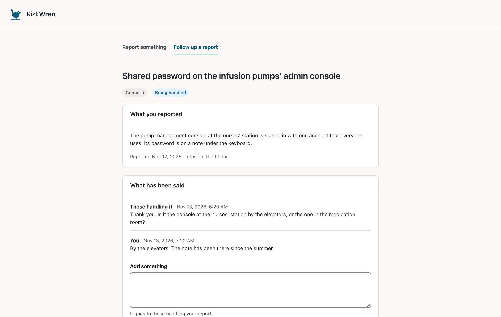

# Incidents

This guide is for everyone who reports something that went wrong, and for those who triage and handle it: most often the security team, and the risk and compliance offices. An incident is a record of its own, on the same record as the risks and controls: something that happened, nearly happened, or worries someone. It is not an issue. An issue is something to put right; an incident is something that happened.

## Reporting something

**Incidents → Report something** takes a minute, from anyone signed in. It asks:

| Question | What to give |
|---|---|
| What is it? | **Incident:** something went wrong, and information, a system, or people were affected. **Near miss:** something nearly went wrong, and was caught in time. **Concern:** something that worries you and may need looking into |
| In a line, what happened | Such as "Laptop left on the train" |
| What happened | What you saw or did, and anything you have done since. Leave out passwords and patient details |
| When it happened | A day, if you know it. It cannot be a day still to come |
| Where | A room, a building, a system, or a website |
| The unit it happened in | Your own unit, unless you say otherwise. If you are not sure, leave it: triage puts it right |

**Send the report** gives it a reference (`INC-0007`) and tells those who triage for its unit. You can follow it from **Incidents**, where **Reported by me** lists what you sent.

## Who sees a report

A report is seen by those who need to, and by nobody else:

- **Whoever reported it.** They see what they reported, where it stands, who handles it, and what is said to them. They do not see the handling itself: its severity, the records it concerns, notes among those handling it, or its history.
- **Those who handle it,** named at triage.
- **Those who triage for its unit:** managers, and assessors for the unit. An assessor for the whole organization, as a security team's usually is, triages everywhere.
- **The leaders and stewards of its unit,** and of the units above it.
- **Those who read everything:** managers for the whole organization, auditors, and administrators.

Lists, search, and counts follow the same rule. Someone else in the same unit, or a steward of another unit, does not know it exists.

## Triage

A new report waits on the home page of everyone who triages for its unit, with **Triage**. Triage gives it:

| | |
|---|---|
| Category | From the program's list of incident categories: security, privacy, safety, conduct, compliance, operations, and other, to begin with. **Admin → Program → Vocabularies** renames them and adds to them |
| Severity | On the same scale as issues: critical, high, moderate, or low |
| Unit | Where it belongs, if the reporter did not know. Moving it moves who sees it |
| The records it concerns | Systems, services, information, third parties, processes, risks, controls, and scopes, from those you can see |
| Who handles it | One person, who is told, and finds it on their home page until it is closed |

Triage can be done again while it is open: a new handler takes the place of the last, and the records named are set again. A record named by someone else that you cannot see stays: you cannot take away what you cannot know is there. Everything triage does is in the incident's history.

## Handling it

Those handling an incident, and those who see all of it, write on it under **What has been said**. Each thing written is either:

- **Only those handling it:** a note, for the people working on it.
- **The reporter too:** a message to whoever reported it, who is told. They answer on the same page, and whoever handles it is told.

When it is done, **Close** asks how it ended, and the reporter is told it is closed. Its handlers close it, or those who triage it. Those who triage it can **Reopen** it.

## Reporting without a name

Some things are not reported if a name must go with them. Where the organization chooses, anyone may report a concern, an incident, or a near miss without signing in, at `/report`. The sign-in page offers it.

It is closed until an administrator opens it, under **Admin → Program → Who sees what**. When it is open:

- **Nothing about who sent a report is kept:** no account, no name, and no address. Someone signed in who uses the page is not named either. The history says it was reported without a name.
- **The reporter is shown a follow-up code, once.** It is four groups of five letters and numbers, and only a digest of it is kept, so nobody here can look it up for them. With it, at `/report` under **Follow up a report**, they see where their report stands, read what those handling it say to them, and add to it. They do not see who handles it.
- **The code is typed however it comes:** small letters, no dashes, or an O for a zero.
- **Failed codes are not counted against the address they came from,** unlike the other links, so nothing ties a report to where it was sent from. A code is long enough (100 bits) that guessing one is hopeless.
- **At most 30 reports an hour are taken,** from everyone together, so that the page cannot be used to flood the organization.

A report made this way goes to those who triage for the organization as a whole, who move it to the right unit. Those handling it write to the reporter as to anyone: what they share, the reporter reads when they come back with the code.

Whether the web server in front of RiskWren keeps addresses in its own log is decided where it runs, not here. If reporting without a name is open, check that log too: see [Run behind a reverse proxy](configuration.md#run-behind-a-reverse-proxy).

