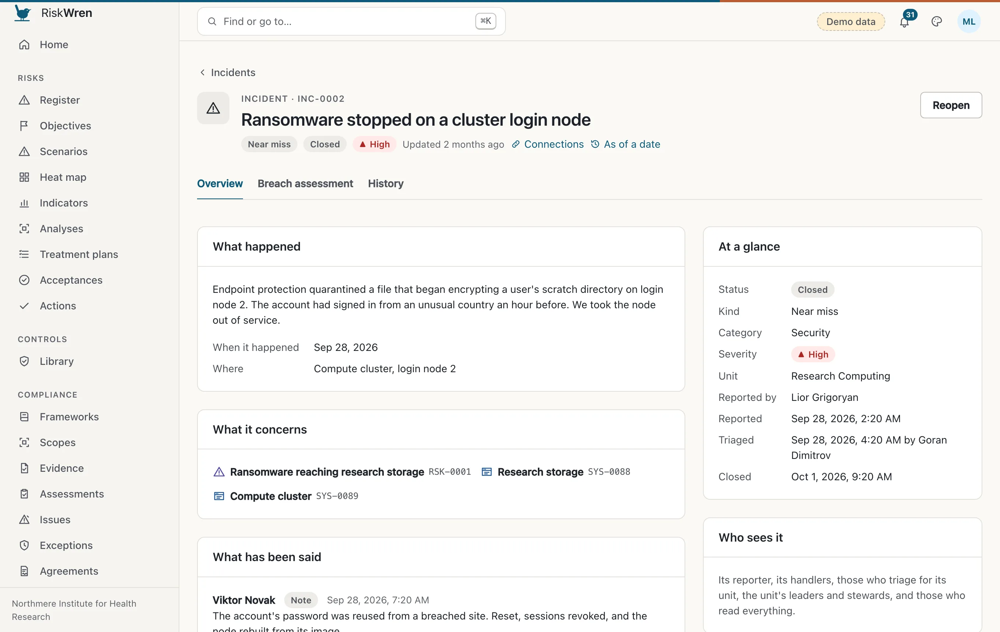
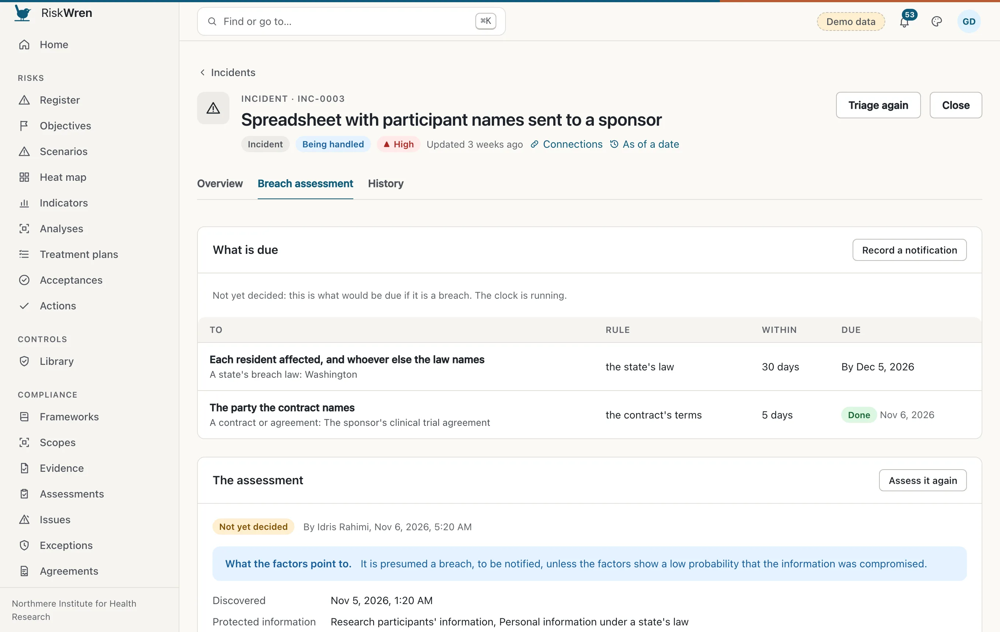
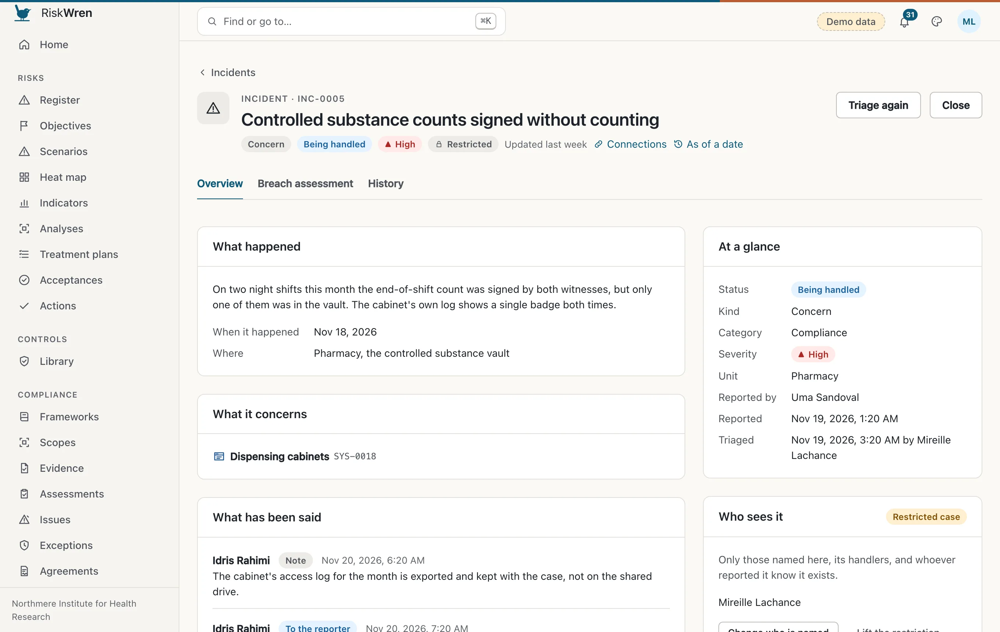

# Incidents

This guide is for everyone who reports something that went wrong, and for those who triage, handle, and learn from it: most often the security team, and the risk and compliance offices. An incident is a record of its own, on the same record as the risks and controls: something that happened, nearly happened, or worries someone. It is not an issue. An issue is something to put right; an incident is something that happened. The [worked example](#a-worked-example-from-report-to-closure) at the end takes one from the report to its closure.

## Reporting something

**Incidents → Report something** takes a minute, from anyone signed in. It asks:

| Question | What to give |
|---|---|
| What is it? | **Incident:** something went wrong, and information, a system, or people were affected. **Near miss:** something nearly went wrong, and was caught in time. **Concern:** something that worries you and may need looking into |
| In a line, what happened | Such as "Laptop left on the train" |
| What happened | What you saw or did, and anything you have done since. Leave out passwords and patient details |
| When it happened | A day, if you know it. It cannot be a day still to come |
| Where | A room, a building, a system, or a website |
| The unit it happened in | Your own unit, unless you say otherwise. If you are not sure, leave it: triage puts it right |

**Send the report** gives it a reference (`INC-0007`) and tells those who triage for its unit. You can follow it from **Incidents**, where **Reported by me** lists what you sent.

### What kind it is

The kind matters more than it looks, and it is not changed on the page: neither the reporter nor triage can change it there. It decides two things:

- **Closing.** An incident of the kind **Incident** that is high or critical is not closed until what was learned is said. A near miss or a concern of the same severity closes without it.
- **Counting.** The figures at the top of **Incidents** are how many incidents and how many near misses there were in the last year. A concern is in neither.

Those who handle or triage it can correct the kind through the API, with `PATCH /api/v1/incidents/{ref}` and a `kind` of `incident`, `near_miss`, or `concern`, while it is open. What the reporter wrote (the line, what happened, when, and where) is corrected the same way, and only there.

## Who sees a report

A report is seen by those who need to, and by nobody else:

- **Whoever reported it.** They see what they reported, where it stands, who handles it, and what is said to them. They do not see the handling itself: its severity, the records it concerns, notes among those handling it, or its history.
- **Those who handle it,** named at triage.
- **Those who triage for its unit:** managers, and assessors for the unit. An assessor for the whole organization, as a security team's usually is, triages everywhere.
- **The leaders and stewards of its unit,** and of the units above it.
- **Those who read everything:** managers for the whole organization, auditors, and administrators.

Lists, search, and counts follow the same rule. Someone else in the same unit, or a steward of another unit, does not know it exists. A [restricted case](#restricted-cases) narrows this further.

## Triage

A new report waits on the home page of everyone who triages for its unit, with **Triage**. Triage gives it:

| | |
|---|---|
| Category | From the program's list of incident categories: security, privacy, safety, conduct, compliance, operations, and other, to begin with. **Admin → Program → Vocabularies** renames them and adds to them |
| Severity | On the same scale as issues: critical, high, moderate, or low |
| Unit | Where it belongs, if the reporter did not know. Moving it moves who sees it. You can move it only to a unit you also triage for |
| The records it concerns | Systems, services, information, third parties, processes, risks, controls, and scopes, from those you can see |
| Who handles it | One person, who is told, and finds it on their home page until it is closed |

**Save the triage** saves it, tells the handler, and, the first time, tells the reporter that what they reported is being handled. Triage can be done again while it is open: a new handler takes the place of the last, and the records named are set again. A record named by someone else that you cannot see stays: you cannot take away what you cannot know is there. Everything triage does is in the incident's history.

### Who handles it

Triage names one handler. Others can work beside them as **delegates**: **Who handles it → Edit** on the incident adds a person and gives them the capacity **Delegate** (or the API, with `PUT /api/v1/incidents/{ref}/owners`). A delegate acts as a handler: they see all of it, write on it, assess it for breach, record notifications, say what it taught, close it, and change who sees it, and they are told when the reporter writes. The home page items (the incident itself, and each notification still to make) go to the handler alone, so name as handler whoever is to be chased.

## Handling it

Those handling an incident, and those who see all of it, write on it under **What has been said**. Each thing written is either:

- **Only those handling it:** a note, for the people working on it.
- **The reporter too:** a message to whoever reported it, who is told. They answer on the same page, and whoever handles it is told.

When it is done, **Close** asks how it ended, and the reporter is told it is closed. Its handlers close it, or those who triage it.

A closed incident takes nothing more: no messages, no breach assessment or notification, no change to who sees it, and the page offers no change to what it taught, what it cost, or the issues raised from it. Those who triage it can **Reopen** it, and it goes back to being handled. The reporter is not told of a reopening, so write to them if they should know.

## What it taught

An incident is worth most for what it teaches the register. Beneath what happened, those who handle or triage it say:

- **What it taught** (**Say what it taught**, and later **Change**): the risks it realized, the controls that failed, and the controls that held; why it happened, from the program's list of root causes (the same list an issue's closure uses); and what was learned, in words. A control cannot both fail and hold in the same incident. An incident of the kind Incident that is high or critical is not closed until what was learned is said. Triage names the records an incident *concerns*; this names what it *showed*, and triage again leaves it alone.
- **What it cost** (**Record a cost**): each cost one amount, of one kind (responding, recovering, revenue or funding lost, notifying people, legal costs, fines and penalties, or other), in whole units of a currency. A cost is never edited: to correct one, record the difference, which may be negative. Amounts in different currencies are not added together.
- **Issues raised from it** (**Raise an issue**): whatever it showed must be put right is raised as an issue in the one register, for the incident's unit, with the incident as its source, so that it is put right, dated, and confirmed closed like any other ([Issues and exceptions](issues-and-exceptions.md)). An issue raised from a restricted case is restricted too, and names the case only to those who may know of it.

The register learns back. A **risk** shows the incidents that realized it, how many in the last year, and what they cost, beside its own ratings and, where it has one, its estimate in ranges. A **control** shows the incidents in which it failed and those in which it held. **Incidents** opens on the last year: how many incidents and near misses, what they cost, the categories, and the risks realized and controls that failed most often. All of it follows who may see each incident: a restricted case is never shown beside a risk or a control to someone not named on it, and is never counted for them.

## Breach assessment

An incident that may involve protected information is assessed for whether it must be notified, on its **Breach assessment** tab, by those who handle or triage it. Do it as soon as protected information may be involved: the clock runs from when the breach was **discovered**, the first day it was known, or would have been known with reasonable care, to anyone working for the organization.

**Assess it** records:

| | |
|---|---|
| When it was discovered | A day and a time, in your own time zone. Every deadline counts from it |
| The protected information involved | Health information, personal information under a state's law, customer financial information, research participants' information, controlled or covered defense information, sign-in credentials, or other. The list is a program vocabulary |
| How many people | About how many it concerns, and the most of them living in any one state. Left empty, it counts as fewer than 500: see below |
| Whether it was secured | Encrypted or destroyed, so as to be unusable, unreadable, or indecipherable to anyone not allowed to see it |
| An exception | Unintentional access in good faith by someone working for the organization; an inadvertent disclosure between two people allowed to see it; or a disclosure to someone who could not reasonably have kept it |
| The four factors | What was involved, who used or received it, whether it was actually taken or seen, and how far the risk has been reduced: each low, moderate, or high, with why |
| The conclusion | It must be notified, it need not be, or not yet decided; and why. Why is needed for either of the first two, and "it must be notified" needs at least one rule that applies |
| The rules that apply | Ticked by hand from those built in; and any state's law (**Add a state's law**), named, with the days it allows, or contract (**Add a contract**), named, with the days or hours it allows |

No rule is ticked for you on a first assessment, whatever information you choose: tick each that applies. Each later assessment starts from the rules ticked on the one before.

Beside it is **what the factors point to**. A use or disclosure that was not allowed is presumed a breach, to be notified, unless the information was secured, an exception applies, or the factors show a low probability that it was compromised. That is the HIPAA Breach Notification Rule's test, and a sound one for other information too. The conclusion is yours, and the reason you give is what a regulator will ask about.

An assessment is never edited. **Assess it again** as more is learned: the new one supersedes the last, and the history keeps both. It is often right to save a first assessment as **Not yet decided** the day it is discovered, so the deadlines show while the facts are gathered.

### What is due, and by when

From the assessment, **What is due** lists every notification the rules that apply require, to whom, and by when, soonest first. While the conclusion is not yet decided, it shows what would be due if it is a breach: the clock is running. Once it is concluded that it need not be notified, nothing is due.

| Rule | Notify | By |
|---|---|---|
| HIPAA Breach Notification Rule | Each individual affected | 60 days after discovery |
| | The Secretary of Health and Human Services | 500 or more people: 60 days after discovery. Fewer: 60 days after the end of the year it was discovered |
| | Prominent media outlets, where more than 500 residents of one state are affected | 60 days after discovery |
| HIPAA, as a business associate | The covered entity | 60 days after discovery |
| FTC Safeguards Rule | The Federal Trade Commission, where 500 or more consumers' unencrypted information is involved | 30 days after discovery |
| DFARS 252.204-7012 | The Department of Defense, through DIBNet | 72 hours after discovery |
| A state's breach law | Each resident affected, and whoever else the law names | As many days as you say the law allows |
| A contract or agreement | The party it names | As many days or hours as you say it allows |

How the dates fall:

- **A deadline in days** falls at 23:59 UTC on its last day, counted from the day of discovery in UTC. In the United States that is the afternoon or early evening of the day shown.
- **A deadline in hours** (DFARS, or a contract's hours) runs from the moment of discovery entered, to the minute.
- **An empty count of people** is taken as fewer than 500. The Secretary's deadline then moves to 60 days after the end of the year, the FTC's notice is not listed, and the media's is not listed without a count of the most in one state. Give a count, even a rough one; where it may reach 500, say so, since the earlier deadlines are the safe ones.

These are the outer limits; each rule asks for notice without unreasonable delay. States' laws differ in what they cover, whom they require to be told, and how long they allow: name each that applies, and check what it says. A delay a law enforcement official asks for is recorded in the assessment's reasons; the dates shown do not move for it.

Each notification still to make waits on the home page of whoever handles the incident, overdue first. It is not in the [email reminders](running-the-program.md#reminders), and delegates do not see it on their home pages, so the handler, or someone working with them, must look. **Record a notification** says which rule and whom it was for, who was notified, when it was sent, how many people were told, how, and any reference a regulator gave. Notifications are never edited, and each is in the history.

## Restricted cases

Some incidents must be kept to a few: a concern about how someone behaves, about the people who lead a unit, or one that may become a matter for lawyers. **Restrict it**, under **Who sees it** on the incident, makes it a restricted case. It is then known only to:

- **Those named on the case,** chosen when it is restricted and changed later under **Change who is named**. Whoever restricts it is named, so as not to lose sight of it.
- **Its handlers,** who are named on it by being its handlers.
- **Whoever reported it,** who still sees their report and what is said to them.

Nobody else learns that it exists: not its unit's leaders and stewards, not those who triage, and not those who read everything, managers, auditors, and administrators included. It is left out of their lists, search results, counts, and the history of everything, and asking for it by its reference answers as though there were nothing there. The notices that told them of it when it was reported are taken back, though a notice already sent as email cannot be. Its events stay in the history's chain, which `riskwren verify` checks like any other. A gap in the numbering (`INC-0004`, then `INC-0006`) is all that is left to see.

Anyone who triages for its unit, and its handlers, may restrict an incident that is not yet restricted. Once it is restricted, only those who handle it, and those named on it who triage for its unit, may change who is named or **Lift the restriction**, which gives it back to everyone who would otherwise see it. Someone named on the case who neither handles nor triages it sees all of it and can write on it, but cannot change who is named, assess it, or close it. Each of these is in its history, and none can be done while it is closed. When its handler leaves, it passes to someone else named on it, never to someone who could not see it; if there is nobody, it stays as it is, and those named on it name a new handler.

Restrict a case at triage, as soon as it is known to be sensitive: until then, everyone who triages for its unit, its unit's leaders and stewards, and those who read everything may open it.

## Reporting without a name

Some things are not reported if a name must go with them. Where the organization chooses, anyone may report a concern, an incident, or a near miss without signing in, at `/report`. The sign-in page offers it.

It is closed until an administrator opens it, under **Admin → Program → Who sees what**. When it is open:

- **Nothing about who sent a report is kept:** no account, no name, and no address. Someone signed in who uses the page is not named either. The history says it was reported without a name.
- **The reporter is shown a follow-up code, once.** It is four groups of five letters and numbers, and only a digest of it is kept, so nobody here can look it up for them. With it, at `/report` under **Follow up a report**, they see where their report stands, read what those handling it say to them, and add to it. They do not see who handles it.
- **The code is typed however it comes:** small letters, no dashes, or an O for a zero.
- **Failed codes are not counted against the address they came from,** unlike the other links, so nothing ties a report to where it was sent from. A code is long enough (100 bits) that guessing one is hopeless.
- **At most 30 reports an hour are taken,** from everyone together, so that the page cannot be used to flood the organization.

The page asks what it is, as the signed-in form does; a report sent to `POST /api/v1/anonymous-reports` without a kind is taken as a concern. A report made this way goes to those who triage for the organization as a whole, who move it to the right unit. Those handling it write to the reporter as to anyone: what they share, the reporter reads when they come back with the code.

Whether the web server in front of RiskWren keeps addresses in its own log is decided where it runs, not here. If reporting without a name is open, check that log too: see [Run behind a reverse proxy](configuration.md#run-behind-a-reverse-proxy).

## A worked example: from report to closure

The demo's dispensing cabinets at the pharmacy are serviced by Meridian Pharmacy Automation, a supplier that handles patient records. One afternoon a pharmacist hears from Meridian's service engineer that a memory stick holding a diagnostic export from one cabinet is lost: it lists about 140 patients, all living in one state, with the medicines dispensed to them. In the [demo](getting-started.md#explore-the-demo-organization), report as the staff member and do the rest as the security leader, who triages everywhere. Two people below are named by their titles: the Pharmacy's Clinical Director, who leads it, and the Director, Compliance and Privacy, who leads that office. The demo makes up their names; signed in as the administrator, **Admin → People** shows who they are.

**Report it.**

1. **Incidents → Report something**: **Incident**; "Cabinet export with patients' names lost by the supplier's engineer"; what the engineer said, and when; where: "Pharmacy, cabinet 3"; the unit: Pharmacy. **Send the report**. Those who triage for the pharmacy are told.

**Triage it, and keep it to a few.**

2. As the security leader, open it from Home. It may become a dispute with the supplier, so first, under **Who sees it**, **Restrict it**, naming the Director, Compliance and Privacy, and the Pharmacy's Clinical Director. Everyone else who could have opened it loses sight of it, and their notices of it are taken back.
3. **Triage**: category **Privacy**, severity **High**, unit Pharmacy; the records it concerns: Meridian Pharmacy Automation, its Dispensing cabinet service, the Dispensing cabinets, and Patient records. **Who handles it**: the Director, Compliance and Privacy. **Save the triage**. The handler is told, and so is the reporter.
4. **Who handles it → Edit**: add the analyst who will gather the facts (in the demo, the assessor) as a **Delegate**. They are named on the case, and act as a handler; the home page items stay with the Director, Compliance and Privacy.

**Assess it for breach, while the clock runs.**

5. On **Breach assessment**, **Assess it**: discovered today, at the hour the engineer told the pharmacist; **Health information**; about 140 people, and 140 the most in any one state; not secured; no exception; the factors you can weigh so far. Tick **HIPAA Breach Notification Rule** (nothing is ticked for you), and **Add a state's law**: the state, with the days its law allows. Conclusion **Not yet decided**. **Save the assessment**.
6. **What is due** shows, if it is a breach: each patient within 60 days, the Secretary within 60 days after the end of the year (fewer than 500 people), and the state's deadline. No media notice is listed: 140 is not more than 500. Had the count been left empty, the Secretary's line would read the same, and a breach of 600 people would have been timed as one of fewer than 500. The handler's Home lists each, soonest first; nothing comes by email.
7. When Meridian confirms the stick is not found and was not encrypted, **Assess it again**: the factors weighed, **It must be notified**, and why. The rules ticked last time are ticked again.
8. As each notice goes out, **Record a notification**: the rule and whom it was for, who was notified ("140 patients, by first-class mail"), the day it was sent, how many were told, and how. Each leaves **What is due** as done.

**Learn from it, and put it right.**

9. **Say what it taught**: the risk it realized, such as a supplier disclosing patient information; the control that failed, such as keeping patient information off removable media; why it happened; and what was learned. **Record a cost** for the mailing.
10. **Raise an issue**: "Meridian's engineers can copy patient information to removable media", high, owned by the pharmacy's manager, about the control that failed. Raised from a restricted case, it is restricted too.

**Close it, and turn to the supplier.**

11. **Close**, saying how it ended. A high incident closes only once what was learned is said, which step 9 did. The reporter is told.
12. On Meridian Pharmacy Automation's page, **Call for a review**: **An incident at the third party**, with what happened and the incident's reference. Its review is due at once, and is on its owners' Home. The demo's Meridian also has no business associate agreement covering the patient records its service handles: the stop at the top of its page. [Third parties](third-parties.md#clear-a-stop) shows how to clear it, and its [worked example](third-parties.md#a-worked-example-from-first-contact-to-covered) how to review a supplier from the start.

To find this incident again from the supplier's side, open `/incidents?about=` with Meridian's reference: incidents are not listed on a third party's page.
