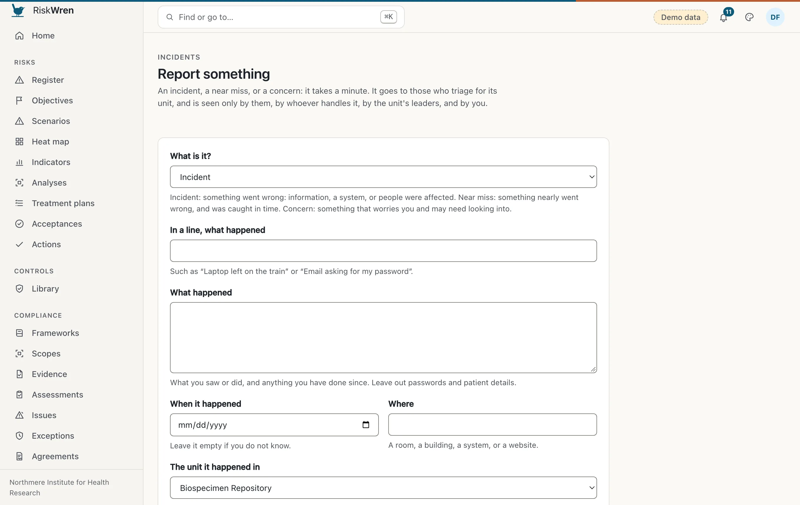
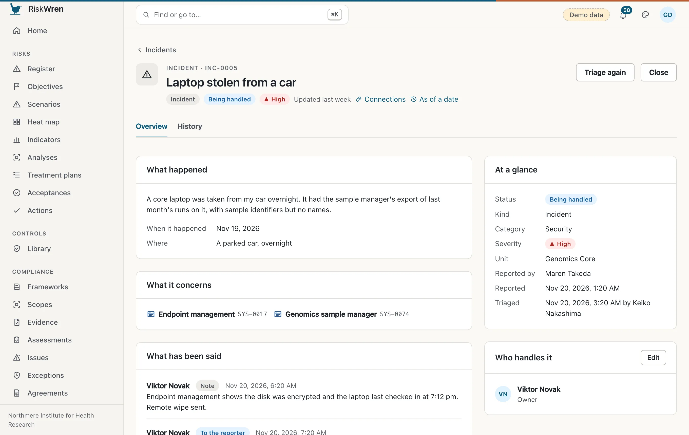

# Incidents

This guide is for everyone who reports something that went wrong, and for those who triage and handle it: most often the security team, and the risk and compliance offices. An incident is a record of its own, on the same record as the risks and controls: something that happened, nearly happened, or worries someone. It is not an issue. An issue is something to put right; an incident is something that happened.

## Reporting something

**Incidents → Report something** takes a minute, from anyone signed in. It asks:

| Question | What to give |
|---|---|
| What is it? | **Incident:** something went wrong, and information, a system, or people were affected. **Near miss:** something nearly went wrong, and was caught in time. **Concern:** something that worries you and may need looking into |
| In a line, what happened | Such as "Laptop left on the train" |
| What happened | What you saw or did, and anything you have done since. Leave out passwords and patient details |
| When it happened | A day, if you know it. It cannot be a day still to come |
| Where | A room, a building, a system, or a website |
| The unit it happened in | Your own unit, unless you say otherwise. If you are not sure, leave it: triage puts it right |

**Send the report** gives it a reference (`INC-0007`) and tells those who triage for its unit. You can follow it from **Incidents**, where **Reported by me** lists what you sent.

## Who sees a report

A report is seen by those who need to, and by nobody else:

- **Whoever reported it.** They see what they reported, where it stands, who handles it, and what is said to them. They do not see the handling itself: its severity, the records it concerns, notes among those handling it, or its history.
- **Those who handle it,** named at triage.
- **Those who triage for its unit:** managers, and assessors for the unit. An assessor for the whole organization, as a security team's usually is, triages everywhere.
- **The leaders and stewards of its unit,** and of the units above it.
- **Those who read everything:** managers for the whole organization, auditors, and administrators.

Lists, search, and counts follow the same rule. Someone else in the same unit, or a steward of another unit, does not know it exists. A [restricted case](#restricted-cases) narrows this further.

## Triage

A new report waits on the home page of everyone who triages for its unit, with **Triage**. Triage gives it:

| | |
|---|---|
| Category | From the program's list of incident categories: security, privacy, safety, conduct, compliance, operations, and other, to begin with. **Admin → Program → Vocabularies** renames them and adds to them |
| Severity | On the same scale as issues: critical, high, moderate, or low |
| Unit | Where it belongs, if the reporter did not know. Moving it moves who sees it |
| The records it concerns | Systems, services, information, third parties, processes, risks, controls, and scopes, from those you can see |
| Who handles it | One person, who is told, and finds it on their home page until it is closed |

Triage can be done again while it is open: a new handler takes the place of the last, and the records named are set again. A record named by someone else that you cannot see stays: you cannot take away what you cannot know is there. Everything triage does is in the incident's history.

## Handling it

Those handling an incident, and those who see all of it, write on it under **What has been said**. Each thing written is either:

- **Only those handling it:** a note, for the people working on it.
- **The reporter too:** a message to whoever reported it, who is told. They answer on the same page, and whoever handles it is told.

When it is done, **Close** asks how it ended, and the reporter is told it is closed. Its handlers close it, or those who triage it. Those who triage it can **Reopen** it.

## Breach assessment

An incident that may involve protected information is assessed for whether it must be notified, on its **Breach assessment** tab, by those who handle or triage it. Do it as soon as protected information may be involved: the clock runs from when the breach was **discovered**, the first day it was known, or would have been known with reasonable care, to anyone working for the organization.

An assessment records:

| | |
|---|---|
| When it was discovered | A day and a time. Every deadline counts from it |
| The protected information involved | Health information, personal information under a state's law, customer financial information, research participants' information, controlled or covered defense information, sign-in credentials, or other. The list is a program vocabulary |
| How many people | About how many it concerns, and the most of them living in any one state |
| Whether it was secured | Encrypted or destroyed, so as to be unusable, unreadable, or indecipherable to anyone not allowed to see it |
| An exception | Unintentional access in good faith by someone working for the organization; an inadvertent disclosure between two people allowed to see it; or a disclosure to someone who could not reasonably have kept it |
| The four factors | What was involved, who used or received it, whether it was actually taken or seen, and how far the risk has been reduced: each low, moderate, or high, with why |
| The conclusion | It must be notified, it need not be, or not yet decided; and why |
| The rules that apply | Those built in, and any state's law or contract, named, with the days or hours it allows |

Beside it is **what the factors point to**. A use or disclosure that was not allowed is presumed a breach, to be notified, unless the information was secured, an exception applies, or the factors show a low probability that it was compromised. That is the HIPAA Breach Notification Rule's test, and a sound one for other information too. The conclusion is yours, and the reason you give is what a regulator will ask about.

An assessment is never edited. **Assess it again** as more is learned: the new one supersedes the last, and the history keeps both.

### What is due, and by when

From the assessment, **What is due** lists every notification the rules that apply require, to whom, and by when, soonest first. While the conclusion is not yet decided, it shows what would be due if it is a breach: the clock is running. Once it is concluded that it need not be notified, nothing is due.

| Rule | Notify | By |
|---|---|---|
| HIPAA Breach Notification Rule | Each individual affected | 60 days after discovery |
| | The Secretary of Health and Human Services | 500 or more people: 60 days after discovery. Fewer: 60 days after the end of the year it was discovered |
| | Prominent media outlets, where more than 500 residents of one state are affected | 60 days after discovery |
| HIPAA, as a business associate | The covered entity | 60 days after discovery |
| FTC Safeguards Rule | The Federal Trade Commission, where 500 or more consumers' unencrypted information is involved | 30 days after discovery |
| DFARS 252.204-7012 | The Department of Defense, through DIBNet | 72 hours after discovery |
| A state's breach law | Each resident affected, and whoever else the law names | As long as you say the law allows |
| A contract or agreement | The party it names | As long as you say it allows |

These are the outer limits; each rule asks for notice without unreasonable delay. States' laws differ in what they cover, whom they require to be told, and how long they allow: name each that applies, and check what it says. A delay a law enforcement official asks for is recorded in the assessment's reasons; the dates shown do not move for it.

Each notification still to make waits on the home page of whoever handles the incident, overdue first. **Record a notification** says which rule and whom it was for, who was notified, when it was sent, how many people were told, how, and any reference a regulator gave. Notifications are never edited, and each is in the history.

## Restricted cases

Some incidents must be kept to a few: a concern about how someone behaves, about the people who lead a unit, or one that may become a matter for lawyers. **Restrict it**, under **Who sees it** on the incident, makes it a restricted case. It is then known only to:

- **Those named on the case,** chosen when it is restricted and changed later under **Change who is named**. Whoever restricts it is named, so as not to lose sight of it.
- **Its handlers,** who are named on it by being its handlers.
- **Whoever reported it,** who sees their report as before.

Nobody else learns that it exists: not its unit's leaders and stewards, not those who triage, and not those who read everything, managers, auditors, and administrators included. It is left out of their lists, search results, counts, and the history of everything, and asking for it by its reference answers as though there were nothing there. The notices that told them of it when it was reported are taken back, though a notice already sent as email cannot be. Its events stay in the history's chain, which `riskwren verify` checks as before. A gap in the numbering (`INC-0004`, then `INC-0006`) is all that is left to see.

Those who handle it, and those who triage for its unit and are named on it, may restrict it, change who is named, and **Lift the restriction**, which gives it back to everyone who would otherwise see it. Each of these is in its history. When its handler leaves, it passes to someone else named on it, never to someone who could not see it; if there is nobody, it stays as it is, and those named on it name a new handler.

## Reporting without a name

Some things are not reported if a name must go with them. Where the organization chooses, anyone may report a concern, an incident, or a near miss without signing in, at `/report`. The sign-in page offers it.

It is closed until an administrator opens it, under **Admin → Program → Who sees what**. When it is open:

- **Nothing about who sent a report is kept:** no account, no name, and no address. Someone signed in who uses the page is not named either. The history says it was reported without a name.
- **The reporter is shown a follow-up code, once.** It is four groups of five letters and numbers, and only a digest of it is kept, so nobody here can look it up for them. With it, at `/report` under **Follow up a report**, they see where their report stands, read what those handling it say to them, and add to it. They do not see who handles it.
- **The code is typed however it comes:** small letters, no dashes, or an O for a zero.
- **Failed codes are not counted against the address they came from,** unlike the other links, so nothing ties a report to where it was sent from. A code is long enough (100 bits) that guessing one is hopeless.
- **At most 30 reports an hour are taken,** from everyone together, so that the page cannot be used to flood the organization.

A report made this way goes to those who triage for the organization as a whole, who move it to the right unit. Those handling it write to the reporter as to anyone: what they share, the reporter reads when they come back with the code.

Whether the web server in front of RiskWren keeps addresses in its own log is decided where it runs, not here. If reporting without a name is open, check that log too: see [Run behind a reverse proxy](configuration.md#run-behind-a-reverse-proxy).

