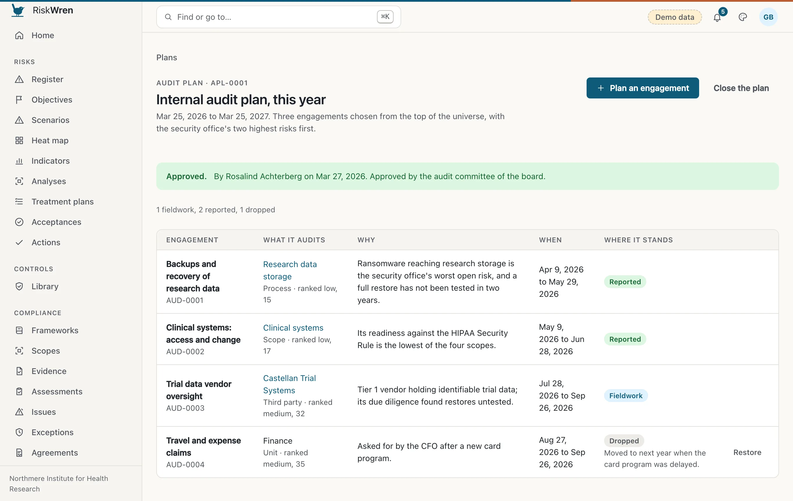
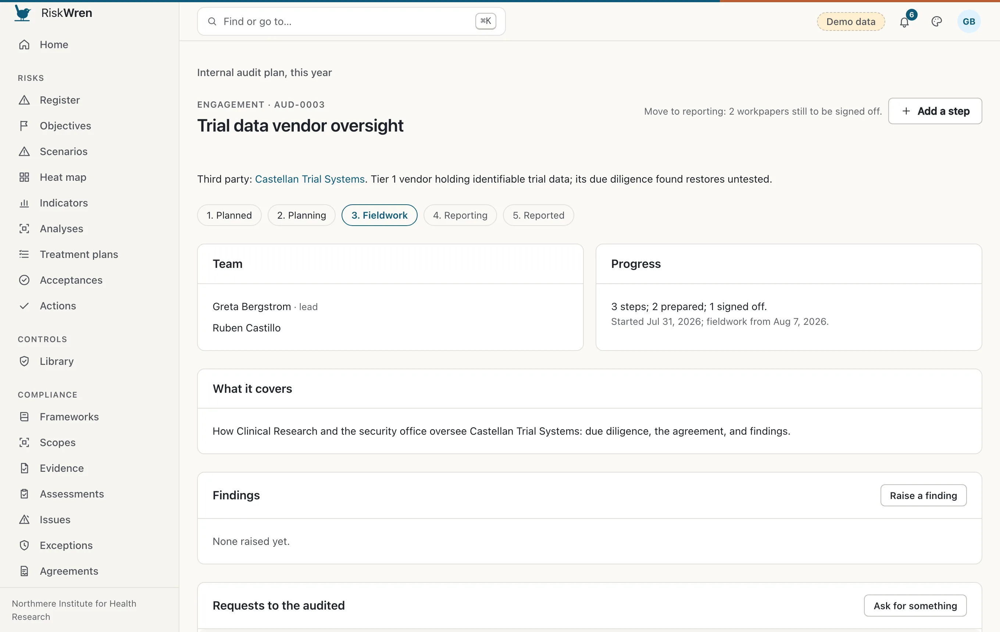
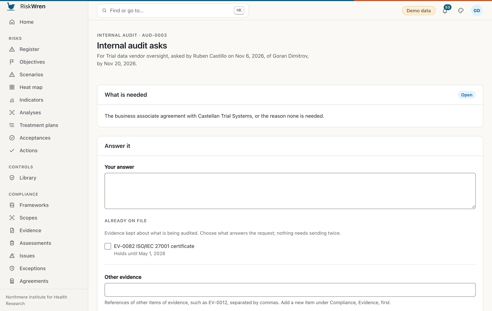
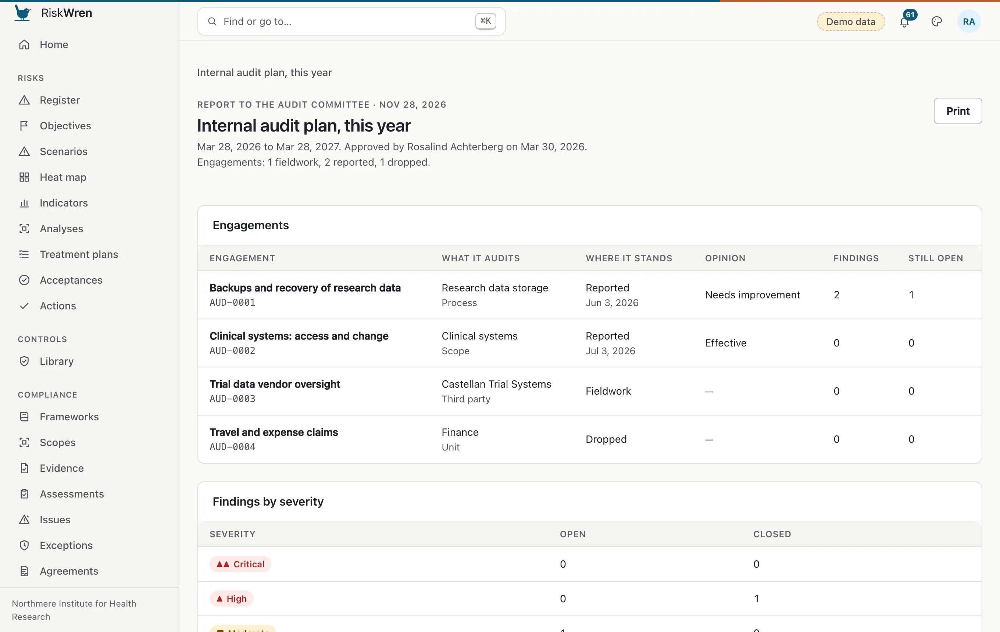
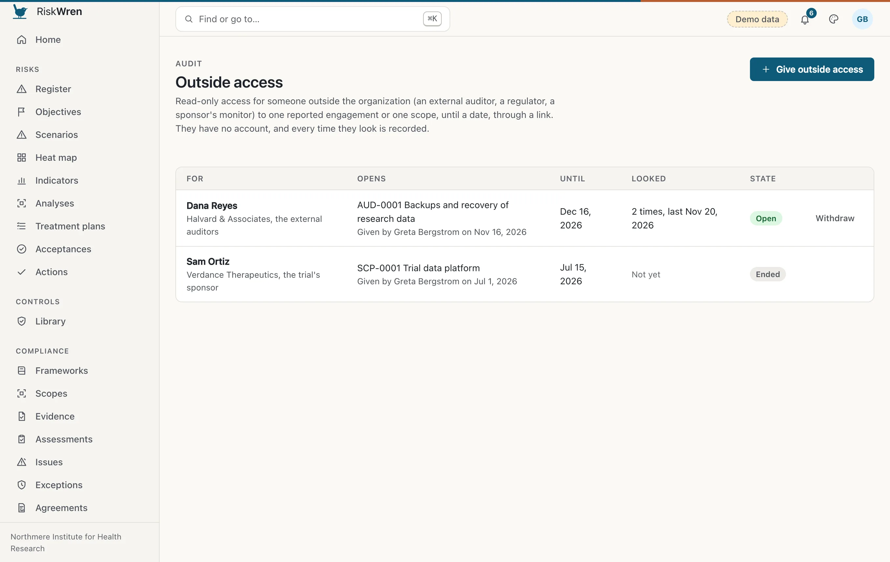

# Internal audit

This guide is for internal audit, the third line: those who decide what is worth auditing, plan a period's work, and carry it out on the same record the first and second lines keep. Auditors read every record and its history, with two exceptions given under [Who sees what](#who-sees-what). They touch the register in one way: a finding they raise is an issue, and it is auditors who confirm its closure, withdraw it, or reopen it. The rest of this guide is the audit function's own records: the universe, the plans, and the engagements in them. What an auditor does in the first weeks is in [Your part in it](roles.md#internal-audit-auditors), and the [worked example](#a-worked-example-from-plan-to-committee-report) at the end takes one plan from draft to the committee.

## The universe

**Audit → Universe** lists everything worth auditing: every unit beneath the organization, and every process, system, third party, and scope in use. Nothing is kept by hand: a thing joins the universe when it is added to the inventory, and leaves when it is retired.

Each is ranked by what the register says about it today, highest first. A ranking is the sum of its parts, and **How** beside it shows each part with the points it gave:

| Part | Points |
|---|---|
| Its worst open risk | Up to 30, by where the residual rating of the worst open risk that concerns it sits on the scale. For a unit, the risks of the unit and everything beneath it |
| Risks above appetite | 4 for each open risk above appetite, up to 16 |
| Open issues | 2 for each, and 2 more for each one critical or high, up to 16. For a process, system, or third party, the issues about it and about its risks |
| Criticality | Up to 15, by where its criticality sits on the program's scale |
| Readiness | For a scope, up to 20, by the share of the requirements that apply that are not yet verified or in place |
| Since it was last audited | 20 if never, 15 after three years, 10 after two, 5 after one |
| Moved by audit | What an auditor added or took away, with the reason |

A ranking of 55 or more is **high**, 30 or more **medium**, and the rest **low**. Because it is worked out from the register each time, it moves when the register does: a risk rated lower, an issue closed, or an audit reported takes a thing down without anyone touching the universe.

The list can be cut to one kind of thing (**Every kind** chooses). **Last audited** says when each was last audited, and **Planned** names the engagements on it that are planned or under way, in any plan. **Left out (n)** shows what audit has left out, and **Show the universe** goes back.

### What audit says about a thing

An auditor's **Say** beside a thing records what audit knows that the register does not:

- **Move it up or down,** by up to 30 points either way, with the reason: a tip-off, a change of system, a regulator's interest. The move is a part of its ranking like any other, with the reason as its label. Zero takes a move away.
- **An audit before RiskWren:** when it was last audited, and by which audit, so that it is not counted as never audited.
- **Leave it out,** with the reason: a thing another body audits, or one too small to be worth it. **Left out** lists them.

Everything audit says is in the history.

## The plan

**Audit → Plans** holds a plan for each period: the engagements internal audit means to carry out, each on one thing from the universe, with the reason for it and when it is planned.

**Draft a plan** names it, gives its period (**From** and **To**), and says what it sets out to do. On the plan, **Plan an engagement** chooses what it audits from the universe, highest ranked first, names the engagement, says why it is in the plan, and gives when it starts and ends, which must fall within the plan's period.

A plan is **approved** by someone with the standing to: an auditor other than the one who drafted it, recording the approval of the audit committee, or a leader of the whole organization. **Approve the plan** asks on whose authority, and when; it is not offered to the auditor who drafted it. A plan with nothing in it is not approved. Once approved it is tracked against: each engagement says where it stands (planned, under way, reported, or dropped), and the plan counts them.

An engagement can still be added after approval, and is marked as added after approval. Until it starts, an engagement can be **dropped** with the reason (**Drop**), never deleted, and a dropped one can be put back (**Restore**). Once an engagement has started, the page offers no way to drop it.

Plans and engagements are not edited once added: a plan's name and period, and an engagement's name, reason, and dates, stay as they were given. To change an engagement that has not started, drop it, saying why, and plan it again.

Nothing closes a plan by itself, not even the end of its period. An auditor closes an approved plan with **Close the plan**, at any time and without being asked to confirm. A closed plan takes no more engagements, and offers no **Drop** or **Restore**; engagements already under way carry on to their reports. A draft plan cannot be closed.

## Engagements

An engagement planned in a plan is started by an auditor with **Start it**: its **Lead**, **The rest of the team** (auditors all), and **What it covers**. The team cannot be changed after the start, so choose it then: an engagement needs at least two auditors to finish (see [why](#why-one-auditor-is-not-enough)).

It then moves through its stages, each moved on by its lead with the button that names the next:

| Stage | Moves on with | When |
|---|---|---|
| **Planning** | **Start fieldwork** | The program of work has at least one step |
| **Fieldwork** | **Move to reporting** | Every workpaper is signed off |
| **Reporting** | **Issue the report** | The report is written: **What the engagement found**, and an **Opinion** (effective, needs improvement, or ineffective) |
| **Reported** | | It is done, and cannot be reopened. The thing it audited counts as audited that day, in the universe |

While something stands in the way, the page says what, in place of the button: "3 workpapers still to be signed off".

### Workpapers

Each step of the program of work has a **workpaper**: what was to be done, what was done, what was found, and the evidence, by reference to items of evidence already kept (`EV-0012`). Steps are added with **Add a step** while planning or during fieldwork; work is recorded during fieldwork.

- **Record the work** on a step says what was done and found, and the evidence. **Record again** changes it. Whoever recorded it last is its **preparer**.
- Another member of the team reviews it: **Add a review note** asks about something, the preparer replies with **Answer**, and the one who wrote the note settles it with **Clear**.
- **Sign off** is done by a member of the team other than its preparer, once every note on it is cleared.
- Recording the work again after sign-off, or a new note, undoes the sign-off.

### Requests to the audited

While an engagement is being planned or in fieldwork, its team asks the audited for what it needs: **Ask for something** on the engagement, with **What is needed**, who it is **Asked of** (anyone who can sign in), and **By** when. The request waits on that person's Home as "Internal audit asks: …". They see what is asked, by whom, for which engagement, and by when, and nothing else of the engagement's work.

The person asked is not sent a notice or an email, and requests are not in the [email reminders](running-the-program.md#reminders), so one that runs late is chased by the team: the engagement's list of requests marks it **Past its date**. Tell the person when you ask.

They answer in words, with evidence, or both, and **Send the answer**. The evidence already kept about the thing being audited is offered first, under **Already on file**, so that nothing already on file is sent again:

| The engagement is about | What is offered |
|---|---|
| A scope | The scope's evidence, and the evidence of the controls it uses |
| A third party | Its reports and certificates |
| A unit, a process, or a system | Nothing: evidence is kept on controls and scopes, not on these |

Anything else is added under **Compliance → Evidence** first and named by its reference under **Other evidence**. The answer waits on the team's Home as "Read the answer: …": they **Accept it**, or **Send it back** with what is still needed, and it is open again for the person asked.

### Independence

Until an engagement is reported, its work is its team's alone. Others who may read the plans see that it exists, who is on it, how many steps are prepared and signed off, and where it stands, and nothing of what it covers, what was done, or what was found; neither does another auditor who is not on its team. The history records every change to a workpaper, a review note, and a request, but keeps their words out of it, so that reading the history does not undo that. Once the report is issued, the whole of it opens to those who read the plans.

## Findings and follow-up

During fieldwork or reporting, the team raises a **finding** with **Raise a finding**: the finding in a line, what was found, its severity, and who **Answers for putting it right**, the manager who agrees and owns the action plan. A finding is an issue in the one register everyone works from, marked as coming from internal audit and from which engagement, in the unit of the thing audited, and about the scope when the engagement is on one; its date follows from its severity like any other. It is shared with management as soon as it is raised, and its owner is told, which is how its action plan is agreed: **management's action plan** is the issue's actions, each with an owner and a date. See [Issues and exceptions](issues-and-exceptions.md#findings-of-internal-audit).

When management says it is put right (**Propose closure** on the issue), it is **internal audit, not the second line, that confirms it closed**, or sends it back with what is missing: any auditor other than its owner and whoever proposed the closure. The closure waits on every auditor's Home, and the engagement's team is told. **Confirm closure** offers **Confirm, and close it** and **Send it back**. Only an auditor, and never one who owns it, can **Withdraw** a finding raised in error. Only an auditor can **Reopen** one that was not put right.

## The committee report

Each plan's **Committee report** is the page for the audit committee. It shows:

- the plan, and who approved it;
- each engagement, with what it audits, where it stands, and its opinion;
- how many findings each engagement raised, and how many are still open;
- the findings by severity, open and closed;
- the findings, and management's actions, that are past their date.

**Print** prints it without the application around it.

It is worked out afresh each time it is opened, so it is always current and never kept. For the committee's papers, print it, or save it as a PDF from the print dialog, on the day.

## Outside auditors

An external auditor relying on internal audit's work, a regulator, or a sponsor's monitor is not given an account. **Audit → Outside access → Give outside access** gives one of them a link to exactly one thing, read-only, for up to 90 days: who it is **For**, whom they are **With**, what it **Opens**, for how many **Days**, and **Why**. It opens either:

- a **reported engagement**: its report and opinion, what it covered, its team, its program of work with every workpaper (what was to be done, what was done and found, the evidence it names, who prepared it and who signed it off), and its findings with where each stands. Not its requests to the audited and their answers, and not its review notes; or
- a **scope**: what it is and its boundary, each framework's requirements and where each stands, how each control is done there, its evidence (which items, when collected, and until when they hold), and its plan of action.

The link is a long random token, of which only a digest is kept. It is shown once, to the auditor who gives it, and RiskWren does not send it: send it on yourself. It follows a `#` in the address, which a browser never sends to a server, so it is in nobody's logs. It opens that one page and nothing else, and stops working on its date or when an auditor withdraws it (**Withdraw**). **Every time it is used, the history records who looked, at what, and when**, on the engagement or scope itself, and the list says how often and when last.

## Who sees what

| | Reads the universe and the plans | Changes them |
|---|---|---|
| Auditors | Yes | Yes |
| Managers for the whole organization, and administrators | Yes | No |
| Leaders of the whole organization | Yes, and may approve a plan | No |
| An engagement's team | Its work, while it is under way | Its work |
| Someone outside with a link | One reported engagement or one scope, read-only, until its date | No |
| Everyone else, managers and leaders of a unit included | No | No |

A person asked for something sees that request, and nothing else of the engagement. A finding, as an issue, is seen as any issue is ([Who sees an issue](issues-and-exceptions.md#who-sees-an-issue)).

Beyond audit's own records, an auditor reads every record and its history, restricted ones included, but not an incident case restricted to those named on it ([Restricted cases](incidents.md#restricted-cases)). Within audit's records, an auditor not on an engagement's team sees its work only once it is reported ([Independence](#independence)).

## A worked example: from plan to committee report

### Why one auditor is not enough

Three of RiskWren's rules keep internal audit's work in more than one pair of hands:

- A plan's drafter cannot approve it.
- A workpaper's preparer cannot sign it off, and fieldwork cannot end until every workpaper is signed off.
- Neither a finding's owner nor whoever proposed its closure can confirm it closed. Management owns the finding and proposes its closure; an auditor confirms it, so an auditor should never be named to answer for one.

So a function of one auditor can draft a plan but not approve it, and can start an engagement but never take it past fieldwork. It needs two auditors on each engagement, and either a second auditor or a leader of the whole organization to approve the plan. Where the function is one person, the second can be a co-sourced auditor working for it, with an account of their own and the auditor role. That role reads every record, restricted ones included, with two exceptions: an incident case restricted to those named on it, and the work of an engagement the auditor is not on until it is reported (see [Who sees what](#who-sees-what)). Give it only to someone bound to the function's confidentiality.

### From draft to report

The demo's Director of Internal Audit, Greta Bergstrom, has drafted next year's plan, with "Medication dispensing controls" in it: audit moved Medication dispensing up the universe after near misses at the pharmacy. Her colleague Ruben Castillo, a senior auditor, is the second auditor.

In the [demo](getting-started.md#explore-the-demo-organization) you can sign in as the auditor (Greta) and as the executive, and do Greta's part of every step. Ruben and the pharmacy's manager are not among the sample people the demo's sign-in page offers, so their parts cannot be done there, and the engagement cannot be taken past fieldwork. Where a step needs them, it names an engagement in this year's plan that shows the same stage done: "Trial data vendor oversight", still in fieldwork, and "Backups and recovery of research data", reported, with two findings.

1. **The universe.** Under **Audit → Universe**, Medication dispensing is ranked high, and **How** shows the points audit added, with the reason. **Planned** names the engagement on it.
2. **The plan.** On **Audit → Plans**, open the draft. **Plan an engagement** adds another from the top of the universe, with why it is in the plan and dates within the plan's period. Greta is not offered **Approve the plan**: she drafted it.
3. **Approval.** Sign in as the executive, a leader of the whole organization, open the plan, and **Approve the plan**: "Approved by the audit committee of the board at its December meeting." From then on the plan is tracked against, and the committee report names who approved it.
4. **Start it.** As Greta, open "Medication dispensing controls" and **Start it**: Greta as **Lead**, Ruben ticked under **The rest of the team**, and **What it covers**: the objectives, the period, and what is in and out. Until the report is issued, only the two of them see its work.
5. **The program of work.** **Add a step** for each part: "Overrides are reviewed each day", "Counts of controlled substances are witnessed", "Access to the cabinets is removed when people leave". **Start fieldwork**.
6. **A request.** **Ask for something** of the pharmacy's manager: "The list of everyone who could open the cabinets on the first of the month, and the leavers' dates", by a date two weeks on. It waits on their Home; tell them it is there. The engagement is on a process, so nothing is offered as already on file: they name the evidence by its reference. Their answer waits on the team's Home: **Accept it**, or **Send it back** saying what is still needed. In the demo, Greta's Home has such an answer waiting, from the security leader, on "Trial data vendor oversight".
7. **The work, reviewed.** Ruben opens the first step and uses **Record the work**: what was done, what was found, and the evidence by reference. Greta uses **Add a review note**: "Which days were sampled?" Ruben replies with **Answer**, Greta uses **Clear**, then **Sign off**. Greta records the second step herself, and Ruben signs it off. The third step is done the same way. In the demo, as Greta, use **Record the work** on a step: **Sign off** is then not offered to her on it, because she prepared it. "Trial data vendor oversight" shows the exchange part way: its first step signed off, and Greta's review note on the second waiting for Ruben's answer.
8. **A finding.** Two people who had left could still open the cabinets. **Raise a finding**: "Leavers keep access to the dispensing cabinets", high, answered for by the pharmacy's manager. It is an issue at once: its owner is told and agrees the action plan by adding actions with owners and dates. In the demo, Greta can raise it; the findings of "Backups and recovery of research data" show action plans agreed.
9. **The report.** When every workpaper is signed off, Greta uses **Move to reporting**, then **Issue the report**, with what the engagement found and the opinion, needs improvement. The engagement's work opens to those who read the plans, and Medication dispensing counts as audited that day. In the demo, "Backups and recovery of research data" shows a report with that opinion, and "Clinical systems: access and change" one found effective.
10. **Follow-up.** When the actions are done, the pharmacy's manager uses **Propose closure** on the issue. It waits on every auditor's Home. Greta or Ruben, neither of whom owns it or proposed it, opens it and uses **Confirm closure**, then **Confirm, and close it**. In the demo, one finding of "Backups and recovery of research data" is closed this way, and the other is still open with its action.
11. **The committee.** On the plan, **Committee report**: each engagement with its opinion and findings, the findings by severity, and what is past its date. **Print** it for the committee's papers. In the demo, this year's plan has the fuller report.
12. **The external auditors.** Under **Audit → Outside access**, **Give outside access** to the reported engagement, for 30 days, for the external auditors' manager. Copy the address shown and send it to them. Each time they open it, the engagement's history records it. In the demo, the external auditors already have a link to "Backups and recovery of research data".
