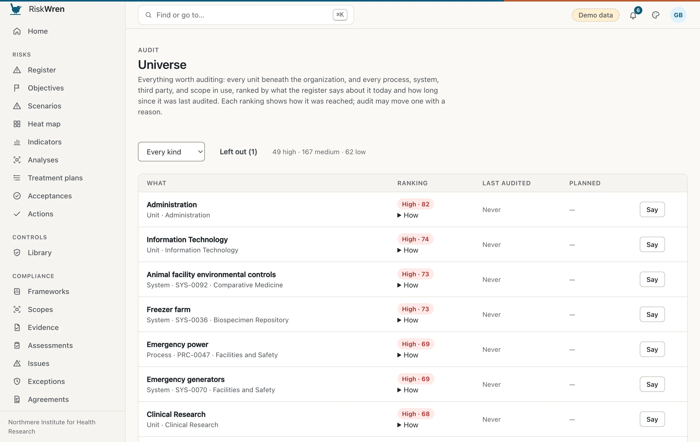

# Internal audit

This guide is for internal audit, the third line: those who decide what is worth auditing, plan a period's work, and carry it out on the same record the first and second lines keep. Auditors read every record and its history, as before, and change none of them. What this guide covers is the audit function's own records: the universe, the plans, and the engagements in them.

## The universe

**Audit → Universe** lists everything worth auditing: every unit beneath the organization, and every process, system, third party, and scope in use. Nothing is kept by hand: a thing joins the universe when it is added to the inventory, and leaves when it is retired.

Each is ranked by what the register says about it today, highest first. A ranking is the sum of its parts, and **How** beside it shows each part with the points it gave:

| Part | Points |
|---|---|
| Its worst open risk | Up to 30, by where the residual rating of the worst open risk that concerns it sits on the scale. For a unit, the risks of the unit and everything beneath it |
| Risks above appetite | 4 for each open risk above appetite, up to 16 |
| Open issues | 2 for each, and 2 more for each one critical or high, up to 16. For a process, system, or third party, the issues about it and about its risks |
| Criticality | Up to 15, by where its criticality sits on the program's scale |
| Readiness | For a scope, up to 20, by the share of the requirements that apply that are not yet verified or in place |
| Since it was last audited | 20 if never, 15 after three years, 10 after two, 5 after one |
| Moved by audit | What an auditor added or took away, with the reason |

A ranking of 55 or more is **high**, 30 or more **medium**, and the rest **low**. Because it is worked out from the register each time, it moves when the register does: a risk rated lower, an issue closed, or an audit reported takes a thing down without anyone touching the universe.

### What audit says about a thing

An auditor's **Say** beside a thing records what audit knows that the register does not:

- **Move it up or down,** by up to 30 points either way, with the reason: a tip-off, a change of system, a regulator's interest. The move is a part of its ranking like any other, with the reason as its label.
- **An audit before RiskWren:** when it was last audited, and by whom, so that it is not counted as never audited.
- **Leave it out,** with the reason: a thing another body audits, or one too small to be worth it. **Left out** lists them.

Everything audit says is in the history.

## The plan

**Audit → Plans** holds a plan for each period: the engagements internal audit means to carry out, each on one thing from the universe, with the reason for it and when it is planned. An auditor drafts a plan and plans its engagements, choosing from the universe, highest ranked first.

A plan is **approved** by someone with the standing to: an auditor other than the one who drafted it, recording the approval of the audit committee (say on whose authority, and when), or a leader of the whole organization. A plan with nothing in it is not approved. Once approved it is tracked against: each engagement says where it stands (planned, under way, reported, or dropped), and the plan counts them.

An engagement can still be added after approval, and says so. One that will not be done is **dropped** with the reason, never deleted; a dropped one can be restored. When the period is over the plan is **closed**, and takes no more.

## Engagements

An engagement planned in a plan is **started** by an auditor, with its lead, the rest of its team (auditors all), and what it covers. It then moves through its stages, each moved on by its lead:

| Stage | Moves on when |
|---|---|
| **Planning** | The program of work has at least one step |
| **Fieldwork** | Every workpaper is signed off |
| **Reporting** | The report is written: what the engagement found, and an opinion (effective, needs improvement, or ineffective) |
| **Reported** | It is done. The thing it audited counts as audited that day, in the universe |

### Workpapers

Each step of the program of work has a **workpaper**: what was to be done, what was done, what was found, and the evidence, by reference to items of evidence already kept. Whoever records the work is its **preparer**. Another member of the team reviews it: a **review note** asks about something, the preparer answers it, and the one who wrote it clears it. A workpaper is **signed off** by a member of the team other than its preparer, once every note on it is cleared. Recording the work again after sign-off, or a new note, undoes the sign-off.

### Requests to the audited

While an engagement is being planned or in fieldwork, its team asks the audited for what it needs: **Ask for something** on the engagement, with what is needed, the person asked (anyone who can sign in), and by when. The request is on that person's home page. They see what is asked, by whom, for which engagement, and by when, and nothing else of the engagement's work.

They answer in words, with evidence, or both. The evidence already kept about the thing being audited (and, for a scope, about the controls it uses) is offered first, so that nothing already on file is sent again; anything else is added under **Compliance → Evidence** first and named by its reference. The answer is on the team's home pages to read: they **accept** it, or **send it back** with what is still needed, and it is open again for the person asked.

### Independence

Until an engagement is reported, its work is its team's alone. Others who may read the plans see that it exists, who is on it, and where it stands, and nothing of what it covers, what was done, or what was found; neither does another auditor who is not on its team. The history records every change to a workpaper, a review note, and a request, but keeps their words out of it, so that reading the history does not undo that. Once the report is issued, the whole of it opens to those who read the plans.

## Findings and follow-up

During fieldwork or reporting, the team raises a **finding**: what was found, its severity, and the manager who answers for putting it right. A finding is an issue in the one register everyone works from, marked as coming from internal audit and from which engagement; its date follows from its severity like any other. It is shared with management as soon as it is raised, which is how its action plan is agreed: **management's action plan** is the issue's actions, each with an owner and a date. See [Issues and exceptions](issues-and-exceptions.md).

When management says it is put right, it is **internal audit, not the second line, that confirms it closed**, or sends it back with what is missing: any auditor other than its owner and whoever proposed the closure. It waits on the auditors' home pages. Only auditors withdraw or reopen a finding.

## The committee report

Each plan's **Committee report** is the page for the audit committee: the plan and who approved it; each engagement with what it audits, where it stands, its opinion, and how many findings it raised and how many are still open; the findings by severity, open and closed; and the findings and management's actions past their date. It prints by itself.

## Who sees what

| | Reads the universe and the plans | Changes them |
|---|---|---|
| Auditors | Yes | Yes |
| Managers and administrators | Yes | No |
| Leaders of the whole organization | Yes, and may approve a plan | No |
| An engagement's team | Its work, while it is under way | Its work |
| Everyone else | No | No |
