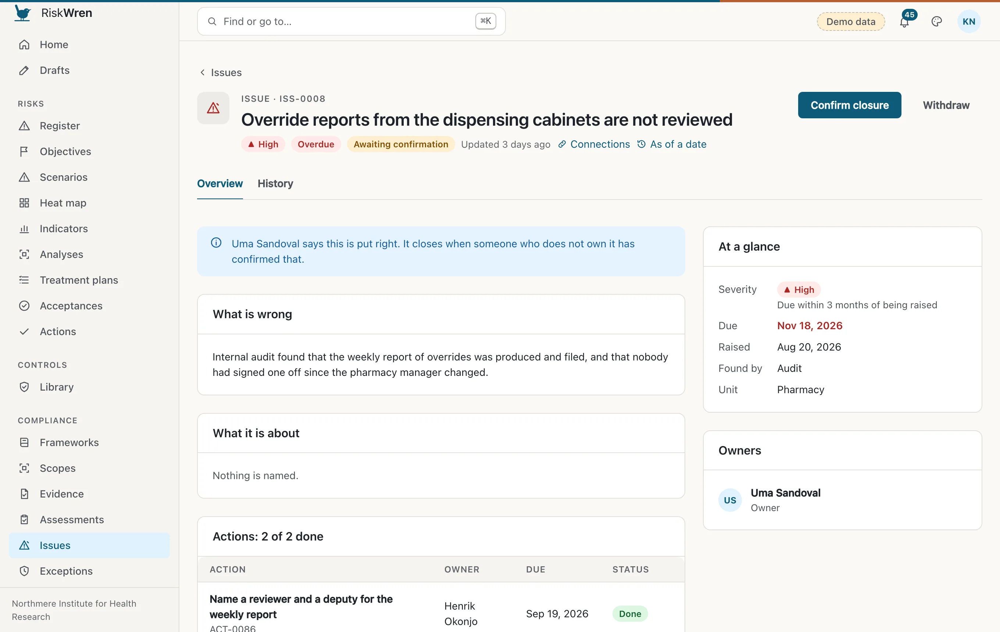
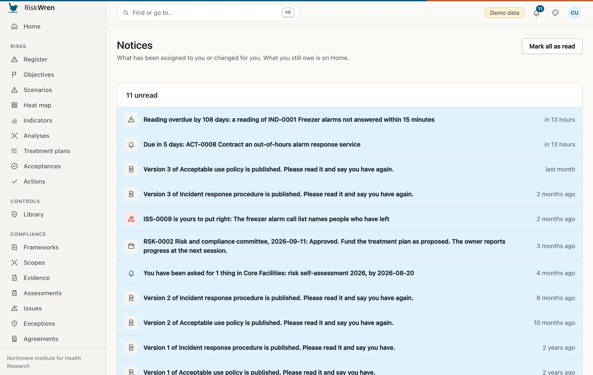

# Issues and exceptions

This guide is for whoever has to put something right, whoever checks that it was, and whoever decides when a departure is allowed for a while. It covers the issue register, where issues come from (tests, other systems, drafts, people), severity and dates, actions, closure, and what closing does and does not change; exceptions from asking to ending; the plan of action; and notices. Two walkthroughs follow the demo: [a failed test, through to closure](#a-failed-test-through-to-closure), and [an exception, from asking to ending](#an-exception-from-asking-to-ending).

## Issues

An issue is something found to be wrong that must be put right. **Compliance → Issues** is one register for all of them, whatever found them. **What found it** is one of these, as shipped:

| Found by | For example |
|---|---|
| **Test** | An assessment found a control partly effective or ineffective |
| **Gap** | A requirement that nothing answers in a scope, or a control with no evidence |
| **Security testing** | A penetration test, a scan, or a security exercise; also a failure another system reported |
| **Audit** | A finding from an internal or external audit |
| **Incident** | Something that went wrong showed it |
| **Exercise** | An exercise of a continuity plan showed it |
| **Review** | A review of a supplier, a system, or a process |
| **Observation** | Somebody noticed it and said so |

The list is one of the program's vocabularies, and can be changed (see [Vocabularies](running-the-program.md#vocabularies)).

### Raise an issue

**Issues → Raise an issue.** Anyone may raise one for a unit they work in or have a role over. Say what is wrong, in which unit, how serious it is, what found it, and what it is about: the controls, scopes, and risks concerned. Name who is to put it right (**Who is to put it right**, which starts as you); they are told.

On a scope's **Requirements** tab, **Raise an issue** beside a requirement that is a gap, planned, or failing starts one already about that requirement and that scope.

### Drafts

An assistant, or another system with a token, may propose an issue without raising it. The proposal is a **draft**, and waits under **Drafts**, beside Home in the menu, for someone who may make it: a steward or a manager of its unit, or an assessor for it. A draft with no unit waits for those whose roles cover the whole organization.

- **Open** fills in the **Raise an issue** form with what the draft proposes. Change what you like and save it; every rule for raising an issue applies, and the draft is marked as used.
- **Set aside** keeps the draft on record with your reason, which is required, and raises nothing.

Home has a line for those who may make drafts that are waiting; nothing is said under the bell. See [Drafts](other-systems.md#drafts).

### From a failed test

When a test result of partly effective or ineffective is confirmed, an issue is opened without anyone asking:

- it is named for the control and the assessment, and carries what the test found and what was looked at;
- it is found by **Test**, and is **high** if the control was found ineffective and **moderate** if partly effective;
- it belongs to the control's owners, who are told, and not to whoever found it;
- it names every scope that uses the control.

If an issue is already open for that control from an earlier test, that one stands and no second one is opened. If the control has no owner the issue has none either, and shows on Home for those who can name one.

### From a report by another system

A scanner or another system may report that a check on a control failed or partly passed. When someone who assesses the control's unit confirms the report, an issue is raised on the control, and on the scope if the report named one. It is found by **Security testing**, is high for a failure and moderate for partly unless the confirmer chooses otherwise, and goes to the control's owners, who are told. If the control has no owner, the confirmer keeps it. As with a failed test, while an issue about the control is open for that reason, a confirmed repeat joins it rather than raising another. See [What other systems report](evidence-and-testing.md#what-other-systems-report).

### Severity sets the date

Each severity has a written meaning, shown as you choose, and the issue is due a fixed time after it was raised:

| Severity | Due within |
|---|---|
| Critical | 30 days |
| High | 90 days |
| Moderate | 180 days |
| Low | 365 days |

The table is part of the program and can be changed (see [Running the program](running-the-program.md#cadences)). Changing an issue's severity applies the rule again, counted from the day it was raised.

**Move the date** changes it by hand. That needs a reason, and where the date started and every move stay on the record, with a count beside the date wherever the issue is listed.

### Put it right

An issue is worked through **actions**, each with an owner and a date: the same actions treatment plans use, on the same list of everything owed. **Add an action** on the issue. Whoever owns an action sees the issue, does their part, and marks it done.

### Close it

1. Its owner chooses **Propose closure**, and says what was done, **why it happened** (a root cause from a short list: procedure, people and time, ownership, technology, design, change, third party, or other), and cites the evidence that shows it. Open actions must be finished or cancelled first.
2. The issue then waits. An assessor or a manager for the unit sees it on Home and chooses **Confirm closure**: either **Confirm, and close it**, or **Send it back** with a note saying what is still missing.

**Nobody confirms the closure of an issue they own, or one they proposed closing.** The server refuses it.

Two more things belong to the second line alone:

- **Withdraw**, for an issue raised in error, is for an assessor or a manager for the unit who does not own the issue. An owner who could withdraw their own issue would never need its closure confirmed.
- **Reopen**, for one that turned out not to be put right, is for an assessor or a manager for the unit.

For a finding of internal audit, an auditor does both in their place, and withdraws only a finding they do not own: see [below](#findings-of-internal-audit).

**Closing an issue changes no rating and no readiness.** An issue is the work of putting something right; a requirement moves on what is known about its controls. A requirement that a failed test made failing stays failing after the issue closes, until a new test of the control is confirmed or the old result lapses. See [the walkthrough below](#a-failed-test-through-to-closure).

### Who sees an issue

An issue is known to those with a part in it: whoever raised it, those named on it, anyone with an action on it, and those with a role over its unit. Working in the unit is not enough. An issue can also be marked restricted.

### Findings of internal audit

An issue raised by internal audit from an engagement says so on its page. Its closure is confirmed by an auditor rather than by an assessor or a manager. Only an auditor withdraws it, and never one who owns it; only an auditor reopens it. See [Findings and follow-up](internal-audit.md#findings-and-follow-up).

## A failed test, through to closure

In the demo, the security team's assessment of central information technology found that removing access when people leave works only in part: the accounts of three people on fixed-term contracts stayed active for up to three weeks, because their end dates never reached the identity team. Sign in to the demo as the assessor or the risk manager to follow it.

1. **The result is confirmed.** When the second assessor confirms it, the control's rating becomes partly effective. Every requirement it answers is failing, in central information technology and in the clinical systems and the data enclave, which inherit it. The risks it reduces are flagged if the controls now suggest a worse rating.
2. **An issue opens.** It is named for the control and the assessment, found by **Test**, moderate because the control was partly effective, and due in 180 days. It belongs to the control's owners, who are told, and it names every scope that uses the control, so it is on each scope's **Plan of action**.
3. **Cover the gap meanwhile, if you need to.** The issue does not make the requirements any less failing. If a scope cannot meet them until the fix is in, its keepers can [ask for an exception](#exceptions), saying what makes up for it. The demo's clinic did: its requirements answered by the control show **Excepted**, with *Underneath: failing* beside them, while the enclave's still show failing.
4. **Put it right.** Actions are added to the issue, each with an owner and a date, and each owner marks theirs done. In the demo there are two: disabling the three accounts and checking the last year's leavers for others, which is done; and sending contract end dates from the personnel system to the identity team each night, which is not yet. The demo stops here; the steps below are what follows.
5. **Propose closure.** The issue's owner chooses **Propose closure**, says what was done and why it happened, and cites the evidence that shows it.
6. **Confirm closure.** An assessor or a manager for the unit, who neither owns the issue nor proposed closing it, checks the evidence and chooses **Confirm, and close it**, or sends it back.
7. **Test it again.** The requirements are still failing: closing the issue changes nothing in readiness, because the last word on the control is still the failed test. Start a new assessment of the scope that does the control, with that control in it, as [Testing again](evidence-and-testing.md#testing-again) describes. When an effective result is confirmed, with evidence that still counts, the requirements become verified wherever the control is in place.

If nobody tests it again, the failed result lapses after twelve months, and the requirements become in place, never verified, until a test says so. If the retest is recorded through the API on the old test rather than in a new assessment, the evidence the old result cited stops counting at once: cite what shows the control works in the new result, or attach it to the control.

**A failure reported by another system** goes differently. Confirming the report raises an issue found by **Security testing**, owned by the control's owners (or by the confirmer, if the control has none), and closed the same way. But a report never rates the control, so nothing becomes failing, and closing the issue moves nothing either. If the failure matters to a scope's readiness, test the control in an assessment.

## Exceptions

An exception is an approved departure from a control, a requirement, or a document, for a time, with what makes up for it. It is the honest answer when something cannot be met yet and everyone knows it.

### Ask

An exception is asked for from a scope, by those who keep it (its owners, and the steward or a manager of its unit):

- on the **Requirements** tab, **Ask for an exception** beside a requirement that is a gap, planned, or failing;
- on the **Controls** tab, **Exception** beside a control, including one the scope inherits and cannot fix itself.

An exception to a policy, standard, or procedure is asked for from the document's own page, and decided by a leader or manager of the unit that keeps it ([Policies](policies.md#exceptions-to-a-document)).

Say why it is needed (**Why it is needed**), what is done in its place meanwhile (**What makes up for it meanwhile**), and the dates it runs between (**From** and **Until**). It is never open-ended: by default it runs for at most twelve months. **From** can be a later day, for a departure planned ahead; it covers nothing until then.

Until it is decided, whoever asked (or the unit's steward or a manager) can **Edit** the request, and whoever asked, or anyone who could decide it, can **Take it back**.

### Decide

A leader or a manager with authority over the scope's unit decides, and **whoever asked does not decide**. They are told, and see the request on Home. **Decide** on the request offers **Approve**, with **Until** brought forward if it should run for less time than was asked, and **Refuse**, which needs a reason. Asking changes nothing: an exception covers nothing until it is approved.

### While it is in force, and after

| State | What it means |
|---|---|
| **Requested** | Waiting to be decided. It covers nothing |
| **Approved, not yet begun** | Approved, with a **From** date still ahead. It covers nothing until that day |
| **In force** | It covers what it is an exception to |
| **Ends soon** | In force, and ends within 30 days |
| **Expired** | Its last day has passed |
| **Refused**, **Withdrawn** | Decided against, or taken back or ended early |

While an exception is in force, what it covers is shown as **excepted** in place of failing, a gap, or planned, with the state underneath said beside it. It does not improve on a control that is in place.

An exception to a control is the scope's own when it is asked for there. One asked for in the scope that provides the control covers that control in every scope that inherits or shares it.

The day after it ends, the state underneath is back, without anyone doing anything. Nothing has to run for that to happen: whether an exception is in force is worked out from its dates on the day.

Whoever asked sees it on Home a month before it ends. **Ask again** starts a new request that carries on from it, which is decided again. **End it early** withdraws one that is no longer needed, and needs a reason.

**Compliance → Exceptions** lists them, and can show those waiting to be decided, in force, ended, refused, or withdrawn, and those to a control, a requirement, or a document.

## An exception, from asking to ending

The demo's clinic relies on central information technology to remove access when people leave, and that control was found partly effective. Agency nurses are the gap: their end dates are not in the personnel system the identity team works from.

1. **Ask.** The clinic's steward opens **Clinical systems → Controls** and chooses **Exception** beside the inherited control. **Why it is needed**: the agency nurses' end dates do not reach the identity team, and a feed is being built. **What makes up for it meanwhile**: each Friday the nurse managers send the identity team the names of agency staff who have finished, and their accounts are disabled that day. **Until**: a date within twelve months.
2. **Decide.** The request goes to the leaders and managers of the clinic, who are told. The clinic's medical director approves it, with a note: until the feed is in, and not to be renewed without a date for it.
3. **In force.** On the clinic's **Requirements** tab each requirement the control answers shows **Excepted**, with the exception, its end date, and *Underneath: failing*. The data enclave, which inherits the same control, still shows failing: this exception is the clinic's.
4. **Ending.** A month before its last day it shows as **Ends soon**, and whoever asked sees it on Home. If the feed is in and a new test has found the control effective, let it end. If not, **Ask again**: the new request starts the day after the old one ends and is decided again, on what has changed. The day after it ends, the requirements show what is underneath.

The demo also has a request from the clinic waiting to be decided, for security training that agency staff cannot take in the learning system. Sign in as the risk manager, who manages the whole organization, to decide it.

## The plan of action

A scope's **Plan of action** tab lists the open issues that bear on it: those about the scope itself, and those about any control it uses or inherits. They are listed most severe first, each with its owner, its milestones (the actions, with who and when), and its date.

It prints, and it is the document a reviewer asks for: what is wrong, who is fixing it, and by when. **OSCAL** downloads it as a plan of action and milestones in the open assessment language; see [The security plan and OSCAL](compliance.md#the-security-plan-and-oscal).

## Notices

The bell at the top right counts what has been assigned to you or decided for you since you last looked. Notices come from every part of RiskWren, not only issues. Among them:

- an issue handed to you, an action that is yours, or a closure sent back;
- an exception approved or refused, or a request waiting for your decision;
- a reminder that something is due or late;
- a campaign's question;
- an incident you are named on;
- a document to approve or acknowledge;
- a supplier's answers to review;
- what someone who left handed to you.

A notice is a sentence and a place to go. It is not the record of what happened, which is in the history, and nobody is told about what they did themselves. **Mark all as read** clears the count. Where the organization has set up email, the same notices are sent as they happen or once a day, as each person chooses. **Home** remains the list of what you still owe.
