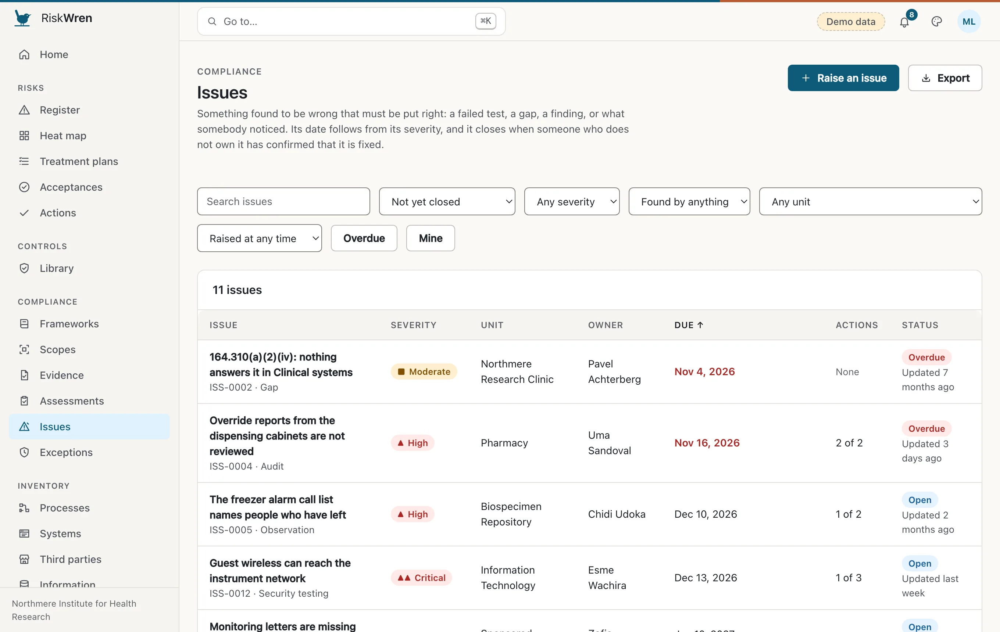
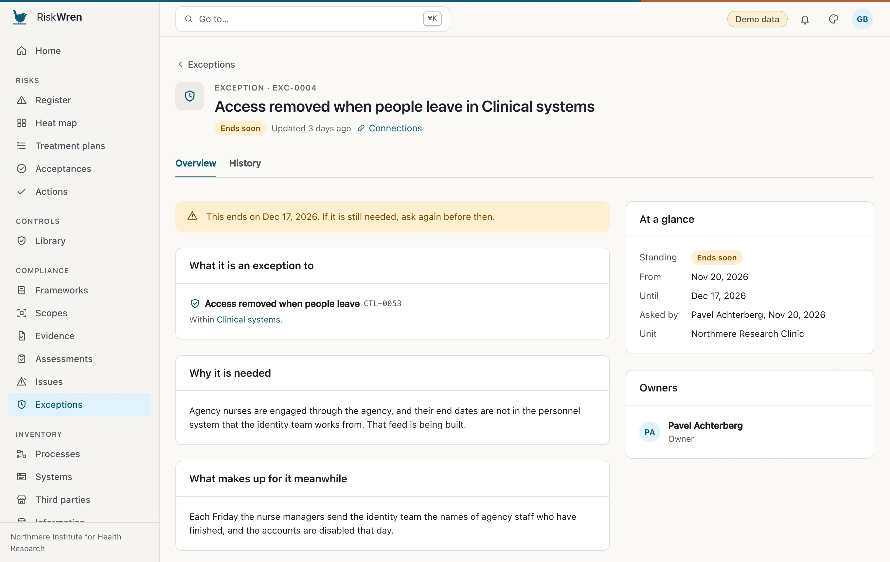
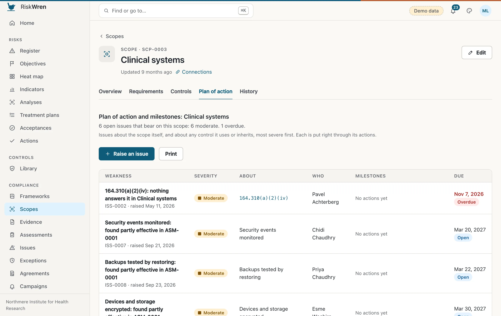

# Issues and exceptions

This guide is for whoever has to put something right, whoever checks that it was, and whoever decides when a departure is allowed for a while. It covers the issue register, severity and dates, actions, closure, exceptions, the plan of action, and notices.

## Issues

An issue is something found to be wrong that must be put right. **Compliance → Issues** is one register for all of them, whatever found them:

| Found by | For example |
|---|---|
| **A test** | An assessment found a control partly effective or ineffective |
| **A gap** | A requirement that nothing answers in a scope |
| **Security testing** | A penetration test, a scan, or an exercise |
| **An audit** | A finding from an internal or external audit |
| **An incident** | Something that went wrong showed it |
| **A review** | A review of a supplier, a system, or a process |
| **An observation** | Somebody noticed it and said so |

### Raise an issue

**Issues → Raise an issue.** Anyone may raise one for a unit they work in or have a role over. Say what is wrong, in which unit, how serious it is, what found it, and what it is about: the controls, scopes, and risks concerned. Name who is to put it right; they are told.

On a scope's **Requirements** tab, **Raise an issue** beside a requirement that is a gap, planned, or failing starts one already about that requirement and that scope.

### From a failed test

When a test result of partly effective or ineffective is confirmed, an issue is opened without anyone asking:

- it is named for the control and the assessment, and carries what the test found and what was looked at;
- it is **high** if the control was found ineffective and **moderate** if partly effective;
- it belongs to the control's owners, who are told, and not to whoever found it;
- it names every scope that relies on the control.

If an issue is already open for that control from an earlier test, that one stands and no second one is opened. If the control has no owner the issue has none either, and shows on Home for those who can name one.

### Severity sets the date

Each severity has a written meaning, shown as you choose, and the issue is due a fixed time after it was raised:

| Severity | Due within |
|---|---|
| Critical | 30 days |
| High | 90 days |
| Moderate | 180 days |
| Low | 365 days |

The table is part of the program and can be changed (see [Running the program](running-the-program.md#cadences)). Changing an issue's severity applies the rule again, counted from the day it was raised.

**Move the date** changes it by hand. That needs a reason, and where the date started and every move stay on the record, with a count beside the date wherever the issue is listed.

### Put it right

An issue is worked through **actions**, each with an owner and a date: the same actions treatment plans use, on the same list of everything owed. **Add an action** on the issue. Whoever owns an action sees the issue, does their part, and marks it done.

### Close it

1. Its owner chooses **Propose closure**, and says what was done, **why it happened** (a root cause from a short list: procedure, people and time, ownership, technology, design, change, third party, or other), and cites the evidence that shows it. Open actions must be finished or cancelled first.
2. The issue then waits. An assessor or a manager for the unit sees it on Home and chooses **Confirm closure**: either confirming, which closes it, or sending it back with a note saying what is still missing.

**Nobody confirms the closure of an issue they own, or one they proposed closing.** The server refuses it.

Two more things belong to the second line alone: **Withdraw**, for an issue raised in error, and **Reopen**, for one that turned out not to be put right. An owner who could withdraw their own issue would never need its closure confirmed.

### Who sees an issue

An issue is known to those with a part in it: whoever raised it, those named on it, anyone with an action on it, and those with a role over its unit. Working in the unit is not enough. An issue can also be marked restricted.

## Exceptions

An exception is an approved departure from a control, a requirement, or a document, for a time, with what makes up for it. It is the honest answer when something cannot be met yet and everyone knows it.

### Ask

An exception is asked for from a scope, by those who keep it:

- on the **Requirements** tab, **Ask for an exception** beside a requirement that is a gap, planned, or failing;
- on the **Controls** tab, **Exception** beside a control, including one the scope inherits and cannot fix itself.

An exception to a policy, standard, or procedure is asked for from the document's own page, and decided by a leader or manager of the unit that keeps it ([Policies](policies.md#exceptions-to-a-document)).

Say why it is needed, what is done in its place meanwhile, and the dates it runs between. It is never open-ended: by default it runs for at most twelve months.

### Decide

A leader or a manager with authority over the unit decides, and **whoever asked does not decide**. They see the request on Home. Approving may shorten it; refusing needs a reason. Asking changes nothing: an exception covers nothing until it is approved.

### While it is in force, and after

While an exception is in force, what it covers is shown as **excepted** in place of failing, a gap, or planned, with the state underneath said beside it. It does not improve on a control that is in place.

The day after it ends, the state underneath is back, without anyone doing anything. Nothing has to run for that to happen: whether an exception is in force is worked out from its dates on the day.

Whoever asked sees it on Home a month before it ends. **Ask again** starts a new request that carries on from it, which is decided again. **End it early** withdraws one that is no longer needed.

**Compliance → Exceptions** lists them, and can show those waiting to be decided, in force, ended, refused, or withdrawn, and those to a control, a requirement, or a document.

### Findings of internal audit

An issue raised by internal audit from an engagement says so on its page. Its closure is confirmed by an auditor rather than by an assessor or a manager, and only auditors withdraw or reopen it. See [Findings and follow-up](internal-audit.md#findings-and-follow-up).

## The plan of action

A scope's **Plan of action** tab lists the open issues that bear on it: those about the scope itself, and those about any control it uses or inherits. They are listed most severe first, each with its owner, its milestones (the actions, with who and when), and its date.

It prints, and it is the document a reviewer asks for: what is wrong, who is fixing it, and by when. **OSCAL** downloads it as a plan of action and milestones in the open assessment language; see [The security plan and OSCAL](compliance.md#the-security-plan-and-oscal).

## Notices

The bell at the top right counts what has been assigned to you or decided for you since you last looked: an issue handed to you, an action that is yours, a closure sent back, an exception approved or refused, a request waiting for your decision.

A notice is a sentence and a place to go. It is not the record of what happened, which is in the history, and nobody is told about what they did themselves. **Home** remains the list of what you still owe.
