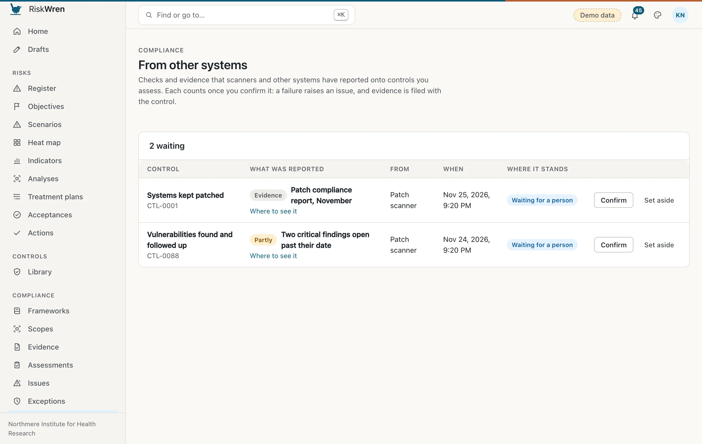
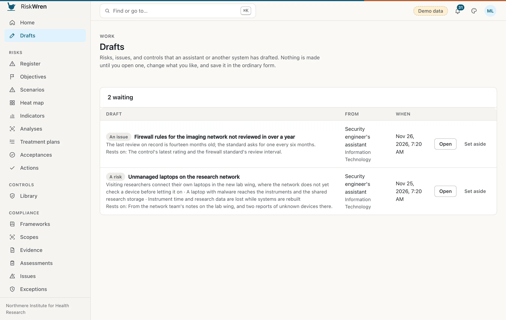

# Other systems and assistants

This guide is for whoever connects RiskWren to the systems around it, and for the people who then see what those systems send: the security team, assessors, stewards, and administrators. It covers tokens, webhooks, results that scanners and other tools report, the good-standing check, drafts, a tool server for an assistant on someone's own computer, and the optional assistant inside RiskWren. Every one of them is optional; an installation that uses none of them loses nothing else.

The technical detail a developer needs (headers, bodies, signatures, every route) is in [The API](api.md). How to turn the assistant on is in [Configuration](configuration.md#the-assistant).

## What can connect, and what cannot

RiskWren is passive. It never reaches into another system, and nothing here changes that:

- **Other systems come to it,** with a token an administrator made for them, and act as a role, never as a person.
- **It tells others only what an administrator asked it to,** through a webhook that names what happened and never says what a record contains.
- **It asks an assistant only if an administrator turned one on,** and then only what the person asking may see.

What another system reports, or an assistant proposes, counts for nothing until a person confirms it or saves it.

## Tokens

An administrator makes a token under **Admin → Other systems**, one for each system that will use the API.

| When making it | What it means |
|---|---|
| **What will use it** | A name, such as *Vulnerability scanner*. Everything the token changes is in the history as *API token Vulnerability scanner* |
| **Acts as** | The role it has: auditor (reads everything), manager, assessor, steward, or member. There are no administrator tokens |
| **Unit** | For a manager's or an assessor's token, optionally one unit; for a steward's, the unit it keeps |
| **It may only read** | Ticked by default. A token that may only read is refused every change, except proposing a draft and asking the assistant, which change nothing a person has not saved |
| **Lasts, in days** | Up to a year and a day. It is refused after its date |

**Make a token** shows it once. RiskWren keeps only its fingerprint, so a lost token cannot be shown again: withdraw it and make another. The list shows each token's role, when it ends, and when it was last used. **Withdraw** ends one at once.

A token never makes a judgment that belongs to a named person: it cannot assess or accept a risk, rate a control, record or confirm a test result, decide an exception, confirm a closure, approve or publish a document, or triage an incident.

**Choosing the role.** Give each system the least it needs:

- A system that only asks, such as a purchasing process checking a supplier's standing, needs an **auditor's** token that may only read.
- A scanner that reports onto controls needs a token that acts as an **assessor** (or a manager or steward) and may change things.
- An assistant needs an **auditor's** token that may only read, or a narrower one if it should see less.
- An inventory feed that keeps a unit's systems current needs a **steward's** token for that unit that may change things.

## Being told what happens: webhooks

A webhook tells an address when something happens: an issue raised or closed, an incident reported, a risk assessed. An administrator registers one under **Admin → Other systems** with a name (**What receives it**), an `https://` **Address**, what it is **Told of**, and how its messages are **Sent as**:

| Told of | Means |
|---|---|
| `*` | Everything |
| `issue.*` | Everything that happens to issues. Any family works the same way: `risk`, `control`, `issue`, `exception`, `incident`, `document`, `evidence`, `assessment`, `third_party`, `third_party_review`, `system`, `process`, `scope`, `agreement` |
| `issue.validate` | One kind of event: here, a proposed closure confirmed or sent back |

An event is named as the history names what was done. The ones most often wanted:

| Event | When |
|---|---|
| `issue.create`, `issue.from_test` | An issue is raised, by a person or by a failed test |
| `issue.propose`, `issue.validate` | Closing an issue is proposed; the closure is confirmed or sent back |
| `issue.cancel`, `issue.reopen` | An issue is withdrawn, or opened again |
| `incident.report`, `incident.triage`, `incident.close` | An incident is reported, triaged, or closed |
| `exception.request`, `exception.decide` | An exception is asked for, or decided |
| `risk.assess`, `risk.escalate` | A risk is assessed, or escalated |
| `control.rate`, `control.reported` | A control is rated, or another system reports onto it |
| `document.publish` | A new version of a policy or other document is published |
| `third_party.call_review`, `third_party.offboard` | A third party's review is called for, or its relationship is ending |

**Admin → Other systems** lists each webhook's latest deliveries with their event names, so a webhook told of a whole family for a while shows the name of everything in it.

| Sent as | For | What arrives |
|---|---|---|
| **The plain message** | A program written to receive it | The event, when it happened, and the record's type, reference, and address |
| **A ticket** | A service desk that opens a ticket from what it is sent | A title, a description, and a link back |
| **A chat message** | A channel that takes incoming messages | One line: `RiskWren: issue.create: ISS-0031 https://…` |

Whatever the shape, a message names the event and the record and never says what the record contains: the receiver asks the API, with a token, for what it may see. A restricted record is never named. A new webhook is told only of what happens after it is registered.

Messages are signed with the webhook's secret, which is shown once, when it is registered. A message the address does not accept is tried again after a minute, five minutes, half an hour, two hours, and twelve hours. The latest deliveries, with how each went, are listed with the webhook for thirty days. A webhook can be paused, and sent a test message (**Send a test**) to check the address.

Webhooks are sent by the **Webhooks** job, every minute, while scheduled work runs ([Scheduled work](configuration.md#scheduled-work)).

## Results reported by other systems

A vulnerability scanner, a configuration checker, or a monitoring tool can report what it has found of a control: that a check **passed**, **partly** passed, or **failed**, or a piece of **evidence** such as a monthly patch compliance report. It reports with a token that acts as an assessor, a manager, or a steward and may change things.

**Where it shows.** What is reported appears at once on the control's page, in a card headed **Reported by other systems**, under its source's name, with a link to see it in the source where one was sent. Reports waiting for a decision are also listed under **Compliance → From other systems**, for those who assess the controls' units.

**Nothing counts until a person confirms it.** Confirming needs someone who assesses the control's unit (an assessor or a manager for it) and does not own the control, the same second pair of eyes a test result needs.

| Reported | Confirming it |
|---|---|
| **Failed** or **Partly** | Raises an issue on the control, found by security testing, with the severity the confirmer chooses (high for a failure, moderate for partly, unless changed). The control's owners are made its owners and are told, as for a failed test; if the control has no owner, the confirmer keeps it |
| **Passed** | Keeps it on record as confirmed. Nothing else changes |
| **Evidence** | Files it with the control, as evidence that counts for a year from when it was observed |

**Set aside** keeps a report on record, with the reason, and changes nothing else.

A report never rates the control and never replaces a person's test result: only a test in an assessment does that. It also never changes a risk's rating by itself.

Three things to know:

- **Home says when reports are waiting.** Those who may confirm them see one line, with how many, leading to **From other systems**; nothing is said under the bell.
- **The page lists only what is waiting.** A report once decided stays on the control's card, with who decided it and how.
- **A scanner that reports the same failure every night** raises one issue. While an issue is open because the control was found wanting, by a test or an earlier report, confirming another failure joins it rather than raising a second.

## Is it in good standing?

Another process can ask whether a **third party**, a **scope**, or an **exception** is in good standing before it goes ahead: purchasing before it buys from a supplier, a data-access request before it grants access to a research enclave, a deployment pipeline before it releases into a scope. It gets yes or no, with each reason as a short code and a sentence, and nothing of the record's contents. A record its token may not see is not found.

| Asked about | It is not in good standing when |
|---|---|
| **A third party** | It is not active (`not_active`) or is being offboarded (`offboarding`); it has not been tiered (`not_tiered`); its tier calls for a review and none has been concluded (`never_reviewed`); its last review was not approved (`not_approved`); its review is past its date (`review_overdue`); or information is shared with it that no agreement of the kind the program requires covers (`no_agreement`) |
| **A scope** | It is not active; a requirement it is held to is failing, because a control that answers it failed a test that still holds (`failing`; an exception in force keeps a requirement out of this); or a critical or high issue about it is past its date (`issues_overdue`) |
| **An exception** | It is not in force: still requested, refused, withdrawn, approved but not yet begun (`upcoming`), or ended (`expired`); the reason's code is its state |

Read a yes for what it is. For a third party it means: active and not being ended, tiered, reviewed as its tier asks and approved, the review in date, and no gap in coverage. A gap counts whatever the asking token may see, and the answer says only that there is one. It does not mean the supplier was asked anything beyond what its tier calls for: a supplier in the lowest tier, which calls for no reviews, is in good standing once it is tiered and covered.

Give the asking process an **auditor's** token that may only read: it can ask about anything and changes nothing.

The answer is a reason to look, not a verdict: a process that gets no should stop for a person rather than refuse on its own. The [API guide](api.md#recipes) has recipes for purchasing, data access, and deployments.

## Drafts

An assistant, or another system with a token, may propose a **risk**, an **issue**, or a **control**. A proposal is a **draft**: a record of its own, never a half-made risk. It waits under **Drafts**, beside Home in the menu, for a person who may add that kind of record in its unit: a unit's steward or a manager for a risk or a control, and also an assessor for an issue. A draft with no unit waits for those whose roles cover the whole organization. Whoever asked an assistant for a draft also sees it.

Each draft shows what it proposes, where it came from, and what it rests on, in the drafter's words.

- **Open** puts it in the ordinary form: **Raise a risk**, **Raise an issue**, or **Add a control**, filled in. Change what you like and save it. Every rule that applies to a record you make applies to this one, and the draft is marked as used, naming the record.
- **Set aside** keeps the draft on record with your reason, and makes nothing.

Those who may make drafts that are waiting see one line on Home, with how many, leading to **Drafts**; nothing is said under the bell. A token that may only read may still propose one.

## An assistant on your own computer

`riskwren tools` lets an AI assistant that runs on someone's own computer, and supports the Model Context Protocol, read RiskWren and propose drafts. The assistant starts it, and each tool calls RiskWren's API with a token, so the assistant sees exactly what the token may and nothing more.

| Tool | What it does |
|---|---|
| `search` | Searches every kind of record the token may see |
| `get_record` | One record in full, by its reference |
| `risk_with_controls` | A risk, with its ratings and the controls that bear on it |
| `scope_readiness` | A scope: what it is held to, how far it meets it, and its open issues |
| `whats_overdue` | Risks whose review is overdue, issues past their date, controls whose rating is stale |
| `draft_risk`, `draft_issue`, `draft_control` | A draft, which a person then opens under **Drafts** |

To set it up:

1. Ask an administrator for a token: an auditor's that may only read is enough, since drafting needs no more.
2. Tell the assistant to start `riskwren tools --url https://your-riskwren-address`, with the token in the `RISKWREN_TOKEN` environment variable of the assistant's own settings, never on the command line. The [API guide](api.md#an-assistant-the-tool-server) shows the usual settings file.
3. Use `--no-drafts` to offer only the tools that read.

What the assistant does with what it reads is between it and whoever provides the model behind it. Use one your organization trusts with what the token may see, or narrow the token.

## The assistant in RiskWren

An administrator may turn on an assistant inside RiskWren, with a provider the organization chooses: a model running on its own machines, or a service it has an agreement with. While it is off, none of what follows appears.

When it is on, it works for whoever is signed in, from what they may see, through the same tools as the tool server. It is sent no restricted record, and no record of a data class the organization keeps back; such a record reaches it only as a reference and the reason it was withheld. Each person may ask it a limited number of times a day, and each request stops after a set time.

### Summarize

**Summarize**, beside **Connections** on a record's page, writes a short summary of the record: what it is, where it stands, what is overdue or failing, and what would help next. The summary is shown, not saved; it says which tools it used, and should be checked against the record before anyone relies on it. It is not offered on a restricted record.

### Draft with the assistant

**Draft with the assistant**, on the risk register, asks for a few sentences about what could go wrong and, optionally, the unit. The assistant first looks for a risk that already says the same and, if it finds one, names it instead of drafting. Otherwise it drafts a title, a cause, an event, and a consequence, and the ordinary **Raise a risk** form opens with them filled in. Nothing is made until you save it; if you close the form, the draft waits under **Drafts**. Anyone may ask for a draft, but only a steward or a manager of the unit can save it as a risk. If you cannot add risks, the form will not save: tell your steward, who will find the draft under **Drafts**. Nobody is told of it otherwise.

What you write in the box is sent to the provider as you wrote it, so leave out what should not be.

### For administrators

- Turning it on, choosing a provider, and deciding which data classes may be sent: [Configuration](configuration.md#the-assistant).
- **Admin → Assistant** shows how it is set up, checks that the provider answers (**Check the connection**), and lists every exchange, newest first: who asked, what for, which tools it used, what it answered, how many tokens it took, and how long. Each exchange is also in the history, where it cannot be changed unnoticed.
- A person over the day's limit is told so and can ask again the next day. A provider that fails or takes too long is recorded as failed, and the person is told.
