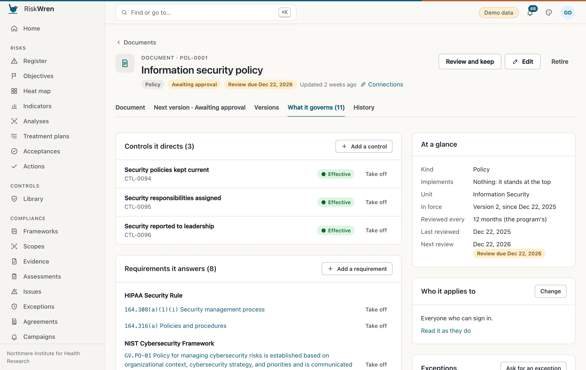
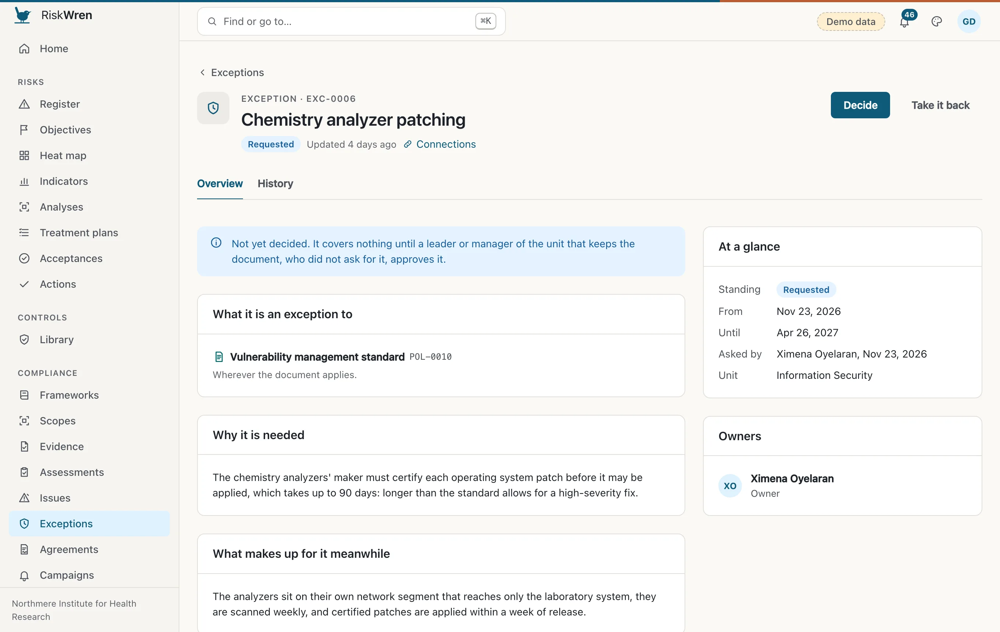
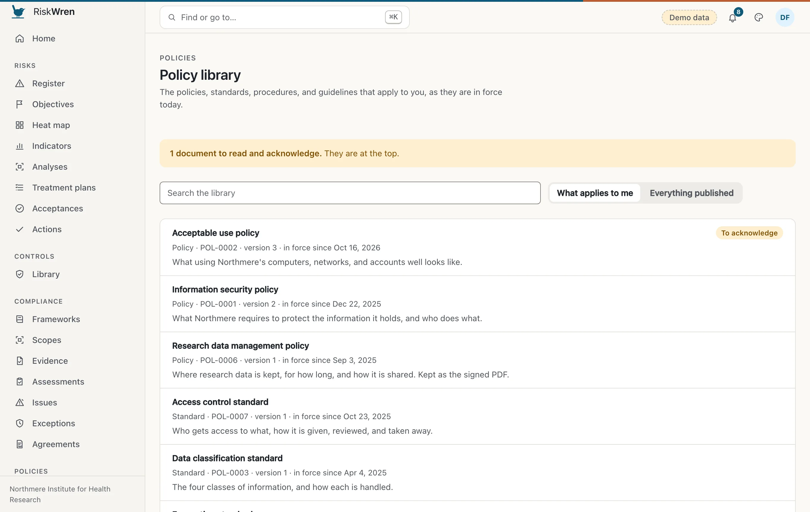
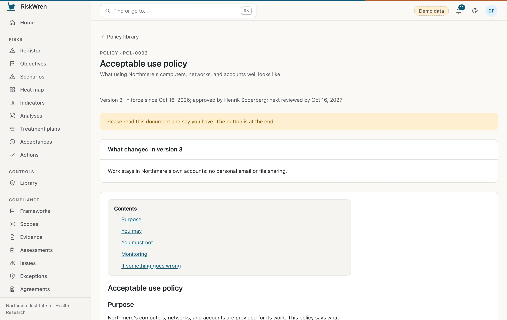
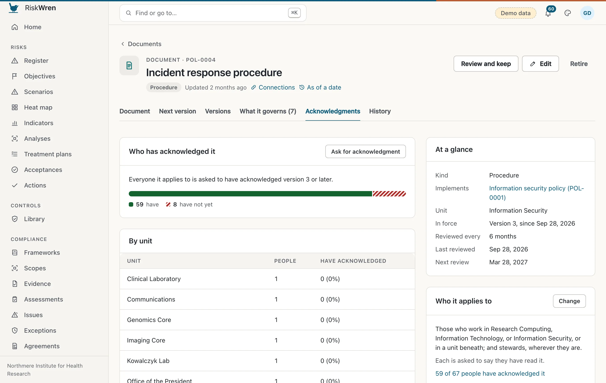

# Policies

This guide is for whoever writes, approves, or keeps the organization's policies, standards, procedures, and guidelines: most often the security office and the compliance office, and the leaders who approve what they write.

RiskWren holds each document with its versions, who approved each one, and when it is next looked at. The words can be written here, or stay where the organization already keeps them; either way the lifecycle is tracked here. Everyone reads what applies to them in the [policy library](#the-policy-library), and says they have where a document asks them to.

## Documents

**Policies → Documents** lists them all, broadest first. It is in the menu of stewards, leaders, assessors, managers, and those who read everything; anyone named an owner of a document reaches it from the document in the library. A document is one of five kinds:

| Kind | What it is |
|---|---|
| **Policy** | What the organization requires, and why. Approved by its leadership. |
| **Standard** | The particular rules that meet a policy: how long a password, which encryption. |
| **Procedure** | The steps someone follows to meet a standard or a policy. |
| **Continuity plan** | What to do to keep a process going, or to bring it back, when something stops it. Written, approved, and reviewed like any document; what it restores, its exercises, and a copy for when the systems are down are under [Continuity plans](the-register.md#continuity-plans-and-exercises). |
| **Guideline** | Advice that helps people do it well. Recommended, not required. |

Each names the document it **implements**: a standard implements a policy, a procedure a standard or a policy. A document may implement one of its own kind or a broader one, never a narrower one, so an access control policy can sit beneath the information security policy, but a policy never sits beneath a procedure. The document's page lists what implements it.

**Add a document** (a steward or leader of the unit, or a manager) gives it a title, its kind, its unit, and what it implements. It starts with its first draft. Like any record it has owners and a history, it can be found by search, and it can be restricted.

## Writing a version

A document's words are in its versions. The **Next version** tab is where the next one is written, in one of three ways:

- **Write it here**, in a simple Markdown: `#` for a heading, `-` for a list, `**bold**`, `*emphasis*`, `[a link](https://…)`, and tables. **Preview** shows it as it will read. A document of three or more sections gets a list of contents.
- **Link to where it is kept**, such as a page on the intranet or a file in the document library. RiskWren keeps its approvals, its dates, and its address.
- **Attach a file**: a PDF or a Word document, up to 25 MB.

A new version starts as a copy of the one in force. **What changed, and why** is needed before a second or later version is sent; it is shown with the version once published. A draft nobody needs can be discarded; the version in force stays as it is.

## Approval

**Send it for approval** names the people who must approve it. Each is told, and it appears on their Home.

- **Nobody approves their own work.** The person who sends a version, and the person who started it, cannot be among those who approve it.
- **Each approves it, or returns it with a reason.** A return sends it back to its author with the reason on the draft; those still to decide are no longer asked. When the author sends it again, everyone named is asked again.
- **What is under review is not changed.** To change it, **take it back**. Those not yet asked are told they no longer need to approve it.
- **When everyone has approved it,** its owners are told and it can be published.

## Publishing

**Publish** puts the approved version in force. It is numbered (version 1, 2, 3), the version before it is superseded, and its next review is set from that day.

**A published version is never changed.** No screen or route edits it; a correction is a new version. The history keeps each version's **fingerprint**, taken when it was published, and `riskwren verify` checks every published version against it: text altered in the database, or a file changed in the data home, is reported.

**Versions** lists every published version with who approved it and what changed. Any two can be compared side by side: lines added, removed, or reworded, with the words that differ marked. A step put in the middle of a list shows as one line added, not every line after it changed. Two versions held as files are compared by their fingerprints alone.

## Review

Each document is looked at again on a cadence: every 12 months as shipped, or its own if it sets one under **Reviewed every**. The program's cadence is changed under Admin → Program → Cadences, which moves the next review of every document that follows it.

When a review comes due it shows on the document, on its owners' Home, and in the reminders: before its date, when it passes, then to the unit's steward and its leader. Look at it, then either:

- **Review and keep**, saying what was looked at. The version stays in force and the next review moves on; the review is in the history.
- **Start a new version**, and send it for approval as above. Publishing it sets the next review.

A document no longer needed is **retired**, with the reason. Its versions and history stay on record, and it can be put back in use. A document that others still implement is not retired until they are moved or retired first.

## What it governs

A document is connected to what it governs on its **What it governs** tab, by those who may change it:

- **The controls it directs.** A control a document directs is how what the document requires is done: the access control standard directs account approval, access reviews, and removing access on leaving. **Add a control** finds one by name or reference.
- **The requirements it answers.** A requirement a document answers is one the organization meets, at least in part, by saying so in it: the information security policy answers the Cybersecurity Framework's GV.PO-01 and the HIPAA Security Rule's 164.316(a). **Add a requirement** chooses a framework and finds the requirement by code or words.

Each side shows the other. A control's page lists the documents that **direct** it. A requirement, opened in its framework, lists the **documents that answer it**, beside the controls that do, but only documents in force: a draft, or a document never published or retired, says nothing yet. So "is there a policy for this?" has an answer with a version and a date on it. The history of the document keeps each control and requirement added and taken off.

Documents are in the **Connections** picture (what each implements, what implements it, the controls it directs, and the exceptions to it), in search, and in **Tidy**: a policy, standard, or procedure that directs no control and answers no requirement is listed as missing what it governs. A guideline is advice, and a continuity plan restores processes, so neither is expected to. The export of the document list counts the controls and requirements of each.

## Exceptions to a document

A unit that cannot follow a document for a time asks for an exception to it, as it would to a control or a requirement ([Issues and exceptions](issues-and-exceptions.md#exceptions)): **Ask for an exception** on the document's page, saying why, what it does instead, and until when.

- **Who asks:** a unit's steward, leader, or manager, or those who keep the document. A member of staff asks their steward.
- **Who decides:** a leader or a manager of the unit that keeps the document, and never whoever asked. A departure from the security office's encryption standard is decided by the security leader, whichever lab asks.
- **It ends by its dates,** like every exception. While it is in force the document's page lists it, and the day after it ends it is shown as ended, without anyone doing anything.

An exception to a document does not change how a scope stands: a scope counts exceptions to its requirements and to the controls it uses.

## Who it applies to

A document applies to **everyone**, as shipped, or to the people chosen under **Who it applies to** on its page:

- **those who work in chosen units**, and in the units beneath them, and
- **those who hold chosen roles**, wherever they hold them: every steward, say, or every manager.

Someone in a chosen unit or holding a chosen role is one person, counted once. An account that is disabled is no longer counted. Who it applies to decides what each person finds in their library and who is asked to acknowledge it; it does not decide who may read it, which follows the document's unit and restriction like any record.

## The policy library

**Policies → Policy library** is where everyone reads the documents in force: the published version of each document that applies to them, broadest first, with what they still have to acknowledge at the top. **Everything published** shows every document they may read, whether or not it applies to them. The search finds a word in a title, a summary, or the text.

A document opens to read as it is in force: its version, when it came into force, who approved it, what changed in it, and the documents above and beneath it. Drafts, approvals, and earlier versions are not shown here; they are on the document's own page, under **Policies → Documents**, which those who write and keep documents use. The library is laid out to be read on a phone.

## Acknowledgment

A document can ask the people it applies to to say they have read it: tick **Ask those it applies to to say they have read it** when adding or editing it. Then:

- **Each version that is published asks again.** Those it applies to are told, and it stays on their Home until they have. At the end of the document they press **I have read it and understand it**. What they acknowledged, and when, is kept with the version.
- **A change that does not alter what anyone must do need not ask again.** Untick **Everyone must acknowledge this version again** on the next version, for a correction or a broken link: what people said of the version before still counts. Every version asks again unless its author says otherwise.
- **An acknowledgment cannot be taken back,** and a person who no longer works where the document applies keeps theirs on record.

### Who has acknowledged it

The document's **Acknowledgments** tab shows everyone it applies to, split by whether they have acknowledged the version they must: as a count, by unit with the units that have most still to do first, and person by person. Someone who acknowledged an earlier version that no longer counts is shown with it. The tab is for the document's owners and editors, assessors of its unit, and those who read everything.

### Asking for it by a date

**Ask for acknowledgment** on that tab (an assessor or a manager) starts an **acknowledgment campaign**: those it applies to, or only those in one unit and beneath it, are asked by a date. Those who have already acknowledged the version they must are counted as answered from the start. Everyone else finds it on their Home with the date, is reminded as it approaches, and answers by acknowledging it in the library; the campaign's page shows coverage by unit as they do. The same campaign can be started from **Compliance → Campaigns** ([Running the program](running-the-program.md#campaigns)).
