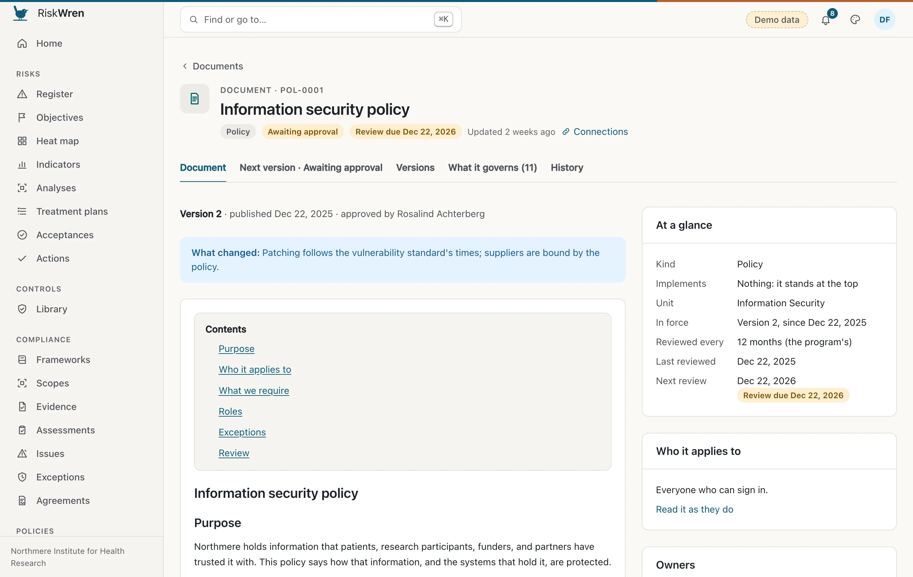
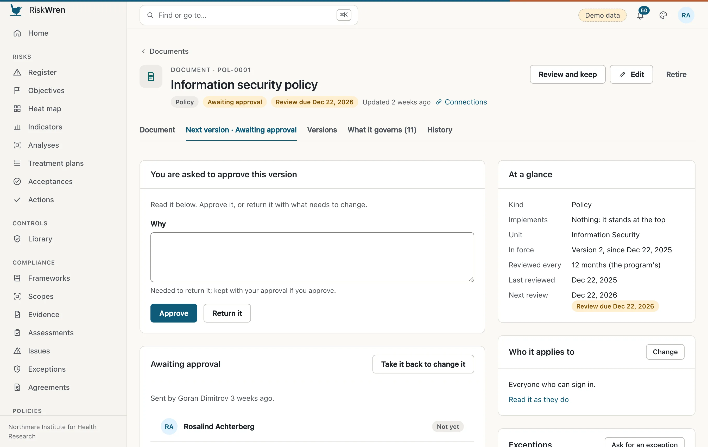
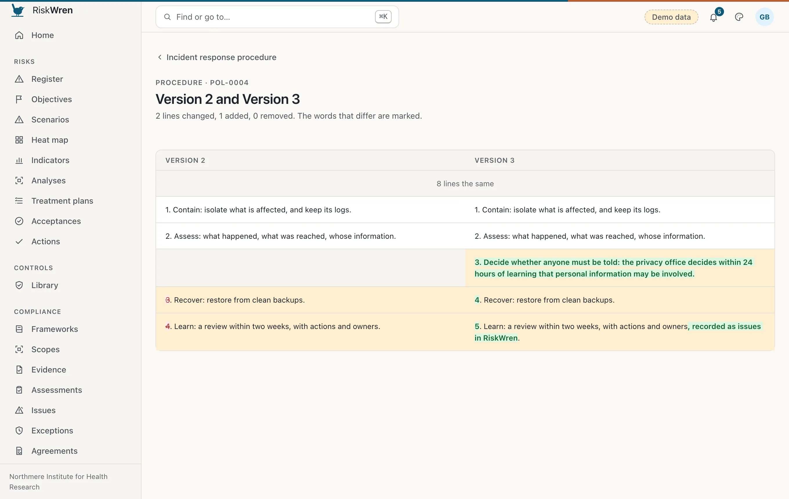

# Policies

This guide is for whoever writes, approves, or keeps the organization's policies, standards, procedures, and guidelines: most often the security office and the compliance office, and the leaders who approve what they write.

RiskWren holds each document with its versions, who approved each one, and when it is next looked at. The words can be written here, or stay where the organization already keeps them; either way the lifecycle is tracked here.

## Documents

**Policies → Documents** lists them all, broadest first. A document is one of four kinds:

| Kind | What it is |
|---|---|
| **Policy** | What the organization requires, and why. Approved by its leadership. |
| **Standard** | The particular rules that meet a policy: how long a password, which encryption. |
| **Procedure** | The steps someone follows to meet a standard or a policy. |
| **Guideline** | Advice that helps people do it well. Recommended, not required. |

Each names the document it **implements**: a standard implements a policy, a procedure a standard or a policy. A document may implement one of its own kind or a broader one, never a narrower one, so an access control policy can sit beneath the information security policy, but a policy never sits beneath a procedure. The document's page lists what implements it.

**Add a document** (a steward or leader of the unit, or a manager) gives it a title, its kind, its unit, and what it implements. It starts with its first draft. Like any record it has owners and a history, it can be found by search, and it can be restricted.

## Writing a version

A document's words are in its versions. The **Next version** tab is where the next one is written, in one of three ways:

- **Write it here**, in a simple Markdown: `#` for a heading, `-` for a list, `**bold**`, `*emphasis*`, `[a link](https://…)`, and tables. **Preview** shows it as it will read. A document of three or more sections gets a list of contents.
- **Link to where it is kept**, such as a page on the intranet or a file in the document library. RiskWren keeps its approvals, its dates, and its address.
- **Attach a file**: a PDF or a Word document, up to 25 MB.

A new version starts as a copy of the one in force. **What changed, and why** is needed before a second or later version is sent; it is shown with the version once published. A draft nobody needs can be discarded; the version in force stays as it is.

## Approval

**Send it for approval** names the people who must approve it. Each is told, and it appears on their Home.

- **Nobody approves their own work.** The person who sends a version, and the person who started it, cannot be among those who approve it.
- **Each approves it, or returns it with a reason.** A return sends it back to its author with the reason on the draft; those still to decide are no longer asked. When the author sends it again, everyone named is asked again.
- **What is under review is not changed.** To change it, **take it back**. Those not yet asked are told they no longer need to approve it.
- **When everyone has approved it,** its owners are told and it can be published.

## Publishing

**Publish** puts the approved version in force. It is numbered (version 1, 2, 3), the version before it is superseded, and its next review is set from that day.

**A published version is never changed.** No screen or route edits it; a correction is a new version. The history keeps each version's **fingerprint**, taken when it was published, and `riskwren verify` checks every published version against it: text altered in the database, or a file changed in the data home, is reported.

**Versions** lists every published version with who approved it and what changed. Any two can be compared side by side: lines added, removed, or reworded, with the words that differ marked. A step put in the middle of a list shows as one line added, not every line after it changed. Two versions held as files are compared by their fingerprints alone.

## Review

Each document is looked at again on a cadence: every 12 months as shipped, or its own if it sets one under **Reviewed every**. The program's cadence is changed under Admin → Program → Cadences, which moves the next review of every document that follows it.

When a review comes due it shows on the document, on its owners' Home, and in the reminders: before its date, when it passes, then to the unit's steward and its leader. Look at it, then either:

- **Review and keep**, saying what was looked at. The version stays in force and the next review moves on; the review is in the history.
- **Start a new version**, and send it for approval as above. Publishing it sets the next review.

A document no longer needed is **retired**, with the reason. Its versions and history stay on record, and it can be put back in use. A document that others still implement is not retired until they are moved or retired first.
