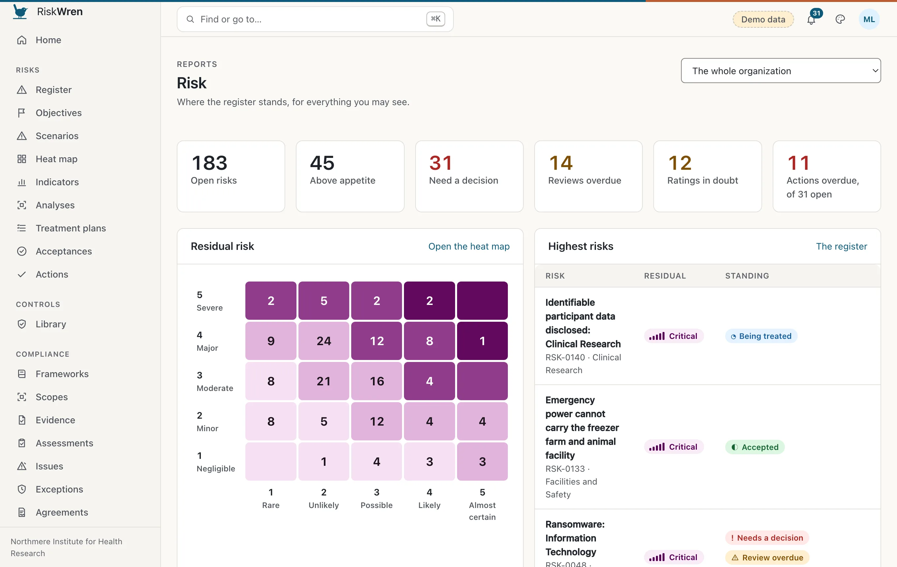

# Running the program

This guide is for the risk, compliance, and security assurance team and for administrators. It covers roles and scope, who sees what, shaping the program, the dashboards, the history, and appearance.

## Two kinds of authority

RiskWren keeps administration and judgment apart.

- An **administrator** manages accounts, units, appearance, and system settings. That role reads the register and can set the program's rules, since it sets everything else up. It does not assess, rate, or accept.
- A **manager** runs the program: shapes the categories, appetite, and scoring method, edits any record, and reads everything. A manager does not accept risk either. Acceptance belongs to leaders.

Someone who does both jobs holds both roles, and the history shows which they acted under.

## Roles and scope

Four roles can be limited to a unit, and then cover that unit and everything beneath it: manager, assessor, leader, and steward. A manager or assessor with no unit covers the whole organization, and only a manager for the whole organization shapes the program.

| Capability | Member | Owner | Steward | Leader | Assessor | Manager | Auditor | Admin |
|---|---|---|---|---|---|---|---|---|
| See what is assigned to them; finish their actions | ✓ | ✓ | ✓ | ✓ | ✓ | ✓ | ✓ | ✓ |
| Read the inventory | ✓ | ✓ | ✓ | ✓ | ✓ | ✓ | ✓ | ✓ |
| Read risks and controls | by setting | ✓ | in scope | in scope | in scope | ✓ | ✓ | ✓ |
| Add a record to a unit | | | ✓ | | | ✓ | | |
| Edit a record; link and unlink | | ✓ | ✓ | | | ✓ | | |
| Assess a risk; rate a control | | ✓ | ✓ | | ✓ | ✓ | | |
| Record a response; run a treatment plan | | ✓ | ✓ | | | ✓ | | |
| Accept a risk | | | | ✓ not their own, up to their limit | | | | |
| Escalate a risk | | ✓ | ✓ | ✓ | | ✓ | | |
| Map a control to requirements | | ✓ | ✓ | | | ✓ | | |
| Add a scope; say what applies in it and how each control is done there | | ✓ | ✓ | | | ✓ | | |
| Add evidence for a unit they work in | ✓ | ✓ | ✓ | ✓ | ✓ | ✓ | | |
| Attach evidence to a control or a scope | | ✓ | ✓ | | ✓ | ✓ | | |
| Start an assessment; plan its tests | | | | | ✓ | ✓ | | |
| Record a test result, or confirm one | | | | | ✓ not their own control or result | ✓ not their own control or result | | |
| Raise an issue for a unit they work in | ✓ | ✓ | ✓ | ✓ | ✓ | ✓ | | |
| Work on an issue: actions, its date, proposing closure | | ✓ | ✓ | | | ✓ | | |
| Confirm an issue's closure; withdraw or reopen one | | | | | ✓ not their own | ✓ not their own | | |
| Ask for an exception | | ✓ of the scope or control | ✓ | | | ✓ | | |
| Decide an exception | | | | ✓ not their own request | | ✓ not their own request | | |
| Export a list they can see | ✓ | ✓ | ✓ | ✓ | ✓ | ✓ | ✓ | ✓ |
| Import records from a spreadsheet | | | ✓ | | | ✓ | | |
| Read the full history | | | | | | ✓ | ✓ | ✓ |
| Shape the program; keep the organization's own frameworks | | | | | | ✓ | | ✓ |
| Manage accounts, units, and appearance | | | | | | | | ✓ |

Roles are given under **Admin → People**, or with [`riskwren users roles`](cli.md#riskwren-users-roles). The last active administrator can never be removed or disabled.

## Who sees what

**The inventory is open.** Processes, systems, third parties, and information assets are visible to everyone signed in, because a record can only be linked to what its author can see. So are frameworks and their requirements.

**The register follows a setting.** A register of risks and controls is useful in proportion to how widely it is read, and sensitive in proportion to how widely it is exposed. **Admin → Program → Who sees the register** sets what a person with no role sees:

| Setting | A member sees |
|---|---|
| **Open** | Every risk and control that is not restricted |
| **Unit** (the default) | The risks and controls of the units they belong to, and any they are named on |
| **Assigned** | Only the risks and controls they are named on |

Whatever the setting, leaders and stewards see their unit and everything beneath it, and managers, assessors, auditors, and administrators see what their role covers.

Any record can be marked **restricted**. It is then seen only by its owners, its unit's steward and leaders, managers, and auditors.

**Evidence, issues, and exceptions are more closely held.** Each is known to whoever made it, those named on it, and those with a role over its unit. Working in the unit is not enough.

- Evidence is also seen through something it is attached to that the person may see, unless it is restricted or of the most sensitive data class.
- An issue is also seen by anyone with an action on it.
- A control that a scope inherits is shown there by name and state to those who keep the scope, whoever may open the control itself.

One rule decides what a person may see, and every list, count, chart, and search uses it. A figure on the dashboard never counts a record its reader could not open.

One consequence is worth knowing. Under the default setting a steward cannot link their risk to a control that another unit runs, because they cannot see it. Controls that one unit runs for everyone, such as backups or training, are linked to other units' risks by a manager.

## Shape the program

**Admin → Program** shows how risks are rated here, in full: the categories and their appetite, the matrix, what follows from each rating, and the written definition of every level. Anyone assessing a risk sees the same definitions as they choose.


### Appetite

Appetite is the highest residual rating the organization will live with for a kind of risk without a plan or an acceptance. It is set for each of the nine top categories and can be set differently for any category beneath; one that sets none takes its parent's.

As shipped, clinical, regulatory, and financial risk have a low appetite, strategic risk a high one, and the rest moderate. Change any of them on the Program page. The page says at once how many risks changed standing, and the change is recorded in the history.

### Who may accept what

The table on the Program page shows, for each rating, how often a risk is reviewed and who may accept it when it is above appetite:

| Residual rating | Reviewed every | May be accepted |
|---|---|---|
| Low | 24 months | No acceptance is needed |
| Moderate | 12 months | For up to 24 months, by a leader of the unit or above |
| High | 6 months | For up to 12 months, by a leader whose limit reaches high |
| Critical | 3 months | For up to 6 months, by a leader whose limit reaches critical |

A leader's limit is set with the role. A sensible start: unit leaders at moderate, division leaders at high, and one or two executives at critical.

### Clocks for issues and exceptions

Two more rules are part of the program:

| Rule | As shipped |
|---|---|
| How long after it is raised an issue is due, by severity | Critical 30 days, high 90, moderate 180, low 365 |
| The longest an exception may run | 12 months |
| How long a control's rating, a test result, and evidence hold | 12 months |

They are in the program pack under `cadences`, as `issue_due_days`, `exception_max_months`, and `control_rating_months`. The meanings of the four severities, the root causes an issue is closed with, what can find an issue, and the other systems a record can be known in (each with an optional address pattern, so that an identifier becomes a link) are vocabularies in the same pack.

### Change the program with a pack

The scoring method, cadences, the acceptance table, and the vocabularies (kinds of system, data classes, owner kinds, and so on) are held as one document, a **program pack**.

```bash
uv run riskwren program export --output program.json    # write the one in force
uv run riskwren program import program.json --dry-run   # check an edited one
uv run riskwren program import program.json             # load it
```

An import checks the whole pack first and reports every problem together. A scoring method in which a rating falls as likelihood or impact rises is refused. A changed method becomes a new version: assessments already made keep the version they were made under, so an old rating always means what it meant.

A pack is also how one installation's program is copied to another, and how a program is kept under version control.

## Questionnaires

A questionnaire is a set of questions RiskWren asks people: to attest that a control still operates, to look again at a risk they own, to confirm that a unit's records are complete. **Admin → Questionnaires** lists them. Anyone signed in can read one and try it; those who run the program change them.

A new installation has four, written for RiskWren:

| Questionnaire | Asks |
|---|---|
| **Control attestation** | A control's owner: does it still operate as described, is there evidence in date, and are you still the right person to answer for it? |
| **Risk self-assessment** | A risk's owner: does it still stand, what has changed, and are its rating and plan still right? |
| **Unit completeness check** | A unit's steward: is everything the unit has on record, with the right owners, and is anything worrying not in the register? |
| **System security profile** | Whoever runs a system: what it holds, who can reach it, how people sign in, and who patches, backs up, and watches it |

### Questions that appear by condition

A question, or a whole section, can be asked only when an earlier answer makes it relevant. "What is different from the statement?" is asked only of someone who said the control operates partly or not at all. So nobody answers what does not apply to them, and what is asked is short.

- A rule looks only at questions asked before it, so showing and hiding can never run in a circle.
- An answer to a question that an earlier answer has since hidden is dropped. It cannot go on deciding what else is asked.
- The form reacts as it is filled in, and the server decides again when the answers are sent. The two use the same rules, held together by one file of test cases.

### Versions

**Edit** changes a questionnaire's sections, questions, their kinds and options, and when each is asked, with the form as it will be asked shown beneath. Saving changed questions **publishes a new version**. Earlier versions are never altered.

- **An answer is read against the version it was given to.** Reword a question or remove one, and what people answered before still reads as it was asked then.
- A draft begun under one version is finished under that version.
- A built-in questionnaire you have edited is yours from then on, and a later release leaves it alone. One you have not touched is brought up to date, as a new version.
- **Versions** lists every one, with who published it and what they said had changed. **Retiring** a questionnaire stops new answers and keeps the old.

The **Try it** tab asks the questions and shows how the answers would be kept, without saving anything.

## Campaigns

A campaign asks a set of people for one thing by a date, and shows who has answered. **Compliance → Campaigns → Start a campaign** (an assessor or a manager, for the units they cover).

| Campaign | Asks | For |
|---|---|---|
| **Control attestation** | The owners of controls | Does each control still operate as described, is its evidence in date, and are you still the right owner? |
| **Risk self-assessment** | The owners of risks | Does each risk still stand, what has changed, and are its rating and plan still right? |
| **Unit completeness check** | The stewards of units | Is everything the unit has on record, with the right owners? |
| **System security profile** | The owners of systems | What each system holds, who can reach it, and who patches, backs up, and watches it |
| **Evidence request** | The owners of controls | A named piece of evidence for each control |

Choose what to ask, give it a name and a date, and say what it is about: everything in a unit and beneath it, or, for controls, only those a compliance scope uses. Before it starts, the form says how many people would be asked about how many things. Each person is told once, with a count, and finds each thing on their **Home**.

- **Everyone is asked the same version** of the questionnaire, the one in use when the campaign started. Changing the questionnaire later does not change a campaign under way.
- Any owner of a control, risk, or system may answer for it, not only the one who was asked. An answer can be saved and finished later.
- **Something with nobody to ask is still listed**, and shown as such, so that a control whose only owner has left does not pass unnoticed. Name an owner, or **excuse** it with a reason.
- **An evidence request closes by itself** when evidence collected since the request is attached to the control.

### Following one

A campaign's page shows how far it has got, what those who answered said, **coverage by unit** with the least covered first, and every item with who was asked. Each figure is the count of the list beneath it.

- **Remind** tells everyone who still owes something, once, with how many. The scheduled [reminders](#reminders) do the same as the date approaches, and tell a unit's steward and then its leader about what stays unanswered.
- **Close** ends a campaign and keeps what was answered. **Cancel it** is for one started in error.

### What an answer sets in motion

Answers are kept as given, and some need someone else to act. Those people are told.

| Answer | Who is told |
|---|---|
| A control only partly operates, or does not | The unit's assessors, managers, and stewards |
| Someone else should own this control | The unit's stewards |
| A risk no longer stands, or its rating is no longer right | The unit's stewards, assessors, and managers |
| A unit's records need attention | The assessors and managers who cover it |

An attestation is recorded on the control, with who said it and when. It is **never a test**: see [An attestation is not a test](evidence-and-testing.md#an-attestation-is-not-a-test).

## Reminders

Everything with a date reminds whoever it is waiting on: actions, risk reviews, issues, evidence, acceptances, exceptions, the next test of each control, what a campaign has asked, and the next reading of each indicator.

| When | Who is told |
|---|---|
| 14 days before the date | Whoever it is waiting on |
| The day after the date | The same people, as overdue. An overdue test also goes to the assessors, because an owner cannot test their own control |
| Still late after 7 days | The steward of the unit |
| Still late after 21 days | The unit's leader |

- Each of these is said **once** for a given date. Moving the date starts again.
- Actions, issues, and what a campaign has asked go up to the steward and the leader. An indicator's reading is reminded only as it falls due, not two weeks ahead. The rest are for their owners: nobody else can renew a person's evidence or review their risk for them.
- Something found already long overdue, as on the first day after an upgrade, is told once to whoever it has reached, and not to everyone below as well.
- A reminder is a notice. It is read under the bell, and sent by email where [email is set up](configuration.md#email).

The three periods are part of the program's cadences, with the others. **Admin → Scheduled work** shows them as they are set.

### Key controls and the next test

What is known about a control holds for twelve months. A control marked **key** is due to be tested again after six. Each control's page shows the date its next test is due, and its owners are reminded as it approaches. Marking a control key does not change what its last rating counts for; it brings the next test forward.

## Read the dashboards

There are two, each for the whole organization or for one unit and everything beneath it. **Reports → Compliance** shows how ready each scope is against what it is held to and what stands in the way; it is described in [The compliance dashboard](compliance.md#the-compliance-dashboard). **Reports → Risk** shows where the register stands:

| Figure | Counts |
|---|---|
| Open risks | Risks that are not closed |
| Above appetite | Open risks whose residual rating exceeds the appetite for their category |
| Need a decision | Those above appetite with neither a plan on time nor an acceptance in force |
| Reviews overdue | Open risks past their next review date |
| Ratings in doubt | Risks flagged because what is known about their controls got worse |
| Actions overdue | Open actions past their due date |

Below them are the residual matrix, the highest risks, the register by standing, by rating, by category, and by unit, and what is known about the controls: how many are effective, partly effective, not assessed, or rated too long ago to rely on.



On both, every figure is the count of a list, and opens that list with the same filters. A dashboard has no numbers of its own, so a figure and the records behind it cannot disagree.

The calendar is caught up every hour by [scheduled work](configuration.md#scheduled-work): when an acceptance expires or a plan runs late, the risk's standing is updated, and the history records that as done by the system. Reading the register catches it up as well, so a figure is never behind the date even where the scheduler is turned off.

## The history

Every change to every record is written to an append-only history in the same transaction as the change: who, when, and each value before and after. Each event is hashed together with the one before it, and the database itself refuses updates and deletes on the history.

- Each record's **History** tab shows its own events in plain words.
- **Reports → History** shows every change in one place, for managers, auditors, and administrators: narrowed to a person, a record, a kind of record, or a span of dates. It opens on changes to records; sign-ins, exports, and settings are one choice away.
- Reading is recorded where it matters: every download of an evidence file and every export of a list is an event, with who and what.
- `uv run riskwren verify` recomputes the chain and reports the first event that has been altered, removed, or cut from the end.
- `uv run riskwren doctor` checks that the database still refuses changes to the history.


Assessments, control ratings, test results, and acceptances are never edited. A new one supersedes the last, and all of them are kept.

## Appearance

**Admin → Appearance** makes the product yours, with a live preview:

- the product's name and your organization's name;
- a logo for light and for dark mode, and a tab icon;
- the default palette (Wren, Slate, or Garnet) and an accent color, which is adjusted for dark mode and refused if text on it could not be read;
- how ratings are colored: an **ordinal** ramp from light to dark in one hue, which keeps rating apart from the colors of standing, or a **signal** ramp from green to red.

Each person chooses light, dark, or system mode and a palette for themselves, from the appearance button at the top right.


## Back up and recover

- Back up the data home, and the database as well if you use PostgreSQL. Evidence files are in the data home under `files/`, and the database refers to them.
- `uv run riskwren program export` keeps a copy of the program you have shaped.
- If nobody can sign in, [`riskwren users`](cli.md#riskwren-users) adds an administrator or resets a password from the server's own command line. Changes made there are recorded in the history as made at the command line.
