# Running the program

This guide is for the risk, compliance, and security assurance team and for administrators. It covers the two kinds of authority; roles and what each may do; who sees what; shaping the program, with an example of changing an appetite; questionnaires and campaigns; committee sessions; when someone leaves; reminders and notices; the dashboards, measures, portfolio, and leadership reports; the history, the record as of a date, and dossiers; the Admin pages; appearance; and backup. What each role does day to day, and which role to give whom, is in [Your part in it](roles.md).

## Two kinds of authority

RiskWren keeps administration and judgment apart.

- An **administrator** manages accounts, units, sign-in, other systems, appearance, and the installation's operations. That role reads every record, restricted ones included, except an incident case restricted to the people named on it. It can set the program's rules, since it sets everything else up. It does not assess, rate, or accept.
- A **manager** runs the program: shapes the categories, appetite, and scoring method, edits any record, and reads everything, with the same exception. A manager does not accept risk either. Acceptance belongs to leaders.

Someone who does both jobs holds both roles. The history records who did each thing, not which role they used.

## Roles and scope

A **leader** and a **steward** are always for a unit, and cover it and everything beneath it; a leader of the top unit leads the whole organization. A **manager** and an **assessor** cover the whole organization, or only the units they are given and everything beneath them. Only a manager for the whole organization shapes the program. Before giving roles, read [Before you give roles, know this](roles.md#before-you-give-roles-know-this).

"In scope" below means for the units the role covers. An owner is anyone named as owner or delegate of the record in question.

| Capability | Member | Owner | Steward | Leader | Assessor | Manager | Auditor | Admin |
|---|---|---|---|---|---|---|---|---|
| See what is assigned to them; finish their actions | ✓ | ✓ | ✓ | ✓ | ✓ | ✓ | ✓ | ✓ |
| Read the inventory, objectives, and scenarios | ✓ | ✓ | ✓ | ✓ | ✓ | ✓ | ✓ | ✓ |
| Read risks and controls | by setting | ✓ | in scope | in scope | in scope | in scope | ✓ | ✓ |
| Read a record marked restricted | if they made it | ✓ | in scope | in scope | | in scope | ✓ | ✓ |
| Report an incident, a near miss, or a concern | ✓ | ✓ | ✓ | ✓ | ✓ | ✓ | ✓ | ✓ |
| Add a process, system, third party, information asset, service, site, risk, control, or indicator to a unit | | | ✓ | | | ✓ | | |
| Edit a record; link and unlink | | ✓ | ✓ | | | ✓ | | |
| Assess a risk; rate a control | | ✓ | ✓ | | ✓ | ✓ | | |
| Record a response; run a treatment plan | | ✓ | ✓ | | | ✓ | | |
| Accept a risk | | | | ✓ not their own, up to their limit | | | | |
| Withdraw an acceptance | | | | ✓ one they gave | | ✓ | | |
| Escalate a risk | | ✓ | ✓ | ✓ | | ✓ | | |
| Start a risk analysis, and work through one | | ✓ work through it | ✓ | | ✓ | ✓ | | |
| Map a control to requirements | | ✓ | ✓ | | | ✓ | | |
| Add a scope; say what applies in it and how each control is done there | | ✓ | ✓ | | | ✓ | | |
| Add evidence for a unit they work in | ✓ | ✓ | ✓ | ✓ | ✓ | ✓ | | |
| Attach evidence to a control or a scope | | ✓ | ✓ | | ✓ | ✓ | | |
| Start an assessment; plan its tests | | | | | ✓ | ✓ | | |
| Record a test result, or confirm one | | | | | ✓ not their own control or result | ✓ not their own control or result | | |
| Raise an issue for a unit they work in | ✓ | ✓ | ✓ | ✓ | ✓ | ✓ | | |
| Work on an issue: actions, its date, proposing closure | | ✓ | ✓ | | | ✓ | | |
| Confirm an issue's closure, or withdraw an issue | | | | | ✓ not one they own, nor internal audit's findings | ✓ not one they own, nor internal audit's findings | ✓ internal audit's findings they do not own | |
| Reopen a closed issue | | | | | ✓ owner or not, except internal audit's findings | ✓ owner or not, except internal audit's findings | ✓ internal audit's findings, owner or not | |
| Ask for an exception | | ✓ of the scope or control | ✓ | | | ✓ | | |
| Decide an exception | | | | ✓ not their own request | | ✓ not their own request | | |
| Triage an incident, and name who handles it | | | | | ✓ | ✓ | | |
| Write a document, send it for approval, and publish it once approved | | ✓ | ✓ | ✓ | | ✓ | | |
| Tier a third party; start, send, and conclude its due diligence reviews | | ✓ | ✓ | | ✓ | ✓ | | |
| Export a list they can see | ✓ | ✓ | ✓ | ✓ | ✓ | ✓ | ✓ | ✓ |
| Import records from a spreadsheet | | | ✓ | | | ✓ | | |
| Read the full history, except restricted incident cases they are not named on | | | | | | ✓ for the whole organization | ✓ | ✓ |
| Read internal audit's universe and plans | | | | ✓ of the whole organization | | ✓ for the whole organization | ✓ | ✓ |
| Run internal audit: the universe, plans, engagements, workpapers, findings, and outside access | | | | | | | ✓ | |
| Approve an internal audit plan | | | | ✓ of the whole organization | | | ✓ not one they drafted | |
| Shape the program; keep the organization's own frameworks | | | | | | ✓ for the whole organization | | ✓ |
| Manage accounts, units, sign-in, other systems, and appearance | | | | | | | | ✓ |

A few rules sit beside the table:

- **Approving a document** is for the people named when a version is sent for approval, whatever their roles; whoever wrote the version or sent it can never be one of them. See [Approval](policies.md#approval).
- **A restricted incident case** is known only to those named on it, whatever their roles, administrators and auditors included; so its triage is for those of the unit's assessors and managers who are named on it. See [Restricted cases](incidents.md#restricted-cases).
- **An issue's closure** is confirmed by someone who neither owns the issue nor proposed closing it, and an issue is withdrawn by someone who does not own it. Reopening a closed issue asks neither. See [Issues and exceptions](issues-and-exceptions.md).
- **Internal audit's work** on an engagement is for its team, and a workpaper is signed off by someone other than its preparer. See [Internal audit](internal-audit.md).
- **A test, a confirmation, a closure, an acceptance, and a decision** are made by a named person. A token from another system may not make them.

Roles are given under **Admin → People**, or with [`riskwren users roles`](cli.md#riskwren-users-roles). The last active administrator can never be removed or disabled.

## Who sees what

**The inventory is open.** Processes, systems, third parties, services, information assets, and sites are visible to everyone signed in, because a record can only be linked to what its author can see. So are frameworks and their requirements, and the organization's objectives and scenarios.

**The register follows a setting.** A register of risks and controls is useful in proportion to how widely it is read, and sensitive in proportion to how widely it is exposed. **Admin → Program → Who sees what**, under **Who sees the register**, sets what a person with no role sees:

| Setting | A member sees |
|---|---|
| **Open** | Every risk and control that is not restricted |
| **Unit** (the default) | The risks and controls of the units they belong to, and any they are named on |
| **Assigned** | Only the risks and controls they are named on |

Whatever the setting, everyone sees what they made and what they are named on; leaders and stewards see their unit and everything beneath it; assessors see the risks and controls of the units they assess that are not restricted; and managers, auditors, and administrators see what their role covers.

Any record can be marked **restricted**. It is then seen only by whoever made it, those named on it, its unit's stewards and leaders, managers for its unit, auditors, and administrators. An assessor does not see it unless named on it. Lists, search, counts, and the history leave it out for everyone else. An incident case can be closed further, to the people named on it ([Restricted cases](incidents.md#restricted-cases)).

**Evidence, issues, and exceptions are more closely held.** Each is known to whoever made it, those named on it, and those with a role over its unit. Working in the unit is not enough.

- Evidence is also seen through something it is attached to that the person may see, unless it is restricted or of the most sensitive data class.
- An issue is also seen by anyone with an action on it.
- A control that a scope inherits is shown there by name and state to those who keep the scope, whoever may open the control itself.

One rule decides what a person may see, and every list, count, chart, and search uses it. A figure on the dashboard never counts a record its reader could not open.

One consequence is worth knowing. Under the default setting a steward cannot link their risk to a control that another unit runs, because they cannot see it. Controls that one unit runs for everyone, such as backups or training, are linked to other units' risks by a manager, or the register is set to **Open**.

## Shape the program

**Admin → Program** is where the program is kept, by those who run it: managers for the whole organization, and administrators. It has six tabs.

| Tab | What is there |
|---|---|
| **Categories and appetite** | The kinds of risk, in a tree two deep, and how much of each the organization will live with |
| **Scales and matrix** | What each level of likelihood and impact means, the ratings, and the matrix that combines them |
| **Cadences** | How often risks are reviewed and key controls tested, how long a rating stands, how long an issue is given, and when reminders go |
| **Vocabularies** | The lists records choose from: kinds of system, data classes, root causes, and the rest |
| **Fields** | What your organization also records about a kind of record ([Fields of your own](#fields-of-your-own)) |
| **Who sees what** | **Who sees the register**, for a person with no role ([Who sees what](#who-sees-what)); **Who reads the leadership reports** ([Leadership reports](#leadership-reports)); and **Reporting without a name**, which only an administrator opens or closes ([Reporting without a name](incidents.md#reporting-without-a-name)) |

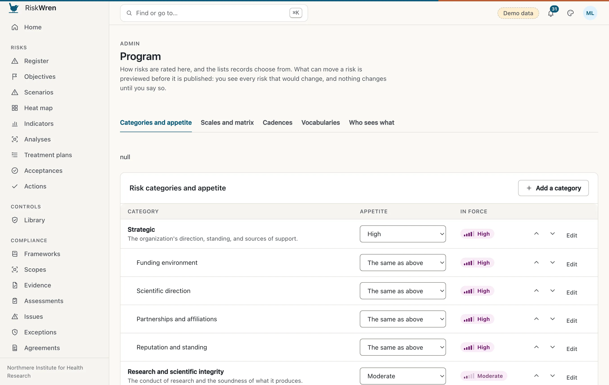

### See what a change would do before you make it

Three things can move a risk without anyone touching it: the **matrix** gives it its rating, **appetite** its standing, and the **cadences** its next review. A change to any of them is not made as you type. The page holds it as a draft, says so in a bar at the top, and **Preview and publish** opens **Before you publish**, which shows every open risk that would change, with what would change about it:

- its inherent, residual, or target **rating**;
- its **standing**: a risk within appetite may now need a decision, or the other way about;
- when it is **next reviewed**.

A change to how often documents are reviewed also says how many documents that follow the program's cadence would have their next review moved.

Nothing has changed at that point. **Publish, and change** the number of risks shown makes the change, and changes exactly the risks listed. **Cancel** leaves everything as it was, draft included; **Discard**, on the bar, drops the draft.

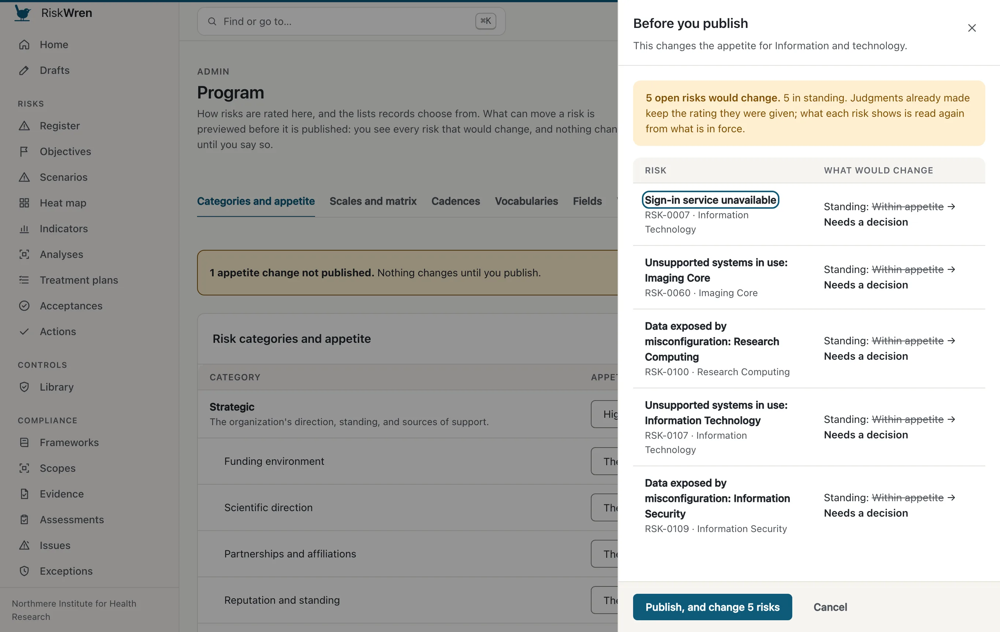

What is published is recorded in the history, and each risk that moved says so in its own history, with the line that changed.

### Categories

**Add a category** at the top of the tree or beneath a category that is there. A category at the top needs an appetite of its own. **Edit** renames one, describes it, or retires it: a retired category is not offered to new risks, and risks already in it keep it. The arrows put categories in the order people will choose from.

### Appetite

Appetite is the highest residual rating the organization will live with for a kind of risk without a plan or an acceptance. It is set for each top category and can be set differently for any category beneath; one that sets none takes its parent's.

In the default program, the research-institute starter, clinical, regulatory, and financial risk have a low appetite, strategic risk a high one, and the rest moderate. The other starter programs differ in their families. Changing an appetite is previewed first, because it changes which risks need a decision.

### An example: lowering an appetite

In the demo organization, sign in as the risk manager, Mireille Lachance. Suppose the security leader asks for information and technology risk to be held to low, not moderate.

1. **Admin → Program → Categories and appetite.** In the row for **Information and technology**, choose **Low** under **Appetite**. The categories beneath it, which set none of their own, follow it. The bar at the top says one appetite change is not published, and that nothing changes until you publish.
2. **Preview and publish.** **Before you publish** lists every open risk whose standing would change. Here they are the technology risks rated moderate, within appetite today: each would become **Needs a decision**, or **Being treated** where a plan is on time.
3. **Read the list before you publish.** Each listed risk will be on the Home of its owners and of the leaders of its unit, and each will need a plan or an acceptance. A moderate risk can be accepted by a leader of its unit, for up to 24 months.
4. **Publish, and change** those risks, or **Cancel** to think again, or **Discard** the draft. Once published, each risk's history records the change to its standing.

### Scales and matrix

Every word in the method can be changed: the name and meaning of each level of likelihood, the name of each level of impact, what each impact level means on each dimension, and the name and meaning of each rating. Each cell of the matrix is a choice of rating.

- **A rating may not fall as likelihood or impact rises.** A matrix that breaks this is refused, with the reason.
- **Publishing makes a new version.** Every open risk is read again from the matrix now in force, so the register always speaks one language. Each judgment already made keeps the rating it was given and the version it was made under: the assessments of a risk show what was decided at the time, and its history shows when the program moved it.
- **The shape stays.** The number of levels and the set of ratings are changed with a program pack, because appetite, acceptances, the review cadence, and people's limits all name the ratings. So is how much a control may reduce a rating.

### Cadences

| Cadence | As shipped |
|---|---|
| How often a risk is reviewed, by residual rating | Critical 3 months, high 6, moderate 12, low 24 |
| How soon a risk not yet rated is due | 3 months |
| How long a control's rating, a test result, and evidence hold | 12 months |
| How often a key control is tested | 6 months |
| The longest an exception may run | 12 months |
| How often a policy, standard, procedure, plan, or guideline is reviewed | 12 months, unless the document sets its own |
| How often a continuity plan is exercised | 12 months; a new plan within three months |
| How long an issue is given, by severity | Critical 30 days, high 90, moderate 180, low 365 |
| Reminders | 14 days before; the steward 7 days late; the leader 21 days late |

A higher rating is never reviewed less often, and a more severe issue is never given longer. Changing how often risks are reviewed moves their review dates, so it is previewed. An issue already raised keeps the date it was given.

### Fields of your own

**Admin → Program → Fields** adds to a kind of record what your organization also records about it: a cost center on a system, a contract owner on a third party, whether a risk goes to the board. Systems, processes, third parties, services, information assets, sites, risks, and controls can each carry up to twelve.

- **A field is a line of text, a number, a date, or one of a list,** with a label, a line of help, and whether it is needed. Its key is made from its label and never changes.
- **It is asked for in the record's form and shown on its page,** under **More about it**, and every change to a value is in the record's history. Through the API, a record takes them as `custom`, by key.
- **A field taken away keeps its values, unshown,** and bringing it back brings them back.

### Vocabularies

Choose a list, then rename its values, say what each means, put them in order, add one, or retire one.

- **Records store a value's key, never its name**, so renaming a value rewrites nothing. A new value's key is made from its name and never changes.
- **A value in use is retired, not removed.** Records that have it keep it; new records cannot choose it.
- **Some lists can only be renamed.** A severity sets a clock, a kind of link says what it joins, an owner kind decides who may edit. Their names, meanings, and order can be changed here; values are added or taken away with a program pack.
- **A value new records start with cannot be retired**, such as a system's lifecycle "in service".
- **What a value holds beyond its name and meaning stays as it was.** The address pattern of another system, for one, is set in a pack ([Change the program with a pack](#change-the-program-with-a-pack)).

### Who may accept what

The table on the Program page shows, for each rating, how often a risk is reviewed and who may accept it when it is above appetite:

| Residual rating | Reviewed every | May be accepted |
|---|---|---|
| Low | 24 months | No acceptance is needed |
| Moderate | 12 months | For up to 24 months, by a leader of the unit or above |
| High | 6 months | For up to 12 months, by a leader whose limit reaches high |
| Critical | 3 months | For up to 6 months, by a leader whose limit reaches critical |

A leader's limit is set with the role, under **Admin → People**: **May accept risks**, up to moderate, high, or critical. The page sets one limit for all of a person's leader roles. A leader left at **The lowest rating that needs acceptance** may accept only what needs no particular limit: moderate risks, as shipped. Nobody may accept a risk they own. A critical risk needs a leader whose limit is critical, over the risk's unit. A sensible start: unit leaders at moderate, division leaders at high, and the executives who lead the divisions at critical. In the demo organization, the President may accept a critical risk anywhere, and the chief operating officer and the chief scientific officer in the divisions they lead.

### Change the program with a pack

The program is held as one document, a **program pack**: the scoring method, the families of risk and their appetite, the cadences, the acceptance table, the tiering rules for third parties, the sharing rules (which information needs which agreements), the privacy rule, and the vocabularies, among them the address patterns of other systems.

```bash
uv run riskwren program export --output program.json    # write the one in force
uv run riskwren program import program.json --dry-run   # check an edited one
uv run riskwren program import program.json             # load it
```

An import checks the whole pack first and reports every problem together. A scoring method in which a rating falls as likelihood or impact rises is refused. A changed method becomes a new version: assessments already made keep the version they were made under, and every open risk is read again from what was loaded, as it is when a change is published in the app.

A pack is the way to change what the Program page does not: who may accept what, the number of levels and ratings, how much a control may reduce a rating, the tiering and sharing rules, and the address patterns of other systems. An identifier recorded under **Known elsewhere as** becomes a link when its system's entry in `external_systems` has a `url` containing `{id}`:

```json
{"key": "ticket", "label": "Ticket", "url": "https://servicedesk.example.org/ticket/{id}"}
```

Four starter programs ship with RiskWren: `research-institute` (the default), `academic-medical-center`, `university`, and `nonprofit`. `uv run riskwren init --program NAME` starts a new installation from one, and `uv run riskwren program import NAME` loads one into an installation, checked like any pack; try it with `--dry-run` first. See [`riskwren program`](cli.md#riskwren-program).

A pack is also how one installation's program is copied to another, and how a program is kept under version control.

## Questionnaires

A questionnaire is a set of questions RiskWren asks people: to attest that a control still operates, to look again at a risk they own, to confirm that a unit's records are complete, to tier a third party or examine it. **Admin → Questionnaires** lists them, for managers for the whole organization and administrators, who add and change them. Anyone signed in can open one and try it.

A new installation has nine, written for RiskWren:

| Questionnaire | Asks | Asked by |
|---|---|---|
| **Control attestation** | A control's owner: does it still operate as described, is there evidence in date, and are you still the right person to answer for it? | A control attestation campaign |
| **Risk self-assessment** | A risk's owner: does it still stand, what has changed, and are its rating and plan still right? | A risk self-assessment campaign |
| **Unit completeness check** | A unit's steward: is everything the unit has on record, with the right owners, and is anything worrying not in the register? | A unit completeness check campaign |
| **System security profile** | Whoever runs a system: what it holds, who can reach it, how people sign in, and who patches, backs up, and watches it | A system security profile campaign |
| **Privacy impact assessment** | Whoever answers for a process or system that handles sensitive information: what it handles about people, why, who it is shared with, how long it is kept, and what could go wrong for them | A privacy impact assessment campaign ([below](#privacy-impact-assessments)) |
| **Third-party tiering** | What a third party holds, how it reaches the organization, and what relies on it; the answers set its tier | Tiering a third party ([Tiering](third-parties.md#tiering)) |
| **Due diligence: short** | Eight questions for a third party with little at stake: how it protects what it holds, and what it does when something goes wrong | A due diligence review of a tier 3 third party |
| **Due diligence: standard** | A security questionnaire for a third party that holds confidential information or reaches systems | A review of a tier 2 third party |
| **Due diligence: full** | The full security questionnaire, for a third party that holds restricted or regulated information or is relied on for critical work | A review of a tier 1 third party |

### Add a questionnaire

**Add a questionnaire** asks for:

| Field | What it is |
|---|---|
| **Title** | What people will see |
| **Short name** | Lower-case letters, digits, and hyphens, made from the title. It is used in addresses and cannot be changed |
| **What it is for** | **Attestation**, **Self-assessment**, **Completeness check**, **Due diligence**, **Review**, **Privacy impact**, or **Other** |
| **What it asks, in a sentence** | Shown under its title |

**Add, then write its questions** opens its **Edit** tab with one section and one question to start from. **What it is for** is a label: it is shown in the list's **For** column and says what kind of asking it is, and it does not decide where the questionnaire is asked.

A campaign always asks its own built-in questionnaire: a control attestation campaign asks **Control attestation**, and so on. A questionnaire of your own is asked in a due diligence review. A review asks the questionnaire its third party's tier names, and a tier can name one of your own in the program pack's tiering rules (`"due_diligence": "its-short-name"` on the tier); a review started through the API can name any questionnaire in use. See [Due diligence](third-parties.md#due-diligence).

### Questions that appear by condition

A question, or a whole section, can be asked only when an earlier answer makes it relevant. "What is different from the statement?" is asked only of someone who said the control operates partly or not at all. So nobody answers what does not apply to them, and what is asked is short.

- A rule looks only at questions asked before it, so showing and hiding can never run in a circle.
- An answer to a question that an earlier answer has since hidden is dropped. It cannot go on deciding what else is asked.
- The form reacts as it is filled in, and the server decides again when the answers are sent. The two use the same rules, held together by one file of test cases.

### Versions

**Edit** changes a questionnaire's sections, questions, their kinds and options, and when each is asked, with the form as it will be asked shown beneath. Saving changed questions **publishes a new version**. Earlier versions are never altered.

- **An answer is read against the version it was given to.** Reword a question or remove one, and what people answered before still reads as it was asked then.
- A draft begun under one version is finished under that version.
- A built-in questionnaire you have edited is yours from then on, and a later release leaves it alone. One you have not touched is brought up to date, as a new version.
- **Versions** lists every one, with who published it and what they said had changed. **Retire**, on the questionnaire's page, stops it being asked in a new review and keeps every answer already given; **Bring it back** undoes it.

The **Try it** tab asks the questions and shows how the answers would be kept, without saving anything.

## Campaigns

A campaign asks a set of people for one thing by a date, and shows who has answered. **Compliance → Campaigns → Start a campaign** (an assessor or a manager, for the units they cover).

| Campaign | Asks | For |
|---|---|---|
| **Control attestation** | The owners of controls | Does each control still operate as described, is its evidence in date, and are you still the right owner? |
| **Risk self-assessment** | The owners of risks | Does each risk still stand, what has changed, and are its rating and plan still right? |
| **Unit completeness check** | The stewards of units | Is everything the unit has on record, with the right owners? |
| **System security profile** | The owners of systems | What each system holds, who can reach it, and who patches, backs up, and watches it |
| **Evidence request** | The owners of controls | A named piece of evidence for each control |
| **Acknowledgment** | The people a document applies to | Read the version in force, and say they have |
| **Privacy impact assessment** | The owners of processes and systems that handle restricted information | What each handles about people, why, who else sees it, how long it is kept, and what could go wrong for them ([below](#privacy-impact-assessments)) |

Choose what to ask, give it a name and a date, and say what it is about: everything in a unit and beneath it, or, for controls, only those a compliance scope uses. Before it starts, the form says how many people would be asked about how many things. Each person is told once, with a count, and finds each thing on their **Home**.

- **Everyone is asked the same version** of the questionnaire, the one in use when the campaign started. Changing the questionnaire later does not change a campaign under way.
- Any owner of a control, risk, or system may answer for it, not only the one who was asked. An answer can be saved and finished later.
- **Something with nobody to ask is still listed**, and shown as such, so that a control whose only owner has left does not pass unnoticed. Name an owner, or **excuse** it with a reason.
- **An evidence request closes by itself** when evidence collected since the request is attached to the control.
- **An acknowledgment campaign is answered in the library,** by acknowledging the document. Those who already have are counted as answered when it starts ([Policies](policies.md#asking-for-it-by-a-date)).

### Following one

A campaign's page shows how far it has got, what those who answered said, **coverage by unit** with the least covered first, and every item with who was asked. Each figure is the count of the list beneath it.

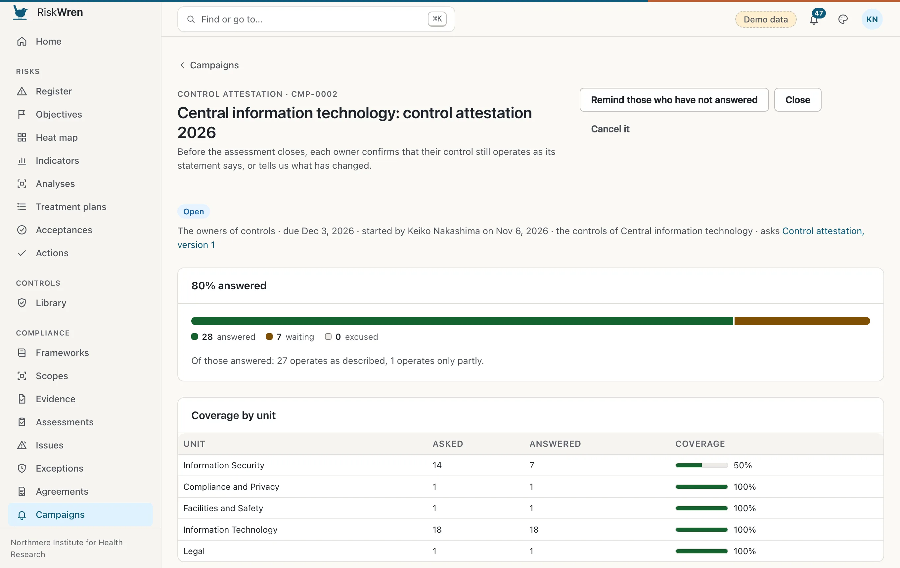

- **Remind** tells everyone who still owes something, once, with how many. The scheduled [reminders](#reminders) do the same as the date approaches, and tell a unit's steward and then its leader about what stays unanswered.
- **Close** ends a campaign and keeps what was answered. **Cancel it** is for one started in error.

### What an answer sets in motion

Answers are kept as given, and some need someone else to act. Those people are told.

| Answer | Who is told |
|---|---|
| A control only partly operates, or does not | The unit's assessors, managers, and stewards |
| Someone else should own this control | The unit's stewards |
| A risk no longer stands, or its rating is no longer right | The unit's stewards, assessors, and managers |
| A unit's records need attention | The assessors and managers who cover it |
| A privacy impact assessment is answered | The assessors and managers who cover its unit, to review it; with concerns, it says so |

An attestation is recorded on the control, with who said it and when. It is **never a test**: see [An attestation is not a test](evidence-and-testing.md#an-attestation-is-not-a-test).

### Privacy impact assessments

A process or a system that handles a class of data the program names needs a privacy impact assessment: what it handles about people, whose information it is and how much, why and on what basis, who else sees it and what covers that, how long it is kept, and what could go wrong for the people it is about. To begin with the class is **restricted**, and an assessment is done again every 36 months; both are set in the program pack's `privacy` rule:

```json
"privacy": {"impact_assessment_classes": ["restricted"], "impact_assessment_months": 36}
```

**Compliance → Privacy impact** lists every process and system in use that needs one, and where each stands: never assessed, asked, answered and waiting for review, reviewed, or due again. A **Privacy impact assessment** campaign asks the owner of each that has none current; one that is current, asked, or waiting for review is not asked again.

When an owner answers, the assessors and managers for its unit are told. The answers are checked for what wants a closer look: more collected than the purpose needs, sharing outside the organization with nothing covering it, more people able to see it than need to, and information not de-identified though it could be. The record's **Privacy** tab shows the last assessment, its concerns, and its answers; one of those who assess for its unit reads it and **Reviews it**, saying what was made of it. The review, and the answers, are kept with the record.

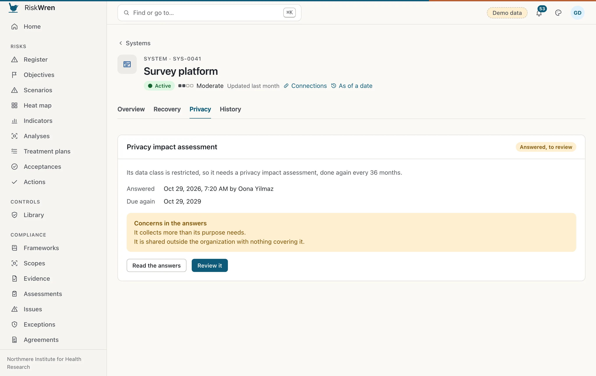

## Committee sessions

**Reports → Committee sessions** holds the meetings of the risk and compliance committees. A unit's leaders, or a manager, plan one: its committee, the day it meets, and the unit it answers to. Whoever plans it is its owner, and sees it on Home in the fortnight before it meets.

- **The agenda** is drawn from the register: a risk, an issue, an exception, a control, a document, an agreement, a scope, an objective, or an assessment, each with what the committee is asked; or a topic of its own. Items are put in order, and taken off until something is decided about them.
- **A decision** is recorded on each item: noted, approved, declined, or deferred, with what was decided. It **shows on the record it was about**, under **Committee decisions**, and that record's owners are told. A decided item stays on the agenda, and a session where anything was decided cannot be cancelled.
- **The minutes** say who was present and what else was said, in the same simple Markdown as documents. The decisions are not repeated there: they are kept with their items.

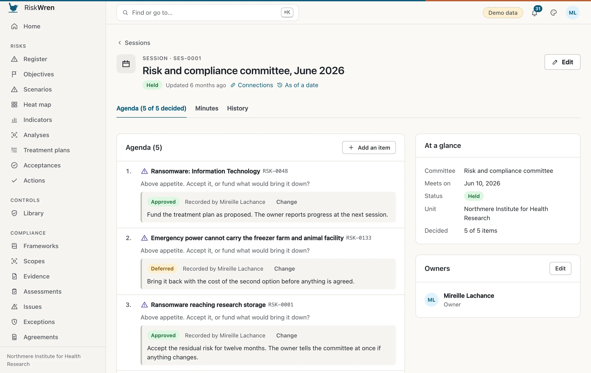

The register's records and their sessions are joined both ways in the **Connections** picture, and the list of sessions can be cut to those that discussed a record.

## When someone leaves

Disable the account under **Admin → People**, or with [`riskwren users disable`](cli.md#riskwren-users-disable). The person is signed out and cannot sign in. Everything they did stays in the history under their name.

Nothing they answered for is left without an owner:

- **What they alone owned** passes at once to the steward of its unit; where the unit and the units above it have no steward, to its leader; failing that to someone who runs the program; and failing that to the administrator who disabled the account. This covers records of every kind, open actions, treatment plans, and what open campaigns were waiting on them for.
- **Whoever it passes to is told**, with a count, and has **Name who takes what they held** on Home until it is done.
- **What they shared with someone else** is left as it is: the other owner still answers for it.

The stand-in is a holding place, not a decision. **Reports → Tidy → From people who have left** lists each person with things still to pass on, and their page lists every one with who has it now. Choose who takes it and **Pass on**: everything ticked changes hands in one step, the new owner is told, and the stand-in is released. A stand-in who should keep something passes it to themselves.

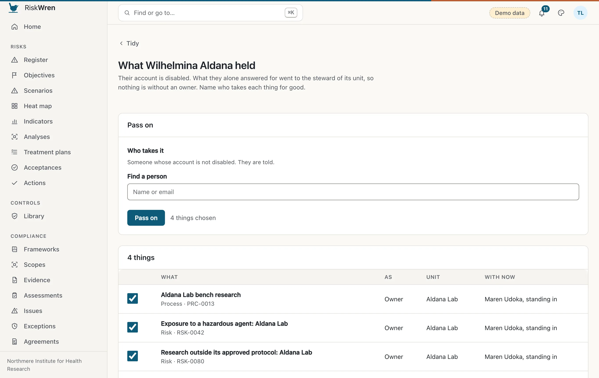

An administrator can pass on anything. A steward or a manager can pass on what belongs to their own units. The same page works for someone who has not left: **Admin → People**, the person, **What they hold**. Use it to move what a person holds when they change jobs.

Letting a person sign in again does not give anything back. A record left with no owner who can sign in shows on Home, to those who can name one, as needing an owner, and under **Tidy** as missing an owner who can sign in.

## Reminders

Everything with a date reminds whoever it is waiting on: actions, risk reviews, issues, evidence, acceptances, exceptions, the next test of each control, what a campaign has asked, the next reading of each indicator, document reviews, agreements' notice dates and ends, third parties due for review, and the answers a due diligence review is waiting for.

| When | Who is told |
|---|---|
| 14 days before the date | Whoever it is waiting on |
| The day after the date | The same people, as overdue. An overdue test also goes to the assessors, because an owner cannot test their own control |
| Still late after 7 days | The steward of the unit, for what goes up |
| Still late after 21 days | The unit's leader, for what goes up |

- **What goes up** to the steward and then the leader: actions, risk reviews, issues, what a campaign has asked, document reviews, the end of an agreement, and third parties due for review.
- **What stays with its owners:** evidence, acceptances, exceptions, control tests, an agreement's notice date, due diligence answers, and indicator readings. Nobody else can renew a person's evidence, or give notice on their agreement, for them.
- Each of these is said **once** for a given date. Moving the date starts again.
- An agreement is told of further ahead: 30 days before the last day to give notice, and 60 days before it ends, because a renewal takes longer to arrange than an action takes to finish ([Agreements](compliance.md#dates-and-warnings)).
- An indicator's reading is reminded only as it falls due, not two weeks ahead. Due diligence answers are owed by a contact with no account, so it is the review's owners who are told, and who chase.
- Something found already long overdue, as on the first day after an upgrade, is told once to whoever it has reached, and not to everyone below as well.

The three periods are part of the program's cadences, with the others. **Admin → Operations** shows them as they are set.

**A reminder is a notice.** So is anything assigned to a person or decided for them. The bell at the top right counts the notices since they last looked, and email, where it is [set up](configuration.md#email), sends the same, as each happens or once a day, as each person chooses under **Your account**. See [Notices](issues-and-exceptions.md#notices).

### Key controls and the next test

What is known about a control holds for twelve months. A control marked **key** is due to be tested again after six. Each control's page shows the date its next test is due, and its owners are reminded as it approaches. Marking a control key does not change what its last rating counts for; it brings the next test forward.

## Read the dashboards

There are two, each for the whole organization or for one unit and everything beneath it. **Reports → Compliance** shows how ready each scope is against what it is held to and what stands in the way; it is described in [The compliance dashboard](compliance.md#the-compliance-dashboard). **Reports → Risk** shows where the register stands:

| Figure | Counts |
|---|---|
| Open risks | Risks that are not closed |
| Above appetite | Open risks whose residual rating exceeds the appetite for their category |
| Need a decision | Those above appetite with neither a plan on time nor an acceptance in force |
| Reviews overdue | Open risks past their next review date |
| Ratings in doubt | Risks whose residual rating is in doubt because something it rested on changed: its controls, a completed plan, an indicator past its limit, or a risk analysis ([When the picture changes](the-register.md#when-the-picture-changes)) |
| Actions overdue | Open actions past their due date |

Below them are the residual matrix, the highest risks, the register by standing, by rating, by category, and by unit; **Early warning**, which counts the indicators past their limit, past their warning level, within their limits, and not yet read; and what is known about the controls: how many are effective, partly effective, not assessed, or rated too long ago to rely on.


On both, every figure is the count of a list, and opens that list with the same filters. A dashboard has no numbers of its own, so a figure and the records behind it cannot disagree.

### Measures

**Reports → Measures** (managers for the whole organization, auditors, and administrators) lists the program's defined measures, grouped as risk, treatment, compliance, issues and exceptions, and third parties. Each says what it counts and among which records, its figure as you may see it, and whether fewer is better. As on the dashboards, a figure opens the list it counts, with the same filters.

| Measure | Counts |
|---|---|
| Open risks, risks above appetite, risks needing a decision, risk reviews overdue, ratings in doubt | As on the risk dashboard |
| Actions overdue | Open actions, from plans and issues, past their date |
| Controls failing a test, controls not assessed | Controls in use whose test, still in date, found them less than effective (as on the compliance dashboard); those whose design or operation nobody has assessed |
| Evidence past its date | Items of evidence in use past the date they hold until |
| Open issues, issues overdue, critical issues open | Issues not closed or cancelled; those past their date; those of critical severity |
| Exceptions in force | Approved exceptions between their start and their end |
| Third parties not tiered, third-party reviews overdue | Third parties in use with no tier, or past their next review date |
| Sharing no agreement covers | The stops on Third parties → Coverage |

Each measure has a **trend**: the organization's figure from a snapshot the scheduler takes each day, over the last quarter, with how far it has moved. A snapshot is bookkeeping, not history: it is kept outside the hash chain, and one taken again the same day replaces the earlier one.

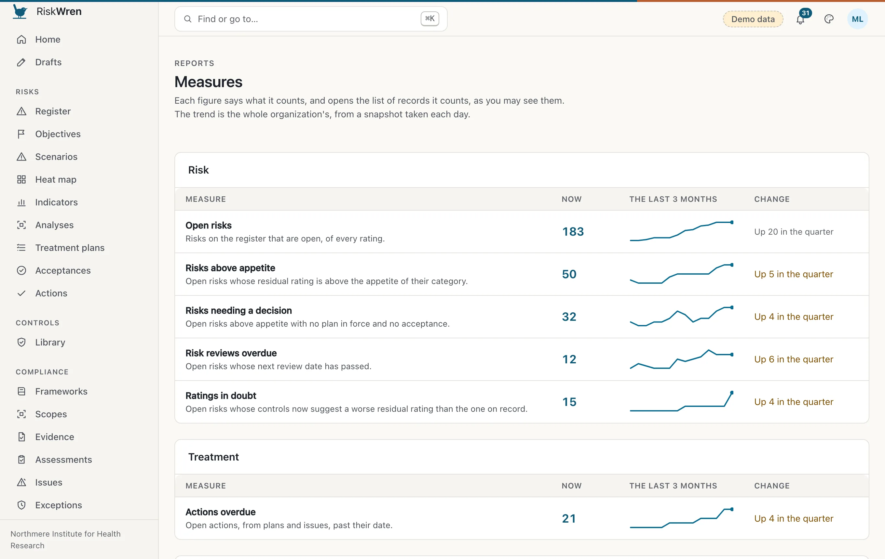

### Portfolio

**Reports → Portfolio** cuts the register and compliance the ways leadership asks, over the last quarter, half year, or year:

| View | Each row | Its figures |
|---|---|---|
| By unit | Each unit beneath the organization, with everything beneath it | Open risks, above appetite, needing a decision, risks added in the period; open and overdue issues, issues raised and closed in the period; exceptions in force |
| By category | Each family of risk, with its appetite | Open risks, above appetite, needing a decision, ratings in doubt, reviews overdue, risks added in the period |
| By framework | Each framework a scope is held to, with those scopes | How much of what applies is verified or in place; open and overdue issues about its requirements, issues raised and closed in the period; exceptions to its requirements in force |
| By third party | Each third party in the two highest tiers | Open risks that concern it, open issues about it, issues raised in the period, sharing no agreement covers; its next review |
| Issues and their causes | | Issues closed in the period by why they happened, raised in the period by what found them, open now by how long ago they were raised, and a year of issues raised and closed month by month |

As everywhere, each figure counts only what you may see, and opens its list with the same filters: the lists of risks and issues can be cut to a period (`added`, `raised`, `closed`), a root cause, or a framework's requirements.

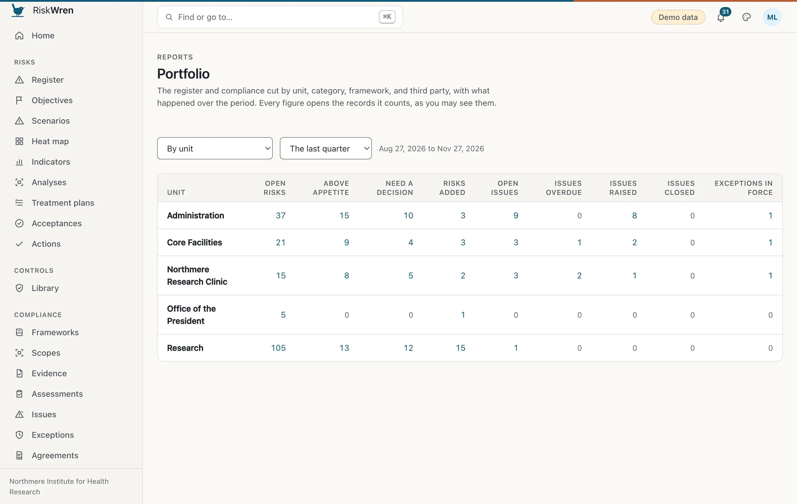

The calendar is caught up every hour by [scheduled work](configuration.md#scheduled-work): when an acceptance expires or a plan runs late, the risk's standing is updated, and the history records that as done by the system. Reading the register catches it up as well, so a figure is never behind the date even where the scheduler is turned off.

### Leadership reports

**Reports → Leadership reports** holds the reports given to leadership, the latest first. A manager for the whole organization prepares the next one: **Prepare the next report** shows it as it stands now, for the period from the day after the last report ended (the first time, the last quarter) to today. To cover another period, change **From** and **To** and press **Show this period**. A report says:

| Part | What it shows |
|---|---|
| Summary | What the person issuing it has to say about the period, in their own words |
| In the period | Risks added, issues raised, and issues closed |
| Top risks | The ten open risks with the highest residual rating, each with its unit, family, standing, and owners, and how it moved since the last report: new since then, joined the top, rose or fell from the rating it had, or unchanged; and the risks the last report listed that are no longer among them |
| Appetite | Each family of risk with its appetite: open risks, those above appetite, those needing a decision, and reviews overdue |
| Posture by framework | How much of each framework is verified or in place in the scopes held to it, how far that moved since the last report, and the open and overdue issues and exceptions in force about its requirements |
| Third parties with most at stake | Those in the two highest tiers: their next review, open risks, open issues, and sharing no agreement covers |
| Measures | Every [defined measure](#measures) now, against the last report; the first time, against the organization's snapshot from the start of the period |
| Overdue | Issues, risk reviews, third-party reviews, and actions past their date: how many, and the ten most overdue of each |

Until a report is issued nothing of it is kept: it is worked out afresh each time it is looked at. **Issue the report** freezes what it says, with its title and summary, and gives it a reference (`LDR-0001`). From then on it reopens exactly as it was, whatever happens to the register. Its figures are what they were on the day, so, unlike the dashboards', they do not open today's lists.

An issued report carries a **fingerprint**: the SHA-256 of what it says, written canonically (keys sorted, no spaces, UTF-8). The history records the issue with the same fingerprint, in its hash chain. Whenever the report is opened, what it says is hashed again and compared with both, and **The fingerprint verifies** means it is the report that was given. A report changed afterwards no longer matches, and the page says so. A report is never edited or withdrawn: the next report is the place to correct one. **Print** prints it without the application around it.

Leadership reports are the organization's, and only managers for the whole organization prepare and issue them. Who reads them depends on the organization's size, so **Admin → Program → Who sees what**, under **Who reads the leadership reports**, chooses it. Those who read everything (managers for the whole organization, auditors, and administrators) and those who lead the whole organization always read them. Beyond them:

| Who else reads them | For |
| --- | --- |
| Nobody else | A large organization, whose executives are the reports' audience |
| Anyone whose role covers the whole organization (the default) | Most organizations. This adds assessors for the whole organization, such as a security leader who assesses everywhere, as a CISO usually does. Stewards and leaders are always for a unit, so it adds none of them |
| Every leader and every manager, of any unit | A smaller organization, where the people who run the program day to day are its most senior users |

People can also be named as readers, whatever the choice: a CISO who leads only the security unit, say, or a GRC director. A change applies from each person's next page, and is in the history.

A reader who may not see a record that a report names (a restricted risk, say) sees where it stands, its rating and how it moved, but not its reference, name, unit, or owners; the page says how many entries are withheld. The report itself is unchanged, and its fingerprint is checked against it as it was issued.

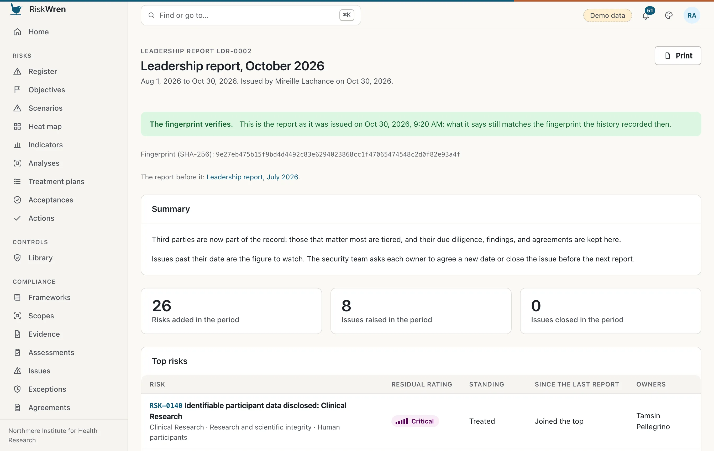

## The history

Every change to every record is written to an append-only history in the same transaction as the change: who, when, and each value before and after. Each event is hashed together with the one before it, and the database itself refuses updates and deletes on the history.

- Each record's **History** tab shows its own events in plain words.
- **Reports → History** shows every change in one place, for managers for the whole organization, auditors, and administrators: narrowed to a person, a record, a kind of record, or a span of dates. It opens on changes to records; sign-ins, exports, and settings are one choice away. A [restricted incident case](incidents.md#restricted-cases) is left out for anyone not named on it; its events are still in the chain that `riskwren verify` checks.
- Reading is recorded where it matters: every download of an evidence file and every export of a list is an event, with who and what.
- `uv run riskwren verify` recomputes the chain and reports the first event that has been altered, removed, or cut from the end. It also checks every published version of a document, and every leadership report, against the fingerprint the history took when it was published or issued.
- `uv run riskwren doctor` checks that the database still refuses changes to the history.

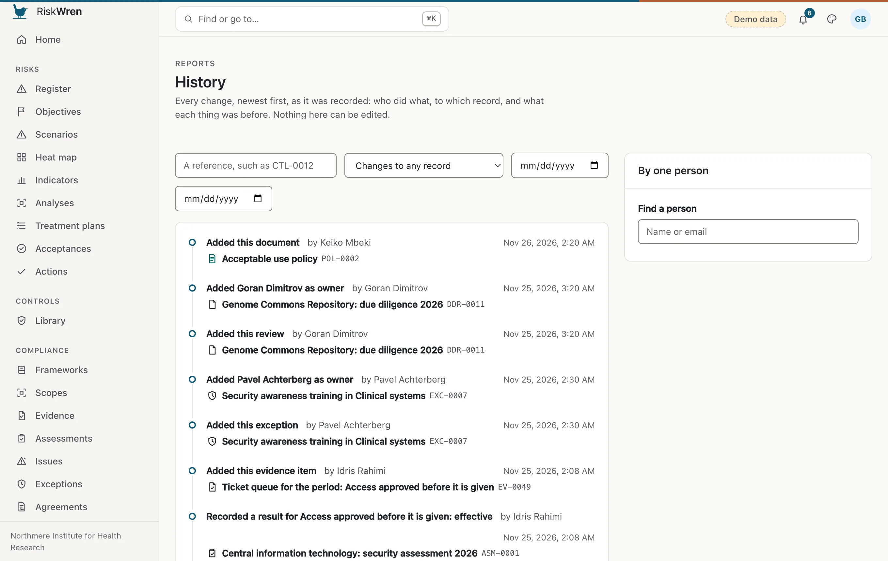

Assessments, control ratings, test results, and acceptances are never edited. A new one supersedes the last, and all of them are kept.

### As of a date

Because every change holds each value before and after, any record and any register can be seen as it stood at the end of a chosen day. Nothing is kept for this: the record as it is now has every later change undone, newest first, and a record added after that day did not exist yet.

- **Reports → As of a date** shows a register (risks, controls, issues, exceptions, or third parties) as it stood: what existed then, each with its status, unit, and the fields that matter for its kind, such as a risk's category, residual rating, standing, and next review. Where something has changed since, the cell is marked and says what it is now. By default it shows only what was open or in use then.
- Every record's page has **As of a date** beside **Connections**: the record's fields at the end of the day beside how they are now, what changed listed first, and who owned it then and now.

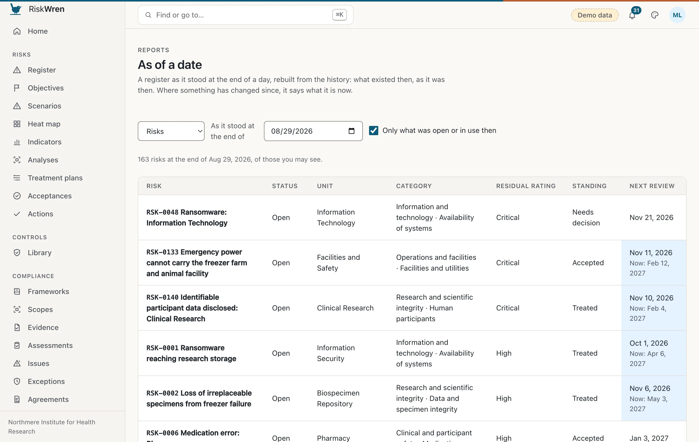

What is rebuilt is what the history holds: a record's own fields and its owners. A record's links, its assessments, and its other parts have their own records and history; a value the history keeps hidden is not shown. A field that an upgrade added has no history from before that upgrade, so for days before it, it shows the value it was given then. As everywhere, you see only the records you may see now.

### Dossiers

A **dossier** is everything known about a scope, a risk, or a third party as one ZIP file: what an auditor, a sponsor, or a regulator asks for, in a form that proves itself. **Dossier** at the top of the record's page takes one.

| Every dossier holds | A scope's also holds | A risk's also holds | A third party's also holds |
|---|---|---|---|
| `index.html`, a page to read and print: the record, what is in the package, and its history; `record.json`, the record as it stands; `history.json`, every change to it | Its members and implementations; each framework's statement; the security plan, as a page and in OSCAL; the plan of action, as data and in OSCAL; its evidence and that of the controls it uses, with their files | Its treatment: response, plans and their actions, acceptances; the issues about it | Its due diligence reviews with their answers and concerns; its reports and certificates with their reviews and files; its agreements; the sharing no agreement covers; the issues and risks about it |

`manifest.json` lists every other file with its size and SHA-256, and has a **fingerprint**: the SHA-256 of the manifest written canonically (keys sorted, no spaces, UTF-8), without the fingerprint itself. Taking a dossier is recorded in the history with that fingerprint. There are three ways to check one:

- **By hand, without RiskWren:** a file's hash is what `shasum -a 256` prints.
- **Reports → Check a dossier** checks all of it at once: every listed file is there and unchanged, nothing has been added, and the fingerprint is the manifest's own. If this installation's history recorded the dossier, it also says who took it and when.
- `uv run riskwren check-dossier FILE` does the same on the server, for a dossier of any size and without the database.

A dossier holds only what the person taking it may see. A file they may not open is left out; so is a file missing from the data home, or one that would take the package past 200 MB of files, and the manifest and `index.html` list what was left out and why.

## Administration

The **Admin** menu holds what keeps the installation running. Its pages are for administrators, except **Program** and **Questionnaires**, which are also for managers for the whole organization.

| Page | What it is for | Explained in |
|---|---|---|
| **People** | Add, import, edit, and disable accounts. Editing changes a person's name, title, and **Email address**, which they sign in with and single sign-on matches them by. **Works in** says which units a person belongs to; the first ticked is their main one, and the default unit on the records they add. Their roles are ticked beneath, with **May accept risks** for a leader: one acceptance limit covers all of a person's leader roles. Roles that come from single sign-on are shown, and are managed at the provider. **What they hold** lists and passes on what they answer for | [People and roles](getting-started.md#people-and-roles), [When someone leaves](#when-someone-leaves) |
| **Units** | The organization as a tree, added by hand or imported from a spreadsheet | [Units](getting-started.md#units) |
| **Appearance** | Names, logos, colors, the sign-in page, and **Your own words** for kinds of record and units | [Appearance](#appearance) |
| **Single sign-on** | The connection to the organization's identity provider, and **Roles from the provider** | [Single sign-on](configuration.md#single-sign-on) |
| **Other systems** | Tokens and webhooks | [Tokens](other-systems.md#tokens), [Webhooks](other-systems.md#being-told-what-happens-webhooks) |
| **Assistant** | Shown only when the assistant is turned on: how it is set up, and the log of every exchange | [The assistant](configuration.md#the-assistant) |
| **Operations** | The version, the database, the data home, the last backup, what stands between the installation and production, scheduled work, when reminders go, and email | [Scheduled work](configuration.md#scheduled-work), [Email](configuration.md#email) |
| **Program** | The program's rules | [Shape the program](#shape-the-program) |
| **Questionnaires** | The questions RiskWren asks people, in versions | [Questionnaires](#questionnaires) |

### Reorganizing units

The tree changes as the organization does. Under **Admin → Units**, **Edit** on a unit renames it or changes its kind or code. Two of its fields do more:

- **Within** moves the unit, with everything beneath it, under another unit. A unit cannot be moved beneath itself or a unit of its own. Roles and figures follow the tree: a role held over its new parent covers it from then on, and one held only over its old parent no longer does.
- **Status**: **Closed** closes it. A closed unit keeps its records and their history, is marked **Closed** in the tree, and can no longer be chosen: nothing is added to it or moved into it.

Closing a unit moves no record and changes no role. Its records stay in it, and are counted and reminded about as before; its stewards and leaders keep their roles over it, and a unit completeness check no longer asks about it. So, before or after closing it:

1. Move its records to the units that now answer for them ([Move or retire a record](the-register.md#move-or-retire-a-record)). A record's form offers the unit it is in, closed or not, beside the open units its editor may move it to, so a record is only ever moved on purpose.
2. Change the roles that named it under **Admin → People**, and anyone's **Works in**.

## Appearance

**Admin → Appearance** makes the product yours, with a live preview:

- the product's name and your organization's name;
- a logo for light and for dark mode, a tab icon, and a picture for the sign-in page;
- the default palette (Wren, Slate, or Garnet) and an accent color, which is adjusted for dark mode (or given its own shade after dark) and refused if text on it could not be read;
- how ratings are colored: an **ordinal** ramp from light to dark in one hue, which keeps rating apart from the colors of standing, or a **signal** ramp from green to red;
- a message on the sign-in page, up to five links of your own at the foot of the sidebar and the sign-in page, and the last line of every email, whose header carries your product's name, your organization's, and your accent;
- **Your own words** for kinds of record and for units, such as *department* for unit or *vendor* for third party, used in the menu, in page titles, and for the kinds of record.

An organization that needs its brand exact (every color by day and after dark, its logo files, its typefaces) sets it in the configuration file's [`[branding]`](configuration.md#branding) section instead. What the file sets is shown here, locked; the rest stays editable here.

Each person chooses light, dark, or system mode and a palette for themselves, from the appearance button at the top right.

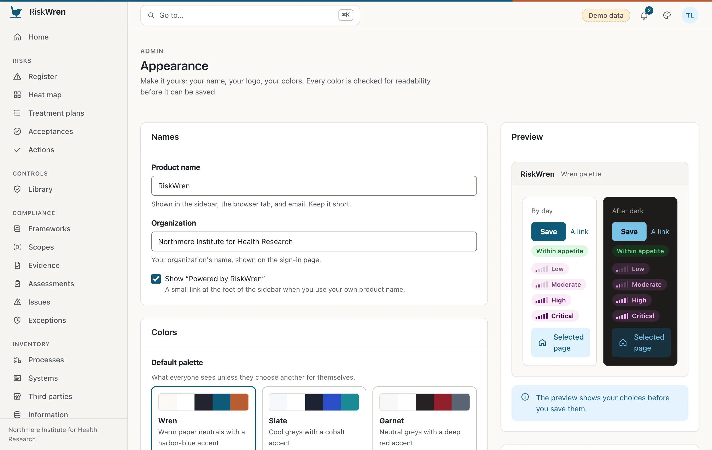

## Back up and recover

- `uv run riskwren backup FILE` writes every table, every stored file, and a manifest of their fingerprints to one file, as of one moment, while the server goes on running. Keep it somewhere safe: it holds everything. See [Back up and restore](configuration.md#back-up-and-restore).
- `uv run riskwren restore FILE` loads a backup into an empty database and data home, then checks every table, every file, and the history against it. See [Restore from a backup](help.md#restore-from-a-backup).
- `uv run riskwren program export` keeps a copy of the program you have shaped, as one file that can be kept under version control.
- If nobody can sign in, [`riskwren users`](cli.md#riskwren-users) adds an administrator or resets a password from the server's own command line. Changes made there are recorded in the history as made at the command line.
