# The register

This guide is for everyone who owns, assesses, or reads a risk. It covers the inventory, risks and their ratings, controls, what the controls suggest, treatment plans, and acceptance. What the organization is held to, and the proof that it meets it, is in [Compliance](compliance.md).

RiskWren is one connected register. A system is recorded once and every risk that concerns it points at it. A control is described once and every risk it bears on leans on the same record, with the same rating of how well it works.

## Home

Home is the page for what you owe. **Waiting on you** lists, most urgent first, the things that need you in particular: an action that is yours, a risk of yours that has not been assessed or is due for review, a risk whose rating is in doubt, a risk that needs a decision, a control of yours to rate, an acceptance you gave that is about to expire, evidence of yours that has stopped counting or soon will, a test you have been asked to do, a result waiting for your review, an issue that is yours to put right, a closure waiting for you to confirm, an exception to decide or one of yours about to end, and, for those who can name a new owner, a record with nobody answering for it. Each item is a link to the place where it is done.

The bell at the top right counts what has been assigned to you or decided for you since you last looked. See [Notices](issues-and-exceptions.md#notices).

The figures above the list count the same things for everything you may see, and each opens the list it counts.

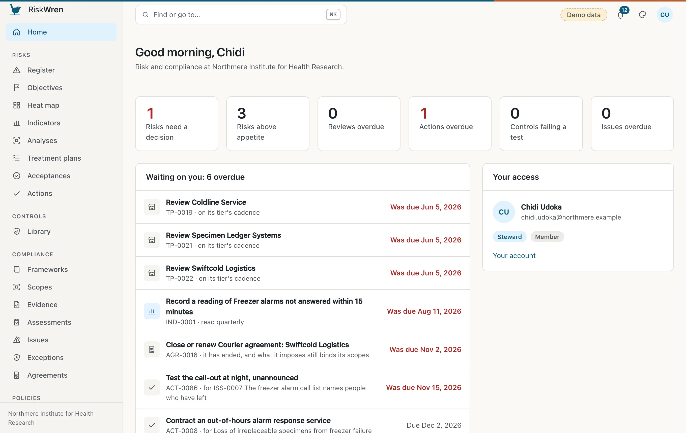

## The inventory

The inventory is what the organization has and depends on. It has four kinds of record:

| Record | What it is | Reference |
|---|---|---|
| **Process** | Something the organization does: a service a core provides, a clinical activity, payroll | `PRC-0001` |
| **System** | What the work runs on: an application, a platform, an instrument, a device, a data store | `SYS-0001` |
| **Third party** | Who it depends on: suppliers, service providers, collaborators, sponsors, subrecipients | `TP-0001` |
| **Information asset** | A body of information it holds: what it is, where it is kept, and who it is shared with. The record describes the information and never contains it | `INF-0001` |
| **Service** | What a third party provides: a hosted application, a maintenance contract, a test sent out. See [Third parties](third-parties.md) | `SVC-0001` |

Every record has a name, a unit, a criticality, the most sensitive class of data it touches, and named owners. Systems also say how they are hosted and where they are in their life: planned, in service, being retired, or unsupported.

The inventory is open to everyone signed in. A unit's steward or a manager adds records; owners and stewards keep them current.

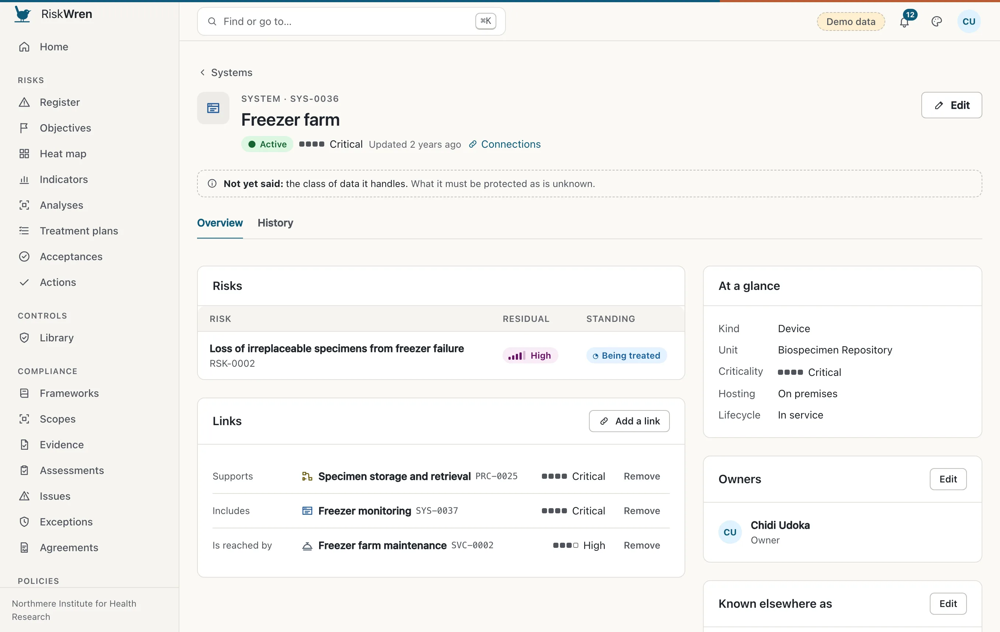

### Links

A record says what it relies on:

| From | Link | To |
|---|---|---|
| Process | relies on | System |
| Process | is performed by | Third party |
| System | is supplied by | Third party |
| System | holds | Information asset |
| Process | uses | Information asset |
| Information asset | is shared with | Third party |
| Service | reaches · handles | System · Information asset |
| Process · System | relies on · is supplied by | Service |
| Third party | subcontracts to | Another third party |
| Process or system | depends on · is part of | Another of the same kind |

A link is made once, from either end, and can be read from both. A lab can say that its work relies on central storage without anyone in central computing doing anything.

### Business impact and recovery

A process's **Business impact** tab says what the organization cannot afford to lose: how much its loss hurts as time goes on (after four hours, a day, three days, a week, and a month, from negligible to severe), how soon it must be back (its recovery time), how much information it can afford to lose (its recovery point), and the least it needs to run. An analysis is a judgment by a named person and is never edited: analysing again supersedes it, and every one is kept.

A system's or a service's **Recovery** tab says what it can actually deliver: what it can be restored within, how much information it can lose, and what that rests on (a restore tested on a date, a supplier's contract, a design never tried), with the processes that rely on it and what each needs.

The process's tab then checks each system and service it relies on against what it needs, and lists every **shortfall**: one that cannot be back in time, one that would lose more information than the process can afford, and one whose capability nobody has said. **Reports → Resilience** lists every analysed process, those with the most shortfalls first.

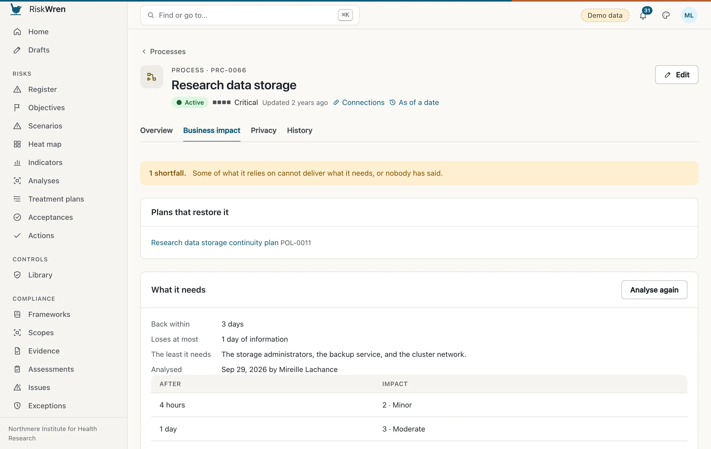

### Continuity plans and exercises

A continuity plan says what to do to keep a process going, or to bring it back, when something stops it. It is written as a document of the kind **Continuity plan** ([Policies](policies.md#documents)), so it has versions, approval by named people before each is published, owners, and a review date, as any document does. **Reports → Continuity plans** lists every plan in use, and the processes with a business impact analysis that no plan restores.

A plan's page shows the version in force, and, beside it, what is needed to use it:

- **What it restores, soonest first:** each process it is said to restore (**Change**, by those who keep the plan), how soon it must be back and how much information it can lose, the least it needs, and each system and service it relies on, against what that can deliver.
- **Whom to call:** the plan's owners, and the owners of each process and of what each relies on, with their titles and email addresses.
- **Exercises:** each test of the plan.

**Print** prints the page without the application around it. **Download for offline use** gives the version in force as one HTML file that needs nothing else to open: its words, what it restores and in what order, what each relies on, whom to call, and when it was last exercised, with the version and the moment it was taken, so that whoever holds it can check it is still the one in force. Keep a printed or downloaded copy where it can be reached when the systems are down. A process's **Business impact** tab names the plans that restore it.

An exercise is a test of the plan: a tabletop, a walk-through, a simulation, or a full interruption. **Record an exercise** (those who keep the plan, and those who assess for its unit) says when it was held, what was tried, who took part, what happened, whether the recovery objectives were met, and how long recovery took if it was timed; it is kept with the version that was in force. Something it showed must be put right is a **finding**: **Raise a finding** raises an issue in the one register, for the plan's unit, with the exercise as its source. A plan is exercised every 12 months (the program's `plan_exercise_months` cadence), a new one within three months of being written; one due within a month waits on its owner's home page.

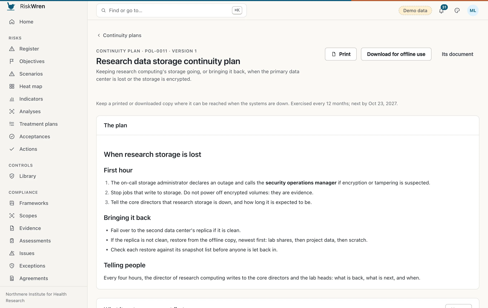

### Connections

Every record has a **Connections** link beside its name. It opens a picture of everything joined to the record: its links in both directions, the risks that bear on it, the controls that reduce them, the scopes it is in, and the evidence, issues, and exceptions about it. A list beside the picture says the same in full. See [Connections](compliance.md#connections).

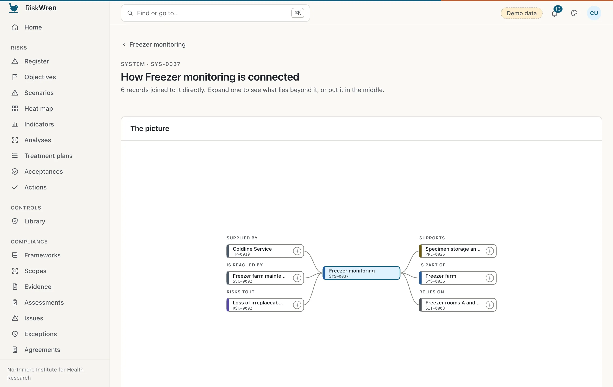

### Known elsewhere as

A record can carry what it is called in other systems: an asset tag, a contract number, a ticket, an entry in a configuration database. **Known elsewhere as → Edit** on the record. Search finds a record by any of them, and where the system has an address pattern they are links.

### Import and export

Every list has an **Export** button. It gives the list as it is filtered, and as much of it as you may see, as a spreadsheet (CSV) or as data (JSON). Taking an export is recorded in the history.

A steward or a manager can **Import** processes, systems, third parties, information assets, risks, and controls from a spreadsheet saved as CSV:

1. Choose the file. RiskWren reads its headings and matches them to fields where the names make it plain.
2. Say which column holds anything it could not match. A unit is given by its code or its name, an owner by their email address, and a choice by its key or by the words you see in the app.
3. **Check the file.** Every problem is listed with its row. Nothing has been added yet.
4. **Import**, once every row is good.

Each row is added as if by hand, by the same rules, in your name. Nothing is added unless every row can be, and a file imported twice adds nothing the second time. A file exported from one installation imports into another with its references kept. A rating is never imported: what a file says of how a control works, or how much risk remains, is a judgment to be made here by a named person.

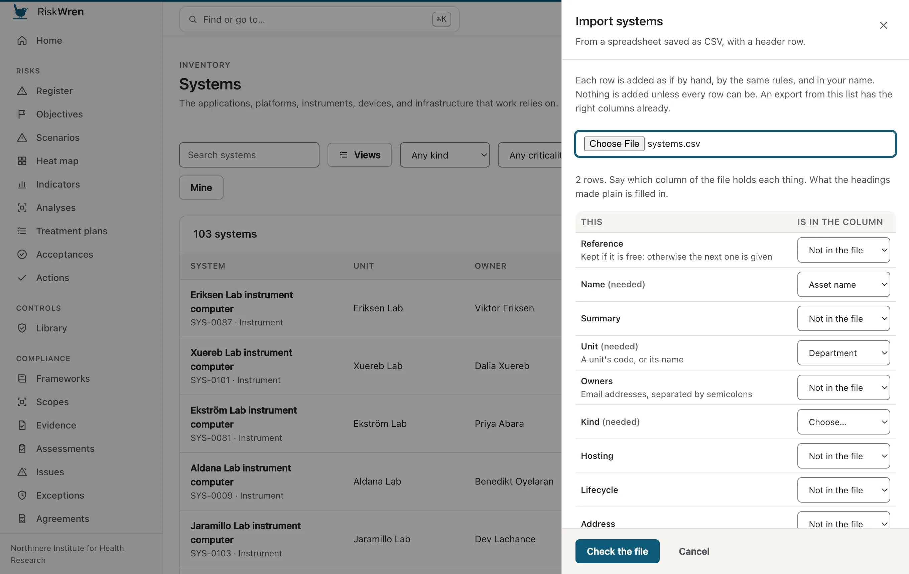

### Owners

Every record names the people who answer for it. An **owner** is accountable, a **delegate** acts for the owner day to day, and a **contact** knows the detail. Owners and delegates may edit the record.

When an owner's account is disabled, nothing they answered for is left without an owner. What they alone owned passes to the steward of its unit, who is told, and stays listed as theirs to pass on until someone is named for good. See [When someone leaves](running-the-program.md#when-someone-leaves).

### History

Every record has a **History** tab: who changed what, when, with each value before and after. Nothing in it can be edited or removed. See [The history](running-the-program.md#the-history).

## Risks

### Raise a risk

**Register → Raise a risk.** Start from the library when you can, by searching it at the top of the form: it holds 57 common risks, written as a cause, an event, and a consequence, each with its category and the controls commonly used for it. Change the wording to fit; the library is a starting point, not a standard.

A risk needs a name, a category, and a unit. Say what it **concerns** by linking the processes, systems, and third parties involved, so that anyone looking at a system sees the risks that bear on it.

### Assess it

A risk carries up to three ratings, and each is a judgment recorded by a named person with a reason.

| Rating | The question it answers |
|---|---|
| **Inherent** | How much is at stake if the controls did not exist or did not work? |
| **Residual** | How much remains, with the controls as they actually work? |
| **Target** | Where should it be once the plan is done? |

To assess, choose a **likelihood** from 1 (rare) to 5 (almost certain) and an **impact** from 1 to 5 on each dimension that applies: mission, safety, financial, legal, and trust. Every level has a written definition, shown as you choose, so that two people rating the same thing reach the same answer. The overall impact is the highest level on any dimension, and the rating is read from the matrix: low, moderate, high, or critical.

A reason is required. An assessment is never edited: a new one supersedes it, and the earlier one stays in the **Assessments** tab with who made it and why.

### Rating and standing

These are two different things, and RiskWren always shows them apart.

- The **rating** says how much is at stake.
- The **standing** says whether the risk is in order.

| Standing | Meaning |
|---|---|
| **Within appetite** | The residual rating is at or below what the organization has said it will live with for this kind of risk |
| **Being treated** | Above appetite, with a plan that is active and on time |
| **Accepted** | Above appetite, and accepted by someone with the authority, until a date |
| **Needs a decision** | Above appetite, and neither treated nor accepted. This is what leaders should look at |
| **Not assessed** | No residual rating yet |
| **Closed** | No longer applies, and kept for the record |

A critical risk that is accepted is in order. A moderate one in a category with a low appetite, with no plan and no acceptance, is not.

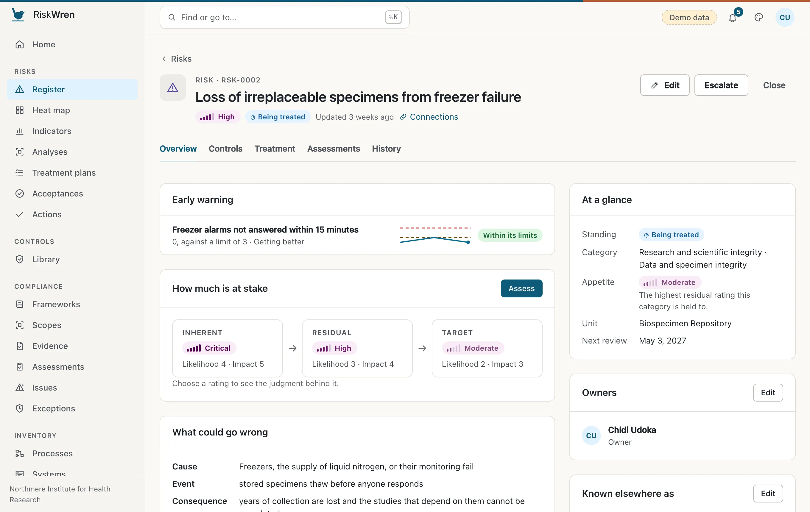

### Reviews

Each risk has a next review date, sooner the more is at stake: by default every 3 months for critical, 6 for high, 12 for moderate, and 24 for low. A review is a new residual assessment, even when nothing has changed; say so in the reason. A risk past its date shows as overdue, on its page and on its owner's Home.

### Escalate

A steward or leader can escalate a risk to a unit above its own, with a reason. The risk stays where it is and keeps its owner; escalation says "this needs you" to the leader above, and puts it among the risks at that level.

### Close

Close a risk when it no longer applies, with the reason. It leaves the open register and stays findable, with its whole history.

### The objectives it threatens

**Risks → Objectives** holds the organization's strategic objectives: what it means to achieve, over what period, and how it will know. A unit's leaders, or a manager, add them; the President's strategic plan is the usual source.

A risk names the objectives it threatens, under **Objectives it threatens** on the risk (those who keep the risk). Each objective then lists exactly the risks that name it, with how each stands, and the list of objectives shows how many open risks threaten each, by rating. That is the register read against the strategic plan: which aims are most at risk, and from what.

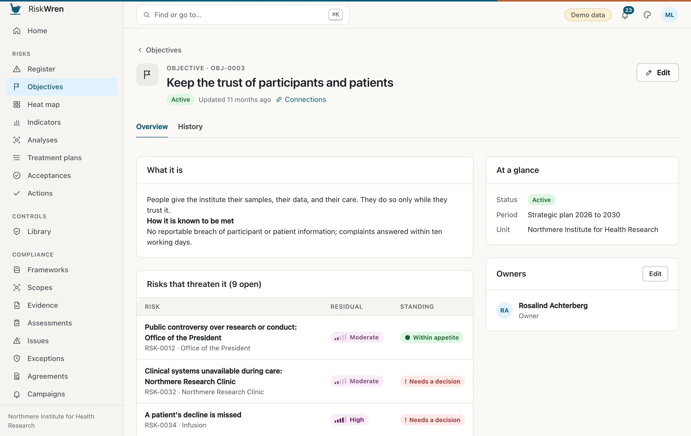

The register can be cut to the risks that threaten one objective. A risk's history keeps each objective it came to name, or stopped naming.

### The bow-tie

A risk's **Bow-tie** tab draws it left to right: what could cause the event, the controls that keep it from happening, the event, the controls that soften what follows, and the consequences. Nothing is entered for it. It reads the risk's own cause, event, and consequence, and the controls on its **Controls** tab: a control that reduces likelihood stands before the event, one that reduces impact after it, and one that reduces both on both sides, each with where it stands. A cause or consequence written one to a line, or with semicolons between, is drawn as several. A table below says the same for those who do not read diagrams.

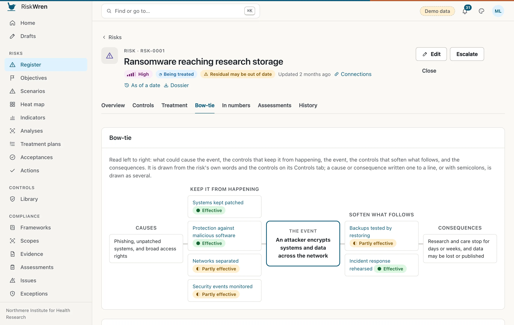

### Estimates in ranges

A rating on the program's scales is what the register is run by. For the risks worth putting a figure on, the risk's **In numbers** tab takes an estimate as ranges: how often a year (the fewest, the likely, and the most, where 0.1 is once in ten years) and what each time costs (the least, the likely, and the most), with what the numbers assume, which is required. An estimate is never edited: estimating anew supersedes the last, and every one is kept and in the history.

A **simulation** then plays out ten thousand years: in each, the year's rate is drawn from a PERT distribution over the frequency range, the number of events from a Poisson distribution at that rate, and each event's cost from a PERT distribution over the loss range. It says the average loss a year, the loss exceeded one year in ten, the chance of any loss in a year, and the chance of a year's loss passing each of ten figures from the median to the worst year simulated, with every assumption in words. Its draws are seeded from the estimate, so the same estimate always gives the same figures, and a figure quoted in a report can be checked.

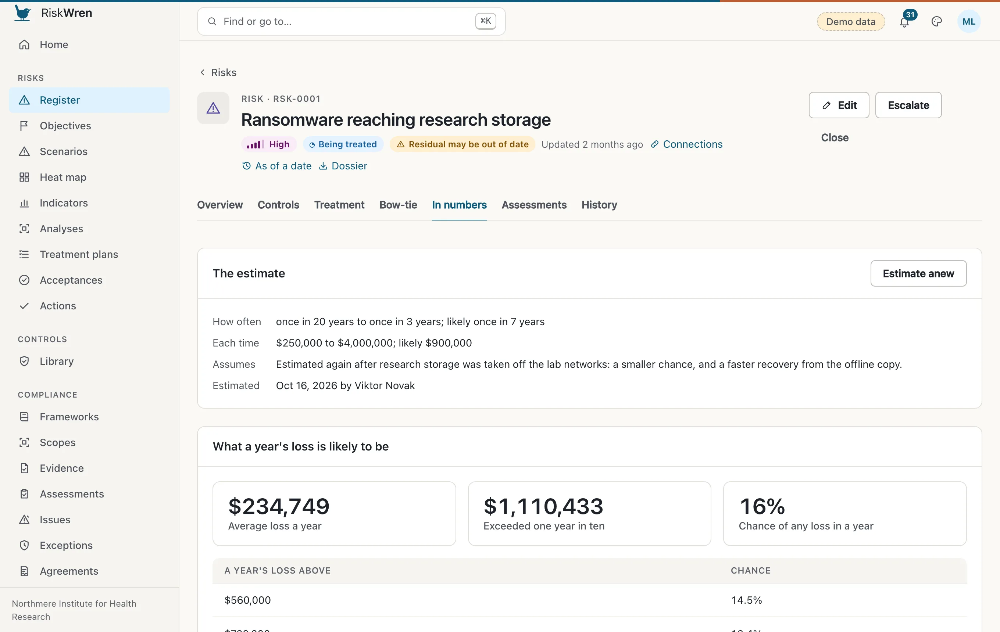

### Scenarios

**Risks → Scenarios** holds stories told on purpose: what might happen ("ransomware takes research computing down for two weeks"), what is assumed, the risks it would bring about or make worse and the processes it would stop, and, once it has been worked through, what was concluded. A scenario is kept by the stewards and leaders of its unit, and by assessors and managers, who work through scenarios with them; concluding one needs its conclusion. Where the risks it touches have estimates in ranges, the scenario shows what a simulation of them together comes to, taking them as independent, and names the risks it touches that have no estimate.

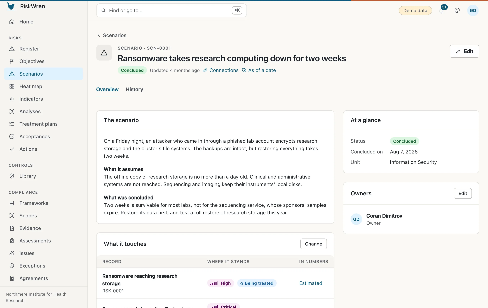

## Controls

A control is something the organization does to make a risk less likely or less harmful. It has a statement of what is done, an owner, a unit, a kind (preventive, detective, corrective, or directive), and how often it happens.

**Controls → Library** is your organization's own controls. **Add a control** can start from a set of 75 common controls in plain words: search it, choose one, and then make it specific. The starting text says "backups are tested"; yours says which systems, how often, and by whom.

### Rate a control

What is known about a control is recorded as a rating with two parts and a note:

- **Design:** if it were done as described, would it work?
- **Operation:** is it actually done?

Each is effective, partly effective, or ineffective. The note says what was looked at. As with assessments, a rating is never edited, only superseded.

A control that has never been rated is **not assessed**, and a rating older than twelve months is **out of date**. Neither counts for anything until someone looks.

A rating by its owner or a steward is a judgment. A rating from a **test** in an assessment, recorded by someone who does not own the control and confirmed by a second person, outranks it: while a test result holds, the control cannot be re-rated by judgment. See [Evidence and testing](evidence-and-testing.md#assessments).

### Link a control to a risk

On the risk's **Controls** tab, link each control that bears on it and say how:

- what it **reduces**: likelihood, impact, or both;
- how much the risk leans on it: **primary** (the risk relies on it) or **supporting** (it helps).

A risk started from the library offers the controls commonly used for it.

### What the controls suggest

Once a risk has an inherent rating and linked controls, RiskWren shows the residual rating the controls suggest, with its working:

1. Each control counts by how well it is known to work: effective counts in full, partly effective counts half, and ineffective, not assessed, and out of date count nothing.
2. A primary control counts in full; a supporting one counts half.
3. The counts are added up for likelihood and for impact. Each whole point takes that axis down one level, by at most two levels.

So a critical risk at likelihood 4 and impact 5, with one primary control that works, one that partly works, and impact controls adding up to one, is suggested at likelihood 3 and impact 4: high.

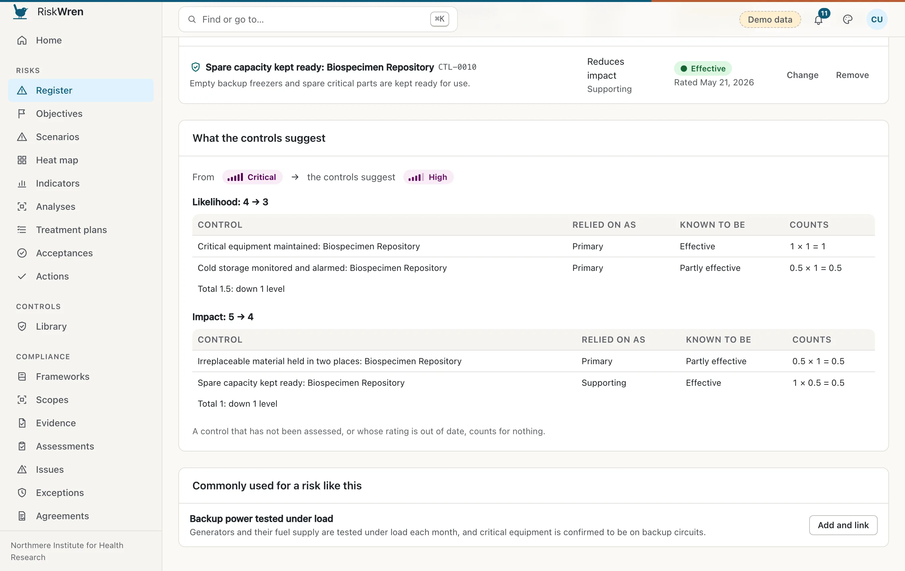

The suggestion is arithmetic and nothing more. The person assessing sees it, and then records their own judgment, which may agree or differ. If it differs, the reason says why, and both are kept.

### When the picture changes

If a control is later rated worse, or unlinked, and what the controls now suggest is worse than both the residual rating on record and what was suggested when it was made, the risk is flagged: its rating is **in doubt**, with the reason named. RiskWren never changes a rating by itself. It asks the owner to assess again.

## Treatment

A risk above appetite needs an answer. On the risk's **Treatment** tab, record the **response**, with the reason: reduce it, accept it, transfer it (by contract or insurance), or avoid it (by stopping the activity).

### Plans and actions

A treatment plan says what will be achieved, who owns it, by when, and the rating it aims for. Its **actions** are the steps, each with an owner and a due date.

- While a plan is active and its date has not passed, the risk is **being treated**.
- An action's owner marks it in progress and done. Moving its date needs a reason, and the original date and every move stay on the record.
- When a plan's last action is done, the plan is complete. That does not lower the rating: the risk is flagged, and its owner is asked for a new residual assessment that reflects what was actually achieved.
- A plan that passes its date with work still open no longer counts, and the risk **needs a decision** again.

**Treatment plans** and **Actions** in the sidebar list them across everything you may see. Actions can be filtered to your own and to those overdue.

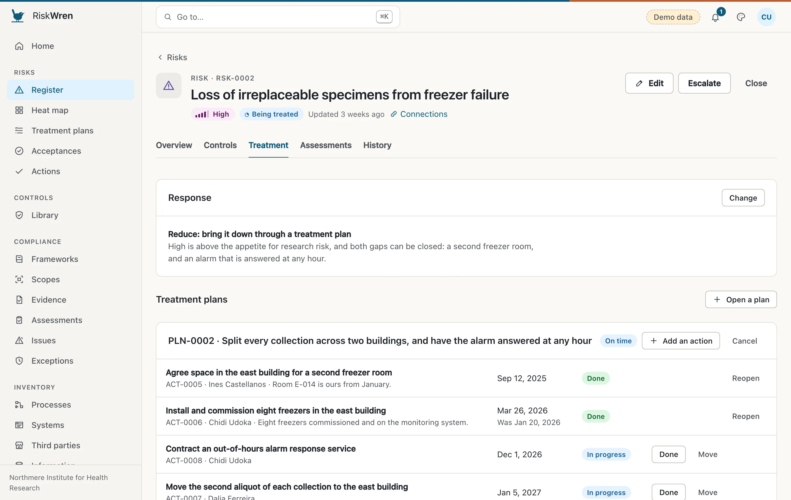

### Accept a risk

Accepting a risk is a decision by a named leader to live with what remains, for a stated reason, until a date. Three rules always hold:

1. **Nobody accepts a risk they own.** It goes to a leader above.
2. **Only a leader of the risk's unit, or of a unit above it, may accept it,** and for a high or critical risk only one whose limit reaches that rating.
3. **An acceptance expires.** By default a moderate risk can be accepted for up to 24 months, a high one for 12, and a critical one for 6.

If you may not accept a risk, its page says why and what is needed. An acceptance can carry **conditions**, the things that must stay true while it runs.

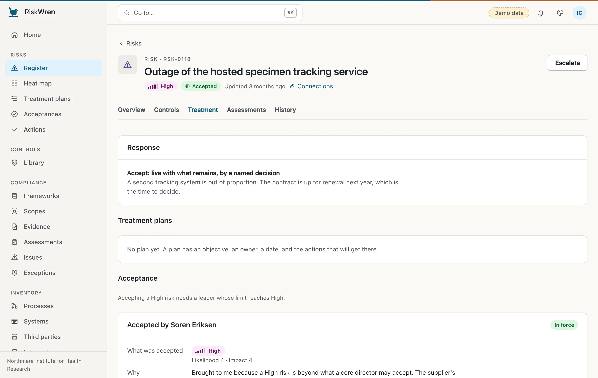

An acceptance covers the rating that was accepted. If the residual rating later rises above it, or the acceptance expires or is withdrawn, the risk needs a decision again. **Acceptances** in the sidebar lists them, soonest to expire first, and can show only those expiring within 30 or 90 days.

## Risk analyses

A risk analysis is a structured look at what is in a scope: each thing taken against each of a list of threats. It is the exercise a security rule or a funder asks for by name, and it leaves a report of what was considered. **Risks → Analyses → Start a risk analysis** (a steward, a manager, or an assessor).

- **What to look at:** what a [scope](compliance.md)'s boundary names, including everything held by the units it names; or everything a unit and the units beneath it hold. Only what is in use, and only what you may see.
- **Which threats:** whole categories of the risk library. Each library risk is one threat.

One question is made for each thing against each threat, on the day it starts; the form says how many before you begin. Nothing is added later, so the analysis says what it looked at.

Open a thing to work through it. For each threat there are three answers, each with room to say why:

| Answer | What it does |
|---|---|
| **Does not apply** | Records that it was considered and set aside, with the reason |
| **A risk already covers it** | Names the risk. The risk now says it concerns this thing. Tick **its rating needs another look** to put its residual rating in doubt and tell its owners |
| **Raise a risk** | Starts a risk from the library, in the thing's unit, about the thing. It goes to whoever owns the thing, and they are told |

Risks already on the register that were started from the same threat, in the thing's unit or about the thing itself, are offered first. **None of the others apply** answers the rest for one thing at once.

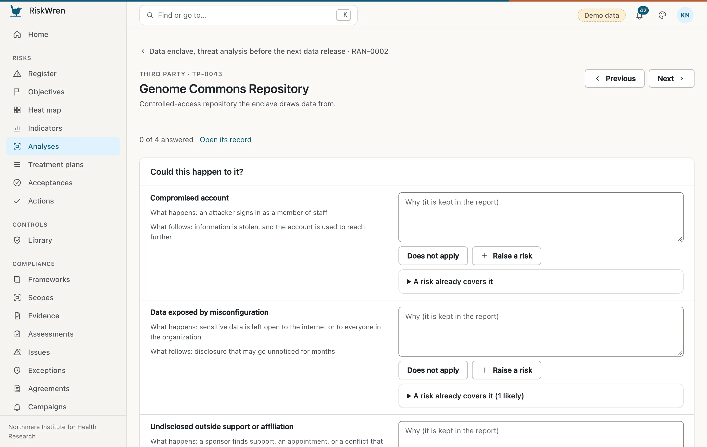

The analysis page shows how far it has got, each thing with its count, and the risks raised and looked at again. Whoever leads it has **Carry on** on Home until it is finished. It can be closed only when every question has an answer and with a few sentences on what it found, so the report passes over nothing in silence.

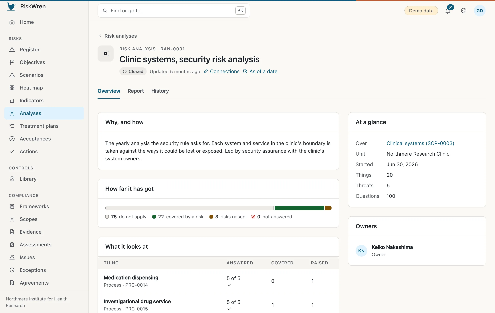

**Report** lists everything considered, thing by thing, with what was decided, why, by whom, and when, and prints. It keeps the names things had on the day, so it still reads if one is later renamed or retired. A closed analysis can be reopened by those who work it.

## Find anything

Press **⌘K** (or Ctrl K), or use the box at the top of every page, and type a name, a reference, or a few words. Records that match appear under the pages and actions; **Search everything** opens the full results.

- The search looks at every kind of record, and actions: in the name, the reference, the summary, and what a record is called in another system.
- Every word you type has to be on the record, in any order. Part of a word is enough.
- Results are grouped by kind, the closest match first. A reference typed exactly is its own best answer.
- You find only what you may open. A record you could not see on its own list is not in a search either, and is not counted.

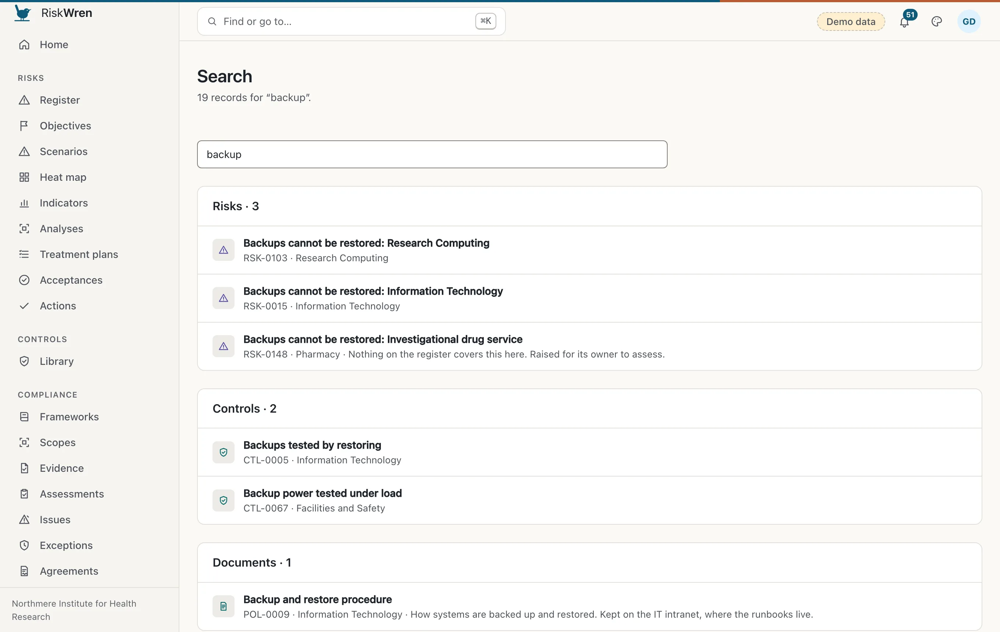

### Saved views

Every list keeps its filters and sort in the address, so a list as you have it can be kept. **Views**, beside the search box of each list, saves what is showing under a name and lists the views of that list.

- A view keeps the question and never the answer. Whoever opens it sees what they may see, as it stands that day.
- A view is yours alone unless it is shared. A steward, an assessor, a manager, an auditor, or an administrator can **share** one, which puts it on that list for everyone.
- Only whoever saved a view can rename or delete it. An administrator can take a shared one down.

### What a record is missing

Each kind of record is expected to say a few things, and a record that does not yet says so under its title, with why it matters.

| Kind | Expected |
| --- | --- |
| Every kind below | An owner who can sign in |
| Processes, systems, third parties, information, services | The class of data it handles; a link to anything else |
| Third parties | A tier |
| Systems | Where it is hosted |
| Information | Where it is held |
| Risks | A rating; a control that bears on it |
| Controls | A rating of how well it works |
| Indicators | A reading; a risk it warns of; where it is read from |

Only records still in use are counted: a retired system or a closed risk is not expected to be complete. A summary is not on the list, because many records are plain from their name.

**Reports → Tidy** counts, for each kind, how many records are missing something and what. Each figure opens the list it counts, and any list can be cut the same way from its address with `missing=`, so it can be saved as a view.

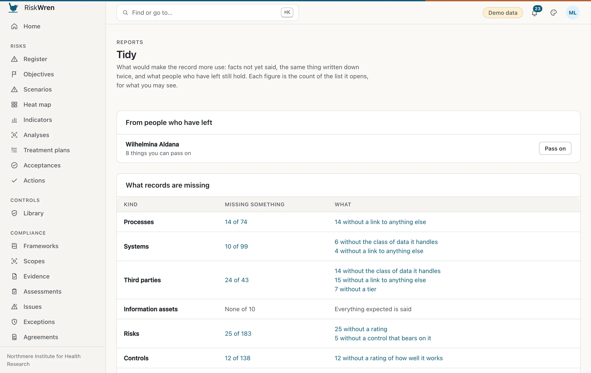

### The same thing written down twice

As you type the name of a new process, system, third party, information asset, risk, control, or issue, records already here that it might be are shown under the box. Open one in a new tab before adding another.

**Reports → Tidy** also lists pairs that look like one thing: names with the same words in any order, or nearly the same spelling. Two units often keep a record each of the same thing on purpose, so across units only the very same name counts.

Nothing is merged for you. Open both, keep the better one, move what the other holds, and retire it. If they are different things, someone who can edit either says so, and the pair is not suggested again.

## Indicators

An indicator is a number someone already reads, kept where the risks it warns of can see it: servers patched within 30 days, days to remove a leaver's access, people who entered a password in the phishing exercise. **Risks → Indicators → Add an indicator** (a steward or a manager).

- **Which way is worse**, a **warning level**, and a **limit**. Patching is worse as it falls; open vulnerabilities are worse as they rise. The warning level is optional and must be reached before the limit.
- **How often it is read:** weekly, monthly, quarterly, or annually. **Read from** says where the number comes from, so whoever reads it next reads the same thing.
- **The risks it warns of.** Any open risk you may see.

RiskWren does not fetch the number. An owner, or the unit's steward, reads it where it lives and records it on the indicator's page, with the day it was read and a note if one is wanted. A second reading for the same day corrects the first, and the history keeps both.

Each reading is placed against the levels: **within its limits**, **past its warning level**, or **past its limit**. The page charts the readings against both levels and says whether the indicator is getting worse, getting better, or holding steady; a move of less than a twentieth of the distance between the warning level and the limit is steady.

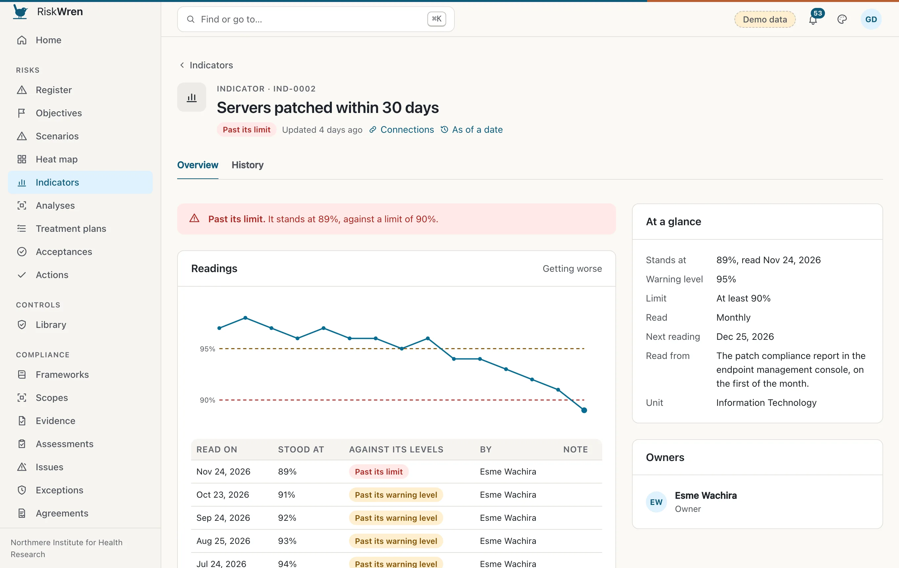

When the newest reading passes the limit:

- the indicator's owners and the owners of each risk it warns of are told, once, with the figure;
- each of those risks that has been assessed is marked **rating in doubt**, with the indicator named as the reason, until someone assesses it again;
- the risk's page shows the indicator, where it stands, and its trend under **Early warning**.

A reading that is still past the limit the next time does not tell everyone again. One that comes back within the limit and later passes it does.

A reading that falls due is on its owners' Home and is reminded as it falls due and when it is late. An indicator nobody reads warns of nothing, so the list marks the overdue ones. **Reports → Risk** counts indicators by where they stand.

## Seeing the whole

- **Register** lists risks, with filters for category, residual rating, standing, and unit, a switch for the ones you are named on, and grouping by category or unit.
- **Indicators** lists every indicator with where it stands, and can show only those past their limit, past their warning level, or never read.
- **Analyses** lists the risk analyses, open and closed, each with how much of it has been answered.
- **Heat map** places every rated risk on the matrix, for the residual, inherent, or target rating, for a unit and everything beneath it, or for one category. Each cell opens the risks in it.
- **Reports → Risk** shows where the register stands, and **Reports → Compliance** how ready each scope is against what it is held to. Every figure opens the list it counts. See [Read the dashboards](running-the-program.md#read-the-dashboards).
- **⌘K** (or Ctrl K) finds any record by name or reference, and goes to any page. See [Find anything](#find-anything).

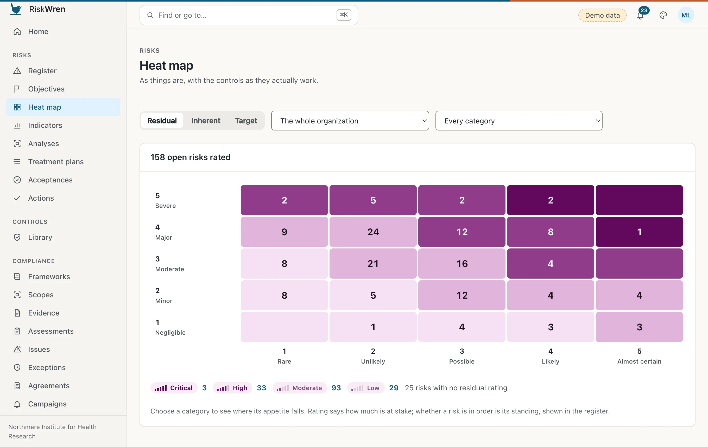

What you see in all of these is what you are allowed to see. See [Who sees what](running-the-program.md#who-sees-what).
