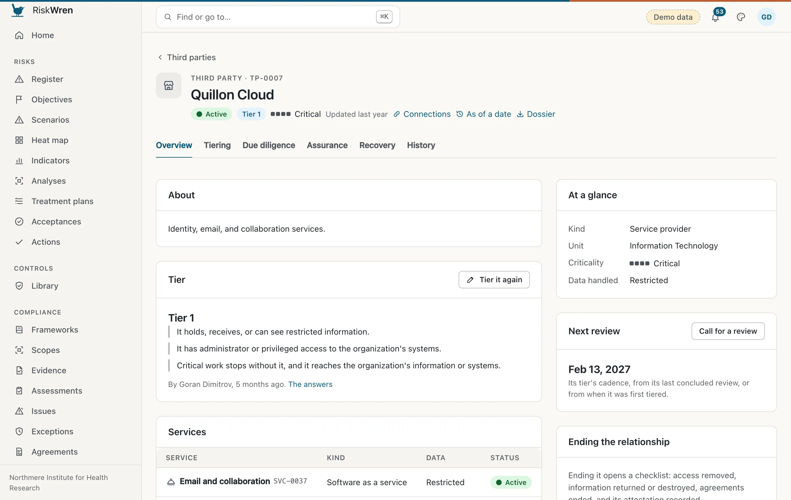
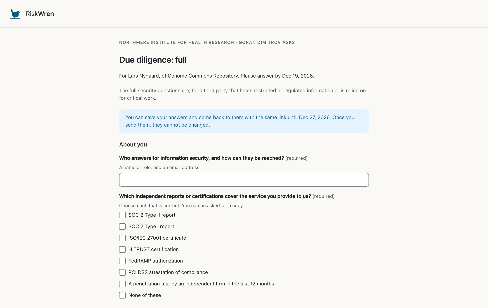
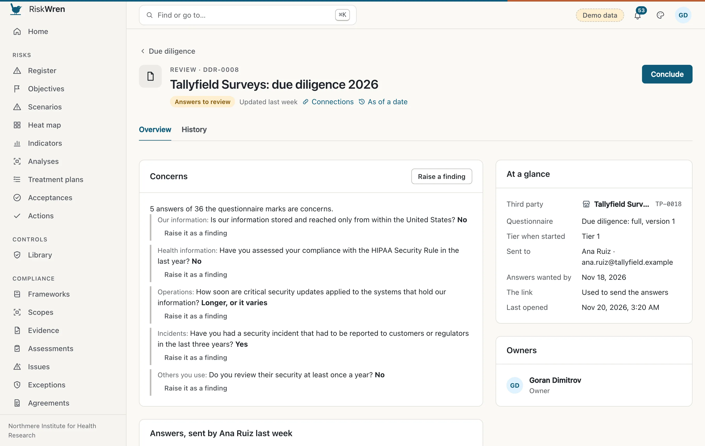
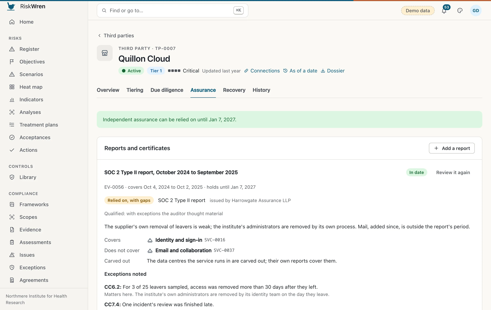

# Third parties

This guide is for whoever looks after the organization's suppliers, service providers, and partners: most often the security office, which asks how each handles the organization's information, and the units that rely on each.

A third party has been a record of the inventory from the start: a name, a unit, owners, and links to the processes it performs and the systems it supplies. This guide is about what RiskWren adds to that: what each third party provides, how much is at stake with it, what it says about itself when asked, what independent reports say about it, whether an agreement covers what is shared with it, and how the relationship goes on and ends.

## Third parties and their services

**Third parties → Third parties** lists every supplier, service provider, contractor, collaborator, sponsor, and subrecipient, with its tier. **Third parties → Services** lists what they provide.

A **service** (`SVC-0001`) is what the organization gets from a third party: the hosted clinical record system, the maintenance contract for the freezer farm, the tests the clinical laboratory sends out. It is a record of the inventory beside its third party, with its own unit, criticality, data class, and owners. A third party with three services may hold restricted information through one and nothing through the others, so it is the services that say what a third party touches:

| From | Link | To |
|---|---|---|
| Service | reaches | System |
| Service | handles | Information asset |
| Process | relies on | Service |
| System | is supplied by | Service |

**Add a service** on a third party's page (those who keep the third party, or a unit's steward) names what it is and its kind. Link it from its own page, as any record is linked. A third party's page lists its services, and each service's page names its third party. Both are in the **Connections** picture.

## Tiering

A third party's **tier** says how much is at stake with it, and so how closely it is reviewed. The program has four, as shipped:

| Tier | What puts a third party in it | Reviewed |
|---|---|---|
| **Tier 1** | It holds or can see restricted or regulated information, has privileged access to systems, or is relied on for critical work and reaches information or systems | Every 12 months |
| **Tier 2** | It holds confidential information, reaches the network, accounts, or systems, holds records about 500 or more people, or critical work stops without it | Every 24 months |
| **Tier 3** | It holds internal information, works on the premises, passes work on to others, holds information outside the United States, or would be missed | Every 36 months |
| **Tier 4** | None of the above | When something calls for it |

**Tier it** on the third party's page (those who keep it, and assessors) asks a few questions: the most sensitive information it will hold or see, whether any of it is regulated (health information, research participants' information, controlled-access data, payment cards, government identifiers, student records, export-controlled information), about how many people, how it reaches the organization, and what would happen if it stopped. Where the inventory already knows, the answer is filled in, and the form shows which records it comes from:

- the most sensitive **information** is the highest data class among the third party, its services, the information its services handle, and the information shared with it;
- the most critical **work that relies on it** is the highest criticality among the processes it performs or that rely on its services, and the systems it or its services supply;
- the **systems it reaches** are those its services reach and those it supplies.

As the answers change, the form shows the tier the program's rules give and every rule of that tier that holds, in words. The tiers are read in order, and the first with a rule that holds is the one given.

The tier recorded is a judgment by a named person, like every rating in RiskWren. Recording a different tier from the rules' needs a reason, and both are kept: the page shows the tier recorded, the one the rules give, and why they differ. Tiering again keeps the earlier tierings under the **Tiering** tab, each with its answers as they were asked, and the history tells each one.

The list of third parties sorts by tier, and can be cut to one tier or to those **not tiered**. A third party with no tier is listed in **Tidy** as missing one.

The tiers, their review cadences, and their rules are part of the program. Their rules are written in the same condition language as a questionnaire's, over the answers and what the inventory says, and travel with the program when it is exported and imported. The questions are the built-in questionnaire **Third-party tiering**, which can be edited like any other under **Admin → Questionnaires**.

## Due diligence

A **review** (`DDR-0001`) asks a third party about itself: a questionnaire, sent to one of its contacts through a link, answered without an account, and read by someone here who records what they concluded. **Third parties → Due diligence** lists them all, and each third party's **Due diligence** tab lists its own, with its contacts.

### Contacts

A **contact** is a person at the third party who can be asked: a name, an email address, and their role there. Contacts are not accounts and never sign in. Those who keep the third party, and assessors, add them on its **Due diligence** tab, and say when one has left; the tab, and their addresses, are shown to those people and to those who read everything.

### Start a review

**Start a review** on the third party's **Due diligence** tab. The questionnaire is the one its tier names, as shipped:

| Tier | Questionnaire |
|---|---|
| Tier 1 | **Due diligence: full**, about forty-five questions: governance, access, the organization's information, health information, building and changing the service, operations, incidents, continuity, and the others it uses |
| Tier 2 | **Due diligence: standard**, about twenty-five questions on the same ground |
| Tier 3 | **Due diligence: short**, eight questions |
| Tier 4 | None: choose one if a review is wanted at all |

The questionnaires are written for organizations in the United States: they ask about a business associate agreement where health information is involved, about notice of an incident within 72 hours, and where the information is held. They can be edited, or others added, under **Admin → Questionnaires**. A review records the tier when it was started, and asks the version of the questionnaire in use when it was first sent.

### Send it

**Send it** chooses the contact, the date the answers are wanted by (three weeks on, unless another is given), and how long the link lasts (30 days unless said, at most 90). The link is shown once, to copy, and is sent to the contact by email where [email](configuration.md#email) is set up.

The link is the contact's way in, and nothing else is:

- It is a long random token. Only a digest of it is kept, so nobody can read it back from the database, and a message that carried it is cleared once it has been sent.
- The token follows a `#` in the address. Browsers never send that part to a server, so it is not in any server's or proxy's logs.
- It opens one thing: the questionnaire of that review, as that contact. It reaches no other page, record, or route, and the contact has no account.
- It stops working when it expires, when it is withdrawn (**Withdraw the link**), when the review is sent again with a new one, when the review is cancelled, and once the answers have been sent with it.
- Guessing at links is slowed the way guessing at passwords is.

The contact sees who is asking, by when, and the questions, which show and hide as they answer like any questionnaire's. They can **save to finish later**, with the same link, and **send the answers**, which cannot be changed after. The history names them as acting by link.

### Review the answers

When the answers come in, the review's owners are told, and it waits on their Home. The review shows the answers as they were asked. Some answers are marked by the questionnaire as **concerns**: no second factor, critical updates applied only after a month or more, an incident reported in the last three years, information held outside the United States, no independent report. They are listed first, with how many of the answers the questionnaire marks are concerns. They are what to look at, and decide nothing.

**Conclude** records what was concluded: **approved**, **approved with conditions**, or **not approved**. Conditions, and a refusal, say what must change, or why.

A review whose answers are late, or whose link expired or was withdrawn before anyone answered, waits on its owners' Home until it is sent again or cancelled.

## Assurance documents

A report or certificate is what someone independent found: a SOC 2 Type II report, an ISO/IEC 27001 certificate, a HITRUST certification, a penetration test summary, a bridge letter. Each is held as an item of [evidence](evidence-and-testing.md) on the third party, with the period it covers and the date it holds until. Past that date it no longer counts, and its owners are told beforehand, as with any evidence. Reports are confidential: they are seen by their owners, the third party's unit's stewards, leaders, and managers, assessors, and those who read everything, and not by everyone who can see the third party.

The third party's **Assurance** tab lists them, newest first, each with whether it is in date and what its review found, and says at the top whether anything independent and in date can be relied on now.

**Add a report** (those who keep the third party, and assessors) names it, the period it covers, when it was received, and when it stops counting, with the file. A contact can also send reports through the link of a due diligence review, up to ten, beside the answers: each arrives as evidence of the third party, owned by whoever keeps the review, and is listed on the review as sent with the answers.

### Review a report

A report says less than its cover suggests until someone reads it. **Review it** records what a careful reader notes:

- **What it is**, who issued it, and the **opinion**: unqualified, qualified, adverse, or none (a certificate, or a test summary).
- **The services it covers.** Those not ticked are listed as services it does not cover, so a report on the identity service is not taken to vouch for the mail service added since.
- **What is carved out**: the parts left to others the third party uses, such as the data centres it runs in.
- **Each exception the auditor noted**, whether it matters here, and what is done about it.
- **What it leaves to the organization.** A SOC report lists complementary user entity controls: what the customer must do for the report to hold, such as requiring a second factor for its own users. Each is joined to the control here that does it, or said to be not in place, or not to apply. The control's page lists it under **Relied on by suppliers' reports**, so whoever owns that control knows a supplier's assurance leans on it.
- **Whether it can be relied on**: as it is, with gaps, or not at all. With gaps, or not at all, says why.

Reviewing again keeps the earlier review, and the control pages follow the review in force.

## Coverage

Information is **shared** with a third party when it is linked as *shared with* it, or when one of its services *handles* it. The program says which kinds of agreement shared information needs. As shipped, written for the United States:

| When | It needs |
|---|---|
| Patient records are handled by a service provider, contractor, or supplier | A business associate agreement, under HIPAA |
| Participant data or patient records are shared with a collaborator, sponsor, or subrecipient | A data use agreement, or the terms of the award or contract it is shared for |
| Controlled-access data is shared with anyone | A data use agreement |
| Restricted information is shared with anyone | A contract, a confidentiality agreement, a business associate agreement, a data use agreement, or an award's terms |

An agreement meets a rule when it is of one of the kinds the rule names, it is with that third party (**Who it is with**, on the agreement), it is open and in force (started, and not ended), and it covers the information, the service it is shared through, or a scope that holds the information.

Where a rule applies and no agreement meets it, the sharing is a **stop**. It is shown at the top of the information's page, the third party's, and the service's, saying what is shared, through what, which kind of agreement it needs and why, and which agreements there already are with that third party that do not meet it. **Third parties → Coverage** gathers every stop, with the rules. A stop goes, everywhere, as soon as an agreement of the right kind with that third party covers what is shared; it comes back when that agreement ends or is closed.

A third party's page lists the agreements it is party to, with how each stands. The rules are part of the program, written in the condition language over the information's kind and class and the third party's kind and tier, and travel with it when it is exported and imported.

## Over time

### Findings

A concern in a review's answers, or anything else a review turns up, is followed up as an issue. **Raise a finding** on the review (or **Raise it as a finding** beside one concern) raises an [issue](issues-and-exceptions.md) about the third party, found by *review*, which names the review it came from. Like any issue it has a severity, a date by its severity, owners here, and actions.

An action on such an issue can be **done by** one of the third party's contacts: say who, when adding it. The contact has no account; the action's owner here follows it up with them, is reminded of its date, and records when it is done. The issue closes, as every issue does, when someone who does not own it confirms the fix.

### Review again

Each third party is due for review on the cadence its tier sets (as shipped, every 12, 24, or 36 months, and Tier 4 only when called for), counted from its last concluded review, or from when it was first tiered if it has never been reviewed. **Next review** on its page says when, and why. A review due within a month, or late, is on Home for those who keep the third party and in the reminders; the list of third parties can be cut to those whose review is due.

Something can call for a review sooner: an incident at the supplier, a breach notice, a change to what it does for the organization or to who owns it. **Call for a review** records what happened, and makes it due at once. Concluding the next review answers the call, and sets the date after it by the tier. Tiering again, to a tier with a shorter cadence, brings the date forward.

### Ending a relationship

**End the relationship** opens a checklist:

1. **Access removed**: its accounts, remote access, and badges here.
2. **Information returned or destroyed**, with a certificate where there is one.
3. **Agreements ended**: closed, or noted for what survives them.
4. **Its attestation recorded**: its written confirmation that nothing of the organization's is kept.

Each step is recorded by someone who keeps the third party, saying what was done. When the last is recorded, the third party and its services are retired; until then it is shown as being offboarded. Offboarding can be stopped, and the history keeps every step.

### Subcontractors

A third party names the third parties it depends on with a link, **Subcontracts to**, read from the other side as **Is a subcontractor of**. Both are in the **Connections** picture, so a supplier that several of the organization's suppliers rely on in turn is easy to see.
