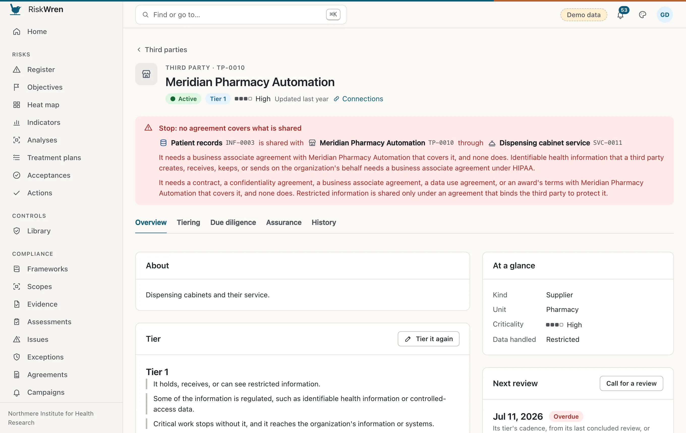

# Third parties

This guide is for whoever looks after the organization's suppliers, service providers, and partners: most often the security office, which asks how each handles the organization's information, and the units that rely on each.

A third party is a record of the inventory, like a system or a process: a name, a unit, owners, and links to the processes it performs and the systems it supplies. Around that record RiskWren keeps what the third party provides, how much is at stake with it, what it says about itself when asked, what independent reports say about it, whether an agreement covers what is shared with it, and how the relationship goes on and ends. The ideas behind it (owners, units, who may do what) are in [How RiskWren works](concepts.md#people-units-roles-and-owners). The [worked example](#a-worked-example-from-first-contact-to-covered) at the end takes one supplier through all of it.

## Third parties and their services

**Third parties → Third parties** lists every supplier, service provider, contractor, collaborator, sponsor, and subrecipient, with its tier. **Third parties → Services** lists what they provide.

A **service** (`SVC-0001`) is what the organization gets from a third party: the hosted clinical record system, the maintenance contract for the freezer farm, the tests the clinical laboratory sends out. It is a record of the inventory beside its third party, with its own unit, criticality, data class, and owners. A third party with three services may hold restricted information through one and nothing through the others, so it is the services that say what a third party touches:

| From | Link | To |
|---|---|---|
| Service | reaches | System |
| Service | handles | Information asset |
| Process | relies on | Service |
| System | is supplied by | Service |

**Add a service** on a third party's page names what it is and its kind. Those who keep the third party (its owners and delegates, its unit's stewards, and managers) add one in the third party's own unit; a service in another unit is added by a steward of that unit or a manager. Link it from its own page with **Add a link**, as any record is linked. A third party's page lists its services, and each service's page names its third party. Both are in the **Connections** picture.

### Bringing them in

A steward or a manager can import third parties from a spreadsheet, as any record of the inventory is imported: see [Import and export](the-register.md#import-and-export). Services and links are added on the records themselves.

### Recovery

A third party's **Recovery** tab says what it can deliver for the processes it performs: what it can be back within, how much information it could lose, and what that rests on, such as its contract. Each process it performs checks that against what the process needs. See [Business impact and recovery](the-register.md#business-impact-and-recovery).

### Incidents about a third party

An incident that names a third party at triage is not listed on the third party's page. To find them, open the incident list with the third party's reference in the address, `/incidents?about=TP-0007`; the list has no control of its own for it. The same question is asked of the API with `GET /api/v1/incidents?about=TP-0007`. After an incident at a supplier, [call for a review](#review-again). See [Incidents](incidents.md).

## Tiering

A third party's **tier** says how much is at stake with it, and so how closely it is reviewed. The program has four, as shipped:

| Tier | What puts a third party in it | Reviewed |
|---|---|---|
| **Tier 1** | It holds or can see restricted or regulated information, has privileged access to systems, or is relied on for critical work and reaches information or systems | Every 12 months |
| **Tier 2** | It holds confidential information, reaches the network, accounts, or systems, holds records about 500 or more people, or critical work stops without it | Every 24 months |
| **Tier 3** | It holds internal information, works on the premises, passes work on to others, holds information outside the United States, or would be missed | Every 36 months |
| **Tier 4** | None of the above | When something calls for it |

**Tier it** on the third party's page (those who keep it, and assessors) asks a few questions:

- the most sensitive information it will hold or see;
- whether any of it is regulated: health information, research participants' information, controlled-access data, payment cards, government identifiers, student records, or export-controlled information;
- about how many people it concerns;
- how it reaches the organization;
- what would happen if it stopped.

Where the inventory already knows, the answer is filled in, and the form shows which records it comes from:

- the most sensitive **information** is the highest data class among the third party, its services, the information its services handle, and the information shared with it;
- the most critical **work that relies on it** is the highest criticality among the processes it performs or that rely on its services, and the systems it or its services supply;
- the **systems it reaches** are those its services reach and those it supplies.

As the answers change, the form shows the tier the program's rules give and every rule of that tier that holds, in words. The tiers are read in order, and the first with a rule that holds is the one given. **Record the tier** keeps it.

The tier recorded is a judgment by a named person, like every rating in RiskWren. Recording a different tier from the rules' needs a reason, and both are kept: the page shows the tier recorded, the one the rules give, and why they differ. Tiering again keeps the earlier tierings under the **Tiering** tab, each with its answers as they were asked, and the history tells each one.

The list of third parties sorts by tier, and can be cut to one tier or to those **Not tiered**. A third party with no tier is listed in **Tidy** as missing one.

The tiers, their review cadences, and their rules are part of the program. Their rules are written in the same condition language as a questionnaire's, over the answers and what the inventory says. The Program page does not edit them: they are changed only in a program pack, exported, edited, and imported again ([Change the program with a pack](running-the-program.md#change-the-program-with-a-pack)). The questions are the built-in questionnaire **Third-party tiering**, which can be edited like any other under **Admin → Questionnaires**.

## Due diligence

A **review** (`DDR-0001`) asks a third party about itself: a questionnaire, sent to one of its contacts through a link, answered without an account, and read by someone here who records what they concluded. **Third parties → Due diligence** lists them all, and each third party's **Due diligence** tab lists its own, with its contacts.

### Contacts

A **contact** is a person at the third party who can be asked: a name, an email address, and their role there. Contacts are not accounts and never sign in. Those who keep the third party, and assessors, add them with **Add a contact** on its **Due diligence** tab, and mark one who has left (**Edit**, then **Status**). The tab, and the contacts' addresses, are shown to those people and to those who read everything.

### Start a review

**Start a review** on the third party's **Due diligence** tab starts one at once, with the questionnaire its tier names, and opens it. Nothing is asked of anyone until it is sent. As shipped:

| Tier | Questionnaire |
|---|---|
| Tier 1 | **Due diligence: full**, about forty-five questions: governance, access, the organization's information, health information, building and changing the service, operations, incidents, continuity, and the others it uses |
| Tier 2 | **Due diligence: standard**, about twenty-five questions on the same ground |
| Tier 3 | **Due diligence: short**, eight questions |
| Tier 4, or not tiered | None |

The page offers no choice of questionnaire. For a third party in Tier 4, or one not tiered, **Start a review** stops with "Choose the questionnaire to ask. A tier 4 third party has none of its own." To ask one of them, or to ask a Tier 1 supplier the short questionnaire, choose it through the [API](api.md): give `questionnaire` (such as `due-diligence-short`) when starting it, with `POST /api/v1/third-parties/{ref}/reviews`, or change it while the review is still a draft, with `PATCH /api/v1/reviews/{ref}`.

The questionnaires are written for organizations in the United States: they ask about a business associate agreement where health information is involved, about notice of an incident within 72 hours, and where the information is held. They can be edited, or others added, under **Admin → Questionnaires**. A review records the tier when it was started, and asks the version of the questionnaire in use when it was first sent.

### Send it

**Send it** on the review chooses the contact, the date the answers are wanted by, and how long the link lasts (30 days unless another number is given, at most 90). With no answer date, it is three weeks on, or the day the link ends if that is sooner. Sending again keeps the date already set unless another is given, so once that date has passed, give a new one. The link is shown once, to copy, and is sent to the contact by email where [email](configuration.md#email) is set up.

The link is the contact's way in, and nothing else is:

- It is a long random token. Only a digest of it is kept, so nobody can read it back from the database, and a message that carried it is cleared once it has been sent.
- The token follows a `#` in the address. Browsers never send that part to a server, so it is not in any server's or proxy's logs.
- It opens one thing: the questionnaire of that review, as that contact. It reaches no other page, record, or route, and the contact has no account.
- It stops working when it expires, when it is withdrawn (**Withdraw the link**), when the review is sent again with a new one, when the review is cancelled, and once the answers have been sent with it.
- Guessing at links is slowed the way guessing at passwords is.

**Withdraw the link** keeps whatever the contact has saved: a new link, sent with **Send it again**, carries on from those answers.

The contact sees who is asking, by when, and the questions, which show and hide as they answer like any questionnaire's. They can **Save to finish later**, with the same link, and **Send the answers**, which cannot be changed after. They can also send up to ten files beside the answers, such as the reports described under [Assurance documents](#assurance-documents). The history names them as acting by link.

### Review the answers

When the answers come in, the review's owners are told, and it waits on their Home. The review shows the answers as they were asked. Some answers are marked by the questionnaire as **concerns**: no second factor, critical updates applied only after a month or more, an incident reported in the last three years, information held outside the United States, no independent report. They are listed first, with how many of the answers the questionnaire marks are concerns. They are what to look at, and decide nothing.

**Conclude** records what was concluded: **Approved**, **Approved with conditions**, or **Not approved**. Conditions, and a refusal, say what must change, or why. Whatever it concludes, concluding sets the date of the next review (see [Review again](#review-again)).

A review whose answers are late, or whose link expired or was withdrawn before anyone answered, waits on its owners' Home until it is sent again or cancelled (**Cancel the review**).

## Assurance documents

A report or certificate is what someone independent found: a SOC 2 Type II report, an ISO/IEC 27001 certificate, a HITRUST certification, a penetration test summary, a bridge letter. Each is held as an item of [evidence](evidence-and-testing.md) on the third party, with the period it covers and the date it holds until. Past that date it no longer counts, and its owners are told beforehand, as with any evidence. Reports are confidential: they are seen by their owners, the third party's unit's stewards, leaders, and managers, assessors, and those who read everything, and not by everyone who can see the third party.

The third party's **Assurance** tab lists them, newest first, each with whether it is in date and what its review found, and says at the top whether anything independent and in date can be relied on.

**Add a report** (those who keep the third party, and assessors) names it, the period it covers, when it was received, and when it stops counting (**Holds until**), with the file.

A contact can also send reports through the link of a due diligence review, beside the answers. Each arrives as evidence of the third party, owned by whoever keeps the review, and is listed on the review under **Sent with the answers**. It arrives with guesses that someone here must correct: it holds until twelve months from the day it was sent, its class is confidential, and it covers no period. Open it, and on its own page **Edit** sets **Covers from**, **to**, and **Holds until** from what the report says, before it is reviewed.

### Review a report

A report says less than its cover suggests until someone reads it. **Review it** records what a careful reader notes:

- **What it is**, who issued it, and the **opinion**: unqualified, qualified, adverse, or none (a certificate, or a test summary).
- **The services it covers.** Those not ticked are listed as services it does not cover, so a report on the identity service is not taken to vouch for the mail service added since.
- **What is carved out**: the parts left to others the third party uses, such as the data centres it runs in.
- **Each exception the auditor noted** (**Add an exception**), whether it matters here, and what is done about it.
- **What it leaves to the organization** (**Add a responsibility**). A SOC report lists complementary user entity controls: what the customer must do for the report to hold, such as requiring a second factor for its own users. Each is joined to the control here that does it, by its reference, or said to be not in place, or not to apply. The control's page lists it under **Relied on by suppliers' reports**, so whoever owns that control knows a supplier's assurance leans on it.
- **Whether it can be relied on**: as it is, with gaps, or not at all. With gaps, or not at all, says why.

**Record the review** keeps it.

Reviewing again keeps the earlier review, and the control pages follow the review in force.

## Coverage

Information is **shared** with a third party when it is linked as *shared with* it, or when one of its services *handles* it. The program says which kinds of agreement shared information needs. As shipped, written for the United States:

| When | It needs |
|---|---|
| Patient records are handled by a service provider, contractor, or supplier | A business associate agreement, under HIPAA |
| Participant data or patient records are shared with a collaborator, sponsor, or subrecipient | A data use agreement, or the terms of the award or contract it is shared for |
| Controlled-access data is shared with anyone | A data use agreement |
| Restricted information is shared with anyone | A contract, a confidentiality agreement, a business associate agreement, a data use agreement, or an award's terms |

An agreement meets a rule when all four hold:

- it is of one of the kinds the rule names;
- it is with that third party (**Who it is with**, on the agreement);
- it is open and in force: started, and not ended;
- it covers the information, the service it is shared through, or a scope that holds the information.

Where a rule applies and no agreement meets it, the sharing is a **stop**. It is shown at the top of the information's page, the third party's, and the service's, saying what is shared, through what, which kind of agreement it needs and why, and which agreements there already are with that third party that do not meet it. **Third parties → Coverage** gathers every stop, with the rules. A stop goes, everywhere, as soon as an agreement of the right kind with that third party covers what is shared; it comes back when that agreement ends or is closed.

A third party's page lists the agreements it is party to, with how each stands. The rules are part of the program, written in the condition language over the information's kind and class and the third party's kind and tier. Like the tiers, they are changed only in a [program pack](running-the-program.md#change-the-program-with-a-pack).

### Clear a stop

An agreement clears a stop only when it is joined to the third party and to what is shared. The name of the other party typed on the agreement does not join them.

1. Under **Compliance → Agreements**, **Add an agreement** (a steward, leader, or manager of the unit that answers for it). Choose a **Kind** the stop asks for, fill in **With** as people know the other party, and give its **Starts** date. **With** is words for people to read: it does not count for coverage.
2. On the agreement's page, **Who it is with → Change**, and add the third party. Until a third party is named there, the agreement covers nothing shared with anyone.
3. **What it covers → Change**, and add the information, the service it is shared through, or a scope that holds the information. A system it covers does not count for a stop.

The stop goes as soon as the three are in place and the start date has come. More on agreements, their dates, and their terms is in [Agreements](compliance.md#agreements).

## Over time

### Findings

A concern in a review's answers, or anything else a review turns up, is followed up as an issue. **Raise a finding** on the review (or **Raise it as a finding** beside one concern) raises an [issue](issues-and-exceptions.md) about the third party, found by *review*, which names the review it came from. Like any issue it has a severity, a date by its severity, owners here, and actions.

An action on such an issue can be **done by** one of the third party's contacts: choose them under **Done by, at the third party** when adding it with **Add an action**. The contact has no account; the action's owner here follows it up with them, is reminded of its date, and records when it is done. The issue closes, as every issue does, when someone who does not own it confirms the fix.

### Review again

Each third party is due for review on the cadence its tier sets (as shipped, every 12, 24, or 36 months, and Tier 4 only when called for), counted from its last concluded review, whatever it concluded, or from when it was first tiered if it has never been reviewed. **Next review** on its page says when, and why. A third party with no tier has no date.

A review due within a month, or late, is on the Home page of the third party's owners and delegates. The reminders go to the people named under its **Owners** two weeks ahead and again when it is late; if it stays late, the third party's unit's stewards are told a week after, and its leaders after three weeks. A third party with nobody named gets no reminder until it has been late a week, so name an owner for every one. The list of third parties can be cut to those whose review is overdue, or due within a month.

Something can call for a review sooner: an incident at the supplier, a breach notice, a change to what it does for the organization or to who owns it. **Call for a review** (those who keep it, and assessors) records what happened, and makes it due at once. Concluding the next review answers the call, and sets the date after it by the tier. Tiering again, to a tier with a shorter cadence, brings the date forward.

### In good standing, for another process

Another system, a purchasing process for one, can ask with a token whether a third party is in good standing, before it buys: `GET /api/v1/standing/third-party/{ref}`. It learns yes or no and, for a no, each reason as a code and a sentence. It never learns what a review found. The answer is no for any of these:

| Code | When |
|---|---|
| `not_active` | The relationship is not active: the third party is retired |
| `review_overdue` | Its next review date has passed |
| `no_agreement` | Information is shared with it that no agreement of the kind the program requires covers: a [stop](#coverage) |

That is all it checks, so a yes says less than it may seem to. It is yes for a third party:

- never tiered, or in Tier 4, since it has no review date to be past;
- newly tiered, until its first review falls due, a full cadence after it was tiered, whether or not anyone has asked it anything;
- whose last review was concluded **Not approved**, since concluding restarts the clock whatever the conclusion;
- being offboarded, since it stays active until the last step is recorded.

A review called for is due that day, so the answer is no from the next day until a review is concluded.

A stop is counted only if the asking token can see the information and the third party. Give the purchasing process an auditor's token, which reads everything, made to only read. Read a yes as "nothing on record says stop", and keep the decision to rely on a supplier with a person. Tokens, and what else can be asked, are in [Is it in good standing?](other-systems.md#is-it-in-good-standing); the [API guide](api.md#asking-whether-something-is-in-good-standing) has the exact answer and a recipe.

### Ending a relationship

**End the relationship** asks why it ends, which must be said, and opens a checklist:

1. **Access removed**: its accounts, remote access, and badges here.
2. **Information returned or destroyed**, with a certificate where there is one.
3. **Agreements ended**: closed, or noted for what survives them.
4. **Its attestation recorded**: its written confirmation that nothing of the organization's is kept.

Each step is recorded with **Record it** by those who keep the third party, or an assessor, saying what was done. The steps can be recorded in any order. When the last is recorded, the third party and its services are retired; until then it is shown as **Being offboarded**, and stays active. **Stop offboarding** ends the checklist without retiring it, and the history keeps every step.

### Subcontractors

A third party names the third parties it depends on with a link, **Subcontracts to**, read from the other side as **Is a subcontractor of**. Both are in the **Connections** picture, so a supplier that several of the organization's suppliers rely on in turn is easy to see.

## Across all of them

- **Reports → Portfolio**, by third party, lists those in the two highest tiers with the open risks that concern each, its open issues, sharing no agreement covers, and its next review: [Portfolio](running-the-program.md#portfolio).
- The leadership report's **Third parties with most at stake** gives the same for leadership, frozen when it is issued: [Leadership reports](running-the-program.md#leadership-reports).
- **Reports → As of a date** shows the register of third parties as it stood at the end of a chosen day: [As of a date](running-the-program.md#as-of-a-date).
- A third party's **Dossier** packs its reviews with their answers and concerns, its reports and their reviews, its agreements, the sharing no agreement covers, and the issues and risks about it, in a file that proves itself: [Dossiers](running-the-program.md#dossiers).

## A worked example: from first contact to covered

Patient Access, in the demo's Northmere Research Clinic, wants a hosted service that texts patients reminders of their appointments. The supplier, here called Fernhollow Reminders, will read the scheduling system and hold patients' names, telephone numbers, and appointment times. In the [demo](getting-started.md#explore-the-demo-organization), do the steward's steps, and the agreement, as the risk manager, who may add records to any unit; do the rest as the security leader, who assesses everywhere.

**Write it down.**

1. Under **Third parties → Third parties**, **Add a third party**: Fernhollow Reminders, a **Service provider**, in Patient Access. Whoever adds it is its owner until they name someone else.
2. On its page, **Add a service**: "Appointment reminders by text message", **Software as a service**.
3. On the service's page, **Add a link**: it **Reaches** the Scheduling system, and it **Handles** Patient records. On the process Scheduling and registration, **Add a link**: it **Relies on** the service.

At once a stop appears at the top of the third party's, the service's, and Patient records' pages: patient records handled by a service provider need a business associate agreement, and there is none. It is also listed under **Third parties → Coverage**.

**Tier it.**

4. On the third party's page, **Tier it**. The form already knows the most sensitive information (restricted, from Patient records), the system it reaches, and the work that relies on it. Answer the rest: the information is identifiable health information; it holds records about 500 or more people; it reaches the organization through a connection that sends or receives its data. The rules give **Tier 1**, with the reasons. **Record the tier**. **Next review** is twelve months on.

**Ask it about itself.**

5. On the **Due diligence** tab, **Add a contact**: the supplier's security lead, with their email address.
6. **Start a review**. As Tier 1, it asks **Due diligence: full**.
7. **Send it**, to the contact. Leave the answer date empty for three weeks on. Copy the link. Where email is not set up, as in the demo, nothing is sent: open the link in a private window to answer as the contact, attach a SOC 2 report, and **Send the answers**.
8. Back as the security leader, the review waits on Home. Its **Concerns** come first: say administrators do not use a second factor that resists phishing, and information is reached from outside the United States.
9. Beside the first, **Raise it as a finding**, high. On the issue it opens, **Add an action**: "Issue security keys to every administrator of the reminder service", with yourself as **Who will do it**, the contact under **Done by, at the third party**, and a date. You are reminded of it; the contact is not.
10. On the review, **Conclude**: **Approved with conditions**, saying what the conditions are (the security keys by the action's date, and the offshore support access named and limited). The next review is due twelve months from today.

**Read what independent reports say.**

11. On the **Assurance** tab, the SOC 2 report the contact sent is listed. Open it and **Edit** it: the period it covers, and **Holds until** twelve months after the period ends, or the date your practice uses.
12. **Review it**: a SOC 2 Type II report, its issuer, an unqualified opinion; tick the reminder service as covered; under **Carved out**, the cloud provider it runs on. **Add a responsibility** for each complementary user entity control: "Customers require a second factor for their own users of the reminder console", joined to the organization's own control for a second factor at sign-in, **In place here**. Say it can be relied on with gaps, and why. **Record the review**. That control's page lists the supplier under **Relied on by suppliers' reports**.

**Cover what is shared.** An agreement is added by a steward, leader, or manager of its unit, so in the demo this is the risk manager's again.

13. Under **Compliance → Agreements**, **Add an agreement**: "Business associate agreement: Fernhollow Reminders", of the kind **Business associate agreement**, **With** "Fernhollow Reminders", with Patient Access as its unit and the day it was signed as **Starts**. The stop is still there: **With** is only words.
14. On its page, **Who it is with → Change**: add Fernhollow Reminders. **What it covers → Change**: add the service (or Patient records).

The stop goes from all three pages and from **Coverage**. Patient records are also restricted, and the same agreement meets the rule for restricted information.

**Ask what another process would hear.**

Purchasing, asking `GET /api/v1/standing/third-party/TP-…` with an auditor's token, hears yes: the supplier is active, its review is not overdue, and nothing shared with it lacks an agreement. That is true and useful, and it is all. It does not say that the review was approved with conditions, that a finding is open with the supplier, or that the SOC 2 report leaves gaps; a person reads those on the supplier's page. Nor does a yes mean the supplier has been asked anything. Before step 14 the answer was no, with `no_agreement`, because nothing covered the patient records. Had the agreement been in place from the start, the answer would have been yes all along, even before the review in step 6.
