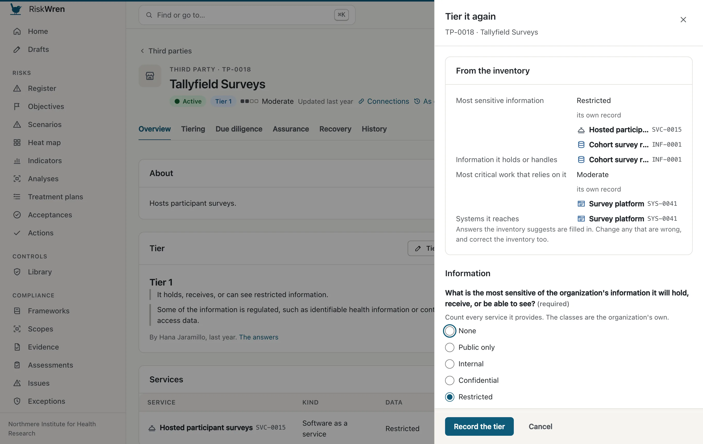

# Third parties

This guide is for whoever looks after the organization's suppliers, service providers, and partners: most often the security office, which asks how each handles the organization's information, and the units that rely on each.

A third party has been a record of the inventory from the start: a name, a unit, owners, and links to the processes it performs and the systems it supplies. This guide is about what RiskWren adds to that: what each third party provides, and how much is at stake with it.

## Third parties and their services

**Third parties → Third parties** lists every supplier, service provider, contractor, collaborator, sponsor, and subrecipient, with its tier. **Third parties → Services** lists what they provide.

A **service** (`SVC-0001`) is what the organization gets from a third party: the hosted clinical record system, the maintenance contract for the freezer farm, the tests the clinical laboratory sends out. It is a record of the inventory beside its third party, with its own unit, criticality, data class, and owners. A third party with three services may hold restricted information through one and nothing through the others, so it is the services that say what a third party touches:

| From | Link | To |
|---|---|---|
| Service | reaches | System |
| Service | handles | Information asset |
| Process | relies on | Service |
| System | is supplied by | Service |

**Add a service** on a third party's page (those who keep the third party, or a unit's steward) names what it is and its kind. Link it from its own page, as any record is linked. A third party's page lists its services, and each service's page names its third party. Both are in the **Connections** picture.

## Tiering

A third party's **tier** says how much is at stake with it, and so how closely it is reviewed. The program has four, as shipped:

| Tier | What puts a third party in it | Reviewed |
|---|---|---|
| **Tier 1** | It holds or can see restricted or regulated information, has privileged access to systems, or is relied on for critical work and reaches information or systems | Every 12 months |
| **Tier 2** | It holds confidential information, reaches the network, accounts, or systems, holds records about 500 or more people, or critical work stops without it | Every 24 months |
| **Tier 3** | It holds internal information, works on the premises, passes work on to others, holds information outside the United States, or would be missed | Every 36 months |
| **Tier 4** | None of the above | When something calls for it |

**Tier it** on the third party's page (those who keep it, and assessors) asks a few questions: the most sensitive information it will hold or see, whether any of it is regulated (health information, research participants' information, controlled-access data, payment cards, government identifiers, student records, export-controlled information), about how many people, how it reaches the organization, and what would happen if it stopped. Where the inventory already knows, the answer is filled in, and the form shows which records it comes from:

- the most sensitive **information** is the highest data class among the third party, its services, the information its services handle, and the information shared with it;
- the most critical **work that relies on it** is the highest criticality among the processes it performs or that rely on its services, and the systems it or its services supply;
- the **systems it reaches** are those its services reach and those it supplies.

As the answers change, the form shows the tier the program's rules give and every rule of that tier that holds, in words. The tiers are read in order, and the first with a rule that holds is the one given.

The tier recorded is a judgment by a named person, like every rating in RiskWren. Recording a different tier from the rules' needs a reason, and both are kept: the page shows the tier recorded, the one the rules give, and why they differ. Tiering again keeps the earlier tierings under the **Tiering** tab, each with its answers as they were asked, and the history tells each one.

The list of third parties sorts by tier, and can be cut to one tier or to those **not tiered**. A third party with no tier is listed in **Tidy** as missing one.

The tiers, their review cadences, and their rules are part of the program. Their rules are written in the same condition language as a questionnaire's, over the answers and what the inventory says, and travel with the program when it is exported and imported. The questions are the built-in questionnaire **Third-party tiering**, which can be edited like any other under **Admin → Questionnaires**.
